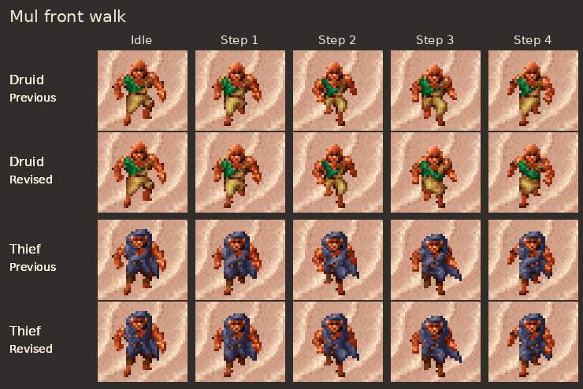
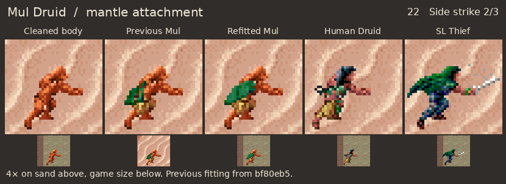
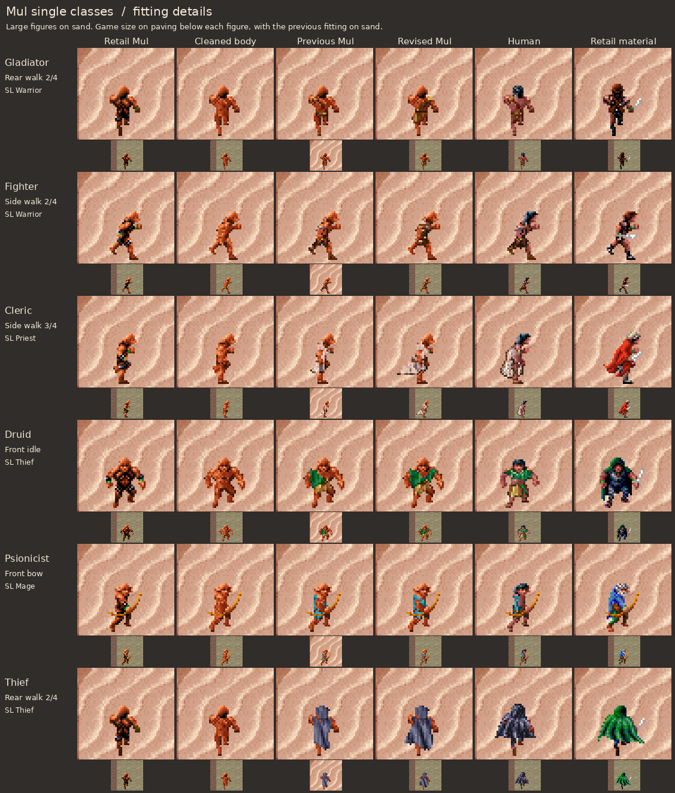
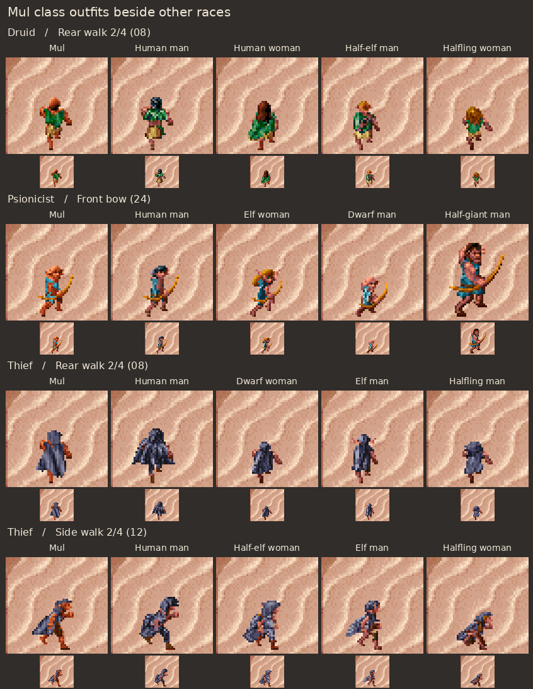
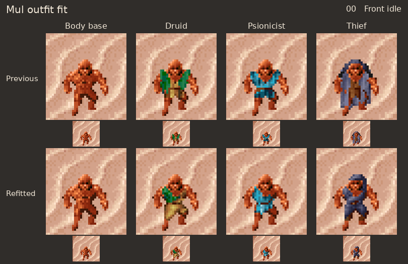
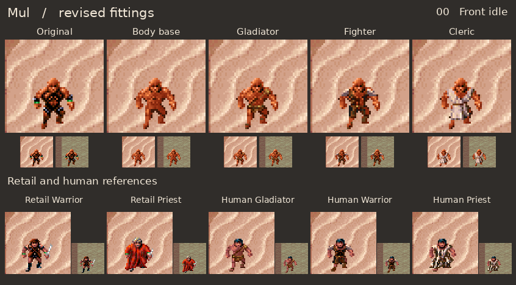

# Mul outfit study

The playable Mul in Shattered Lands is male only. All six single classes are fitted to that figure through the 29 native poses. These galleries show art-study renders with equipment slots empty. [Inspect the Mul body and all six outfits in every pose](mul-singles-poses.png)

## Front walk, strikes and bow

Compare the Druid on front walk steps three and four. The green mantle turns with his ribs, and the ochre wrap lifts across the raised thigh before the weight changes sides. The shorter hem exposes the bend of each knee.

On the Thief, the lit rim follows the viewer’s left temple into the cowl. Under it, a single fold runs down from the near shoulder toward the belt. The far side of the tunic stays in shadow as he steps. [Compare the two Thief fittings through the front walk](mul-thief-front-walk.png). On step three the cloak passes behind the swinging arm. Its free corner reaches past the hip while the brown breeches follow the bent leg in front. The retail Thief in the animation shows the same overlap.

[Inspect Druid steps three and four and Thief step three at 6×](mul-front-details.png) · [Play the front comparison at game size and 3×](mul-front-fit.gif). The cleaned Mul, previous and revised fittings, human class outfit and retail Thief share the same sand tile. The previous Druid is from `b8447ce` and the previous Thief from `d1c46a4`. The walk plays twice before the three front strikes and the bow. The retail Thief supplies the hood and cloak reference for both rows.

## Mantle attachment and clipping

Side strike 2 (22) shows the Druid issue most clearly. In the previous fitting a copper strip split the mantle into two green patches on his back. Follow the revised fold from the shoulder blade to its short free tip. The extended arm passes in front. Front idle (00) shows the mantle falling from one shoulder to the belted wrap. Side strike 3 (23) and hit (27) show how the mantle gathers when he ducks. The close-up uses the previous fitting at `bf80eb5`.

[Watch the Druid comparison through all 29 poses](mul-druid-contact.gif) · [Watch all six Mul outfits](mul-fitting-review.gif)

The frame review compared the outfit pixels against the cleaned body in all 174 dressed poses. That exposed leather, linen and teal flecks above the passing wrist, two skin pixels inside the Fighter’s profile tabs (12 and 13), and interruptions in the Thief’s side-strike lining. The corrected poses retain the visible cheek, bow and bare hand. The skin inside the Thief’s hood opening and the forearm crossing his profile cloak are visible in the full-pose sheet. A second render with more room on each side reproduced every sprite pixel within the study canvas.

## Six-single fitting review

The large figures share one patch of arena sand. Each small figure stands on paving at game size, except for the previous Mul, which comes from the sand sheet at `6363eea`. Read across from the retail Mul and cleaned body to the two fittings, the finished human and the retail figure used to compare material. The retail Warrior supplies leather, the Priest supplies linen, the Thief supplies cape folds and the Mage supplies wrapped cloth.

[Watch all six outfits through all 29 poses](mul-fitting-review.gif) · [Inspect every pose as a still](mul-singles-poses.png)

| Outfit and pose | Detail to follow |
|---|---|
| Gladiator, rear walk 2 (08) | The bronze shoulder piece and diagonal strap turn with the bare back. Follow the strap to the opposite hip and the lit leather edge over the advancing thigh. |
| Fighter, side walk 2 (12) | The bone scale sits above the moving elbow. Dark leather continues behind the forearm, with a short tab behind the hip. This is still the hardest view for distinguishing the two leather outfits at game size. |
| Cleric, side walk 3 (13) | The near arm crosses the fitted sleeve. Behind it, the outer linen fold swings back from the waist and catches light above the hem. |
| Druid, front idle (00) | The green mantle gathers on one shoulder. The bound edge turns across the ribs above a belted ochre wrap. Compare the lifted pleat with the human Druid’s waist. |
| Psionicist, front bow (24) | Follow the continuous teal along the ribs and into the lapped hip cloth where the bent forearm crosses the wrap. The copper wrist and the bow stay visible. |
| Thief, rear walk 2 (08) | The shade changes from hood to shoulder. The wider cloak opens over the lifted leg, and the two corners fall to different heights. Front idle shows the overlap across the chest and the open hem over the breeches. |

The review covers the cleaned body and 174 empty-slot outfit poses. The checks compared the face opening, foreground hand and bow with their underlying pixels, and each silhouette with the retail cel for new enclosed holes or detached pieces. The shaded torso keeps the retail copper highlights. Equipment and live play remain pending.

## Same-class comparison across races

Each figure uses its own frame for the named action. The floor, ground line and pixel scale are shared. The small copies show game size. In the animations the male figures are above the female figures, with the Mul at the left of the male row. Humans, dwarves and elves come from the Loader renderer. Half-elves, halflings, half-giants and the Mul come from their art studies. Each loop includes the available same-class fittings.

| Outfit | What reads differently at game size |
|---|---|
| [Druid · all 29 poses](mul-race-druid.gif) | In rear walk step two (08), the green mantle lifts over the hip. The lighter turned edge on the ochre flap separates the kilt from the copper thigh. Compare the waist with the human Druid’s, then follow the shorter cape through the other three steps. |
| [Psionicist · all 29 poses](mul-race-psionicist.gif) | In front bow (24), a narrow strip of teal shows along the ribs behind the bent arm and meets the wrap at the hip. The Mul turns farther sideways than the human. Rear bow (25) and side bow (26) show more of the same fabric. |
| [Thief · all 29 poses](mul-race-thief.gif) | In rear walk step two (08), follow the shadow beneath the hood to the light lip of the back fold. In profile step two (12), the slate shoulder panel emerges from behind the neck, passes under the arm and joins the trailing cloak. Compare the shoulder attachment with the dwarf’s and the longer fall with the human’s. |

## Druid, Psionicist and Thief

The fitting comparison shows the previous outfits from `a42a969` on the top row and the revisions below. The cleaned Mul on the left gives both rows the same shoulder, waist and foot reference. In front idle (00), follow the Druid’s mantle across the ribs, the Psionicist’s wrap from its single shoulder to the far hip, and the Thief’s cloak down one flank. In rear walk step two (08), the free corner of each cape follows the weight on the advancing leg. In profile step two (12), watch the near arm cross the cloth while the fold continues behind the shoulder.

### Retail comparison

The top row shows the retail Mul followed by the three new outfits. The small copies beneath each figure show game size on sand and paving. The bottom row follows the retail Warrior, Mage and Thief alongside the approved human Druid and Psionicist. A retail reference returns to idle when its picture set lacks the corresponding action.

| Outfit | Where to look |
|---|---|
| Druid | In profile step two (12) the short green cape swings back from the shoulder and the ochre wrap follows the forward thigh. In rear step two (08) the curved folds part above the wrap. |
| Psionicist | The teal wrap sits on one shoulder, crosses the ribs and tucks under the angled belt. In side bow (26), follow the copper draw hand across the folded chest and the leather tie at the waist. |
| Thief | Compare side idle (02) with the four profile steps (11–14). The hood rim follows the brow, its back seam falls toward the shoulder, and the longer slate cloak swings behind the stride. Front strike two (16) shows the cheek and jaw inside the opening. |

The frame review covered all 87 new dressed poses. It checked the visible hand and bow pixels against the underlying figure and examined the Thief’s face opening separately from its covered crown. The silhouettes were checked for new enclosed gaps and detached pixels. The six-single gallery above shows the subsequent body and leather refit alongside the revised cloth.

## Face and neckline

In the previous fitting the cream collar reached the cheek in the side walk and cut across the lower jaw in the front strike. The close-ups compare that collar at `cab055c` with the open neckline. In front strike 2 (16), follow the shadow beneath the mouth from the retail Mul to the cleaned body and dressed figure. In side walk step 2 (12), the cheek ends above exposed throat as the near shoulder comes forward. The small figure beside each crop shows the same pose at game size.

The Fighter’s neckline and the Gladiator’s strap use the same exposed skin where they approach the jaw. All three outfits were reviewed in all 29 poses.

## Cleric fitting comparison

The first robe borrowed the human Priest’s sleeve and hem positions. In rear steps 07–10 the sleeves hung beyond the elbows. In side steps 11–14 the folds followed the human stride. The revised wrap has short sleeves, a belt at the Mul’s waist and a continuous linen skirt. Watch step 12 for the bare forearm crossing the belt and the hem lifting away from the trailing foot. Rear step 08 shows the shallow seam across the shoulder blades.

## Gladiator, Fighter and Cleric

The Gladiator’s strap, the Fighter’s armhole, and their waist and thigh pieces follow the Mul’s own shoulder and hip in each pose. Side idle (02), the four profile steps (11–14) and the follow-through (17) show the change on both. The frame review covered all 87 dressed poses with empty equipment slots. Face and bow pixels matched the retail source, visible hand landmarks matched the body base, and the silhouettes had no new enclosed gaps or detached pixels.

[Inspect all 29 poses at your own pace](mul-poses.png)

| Outfit | Where to look |
|---|---|
| Gladiator | In front idle (00) and the rear walk (07–10), follow the diagonal strap to the hip. Copper skin shows on either side of the strap. A dark lower edge separates the leather kilt from the advancing thigh. |
| Fighter | Compare the shoulders and upper back with the Gladiator in rear idle (01). The bone guard sits at the shoulder and the dark jerkin covers the back between the arms. |
| Cleric | Watch the linen swing behind the calf in the profile walk (11–14). In side step two (12) the hand passes in front of the folds. The side bow (26) shows the draw hand and bow against the cream robe. |

The fittings use the retail Mul’s walking and combat pictures (2093 and 2094). The cleaned body keeps the original stance, scalp, jaw and copper highlights. The reconstructed ribs and hip use the registered human body for depth and the Mul’s copper tones for light and shadow. The leather and bone follow shoulder, belt and knee positions on the Mul. The revised linen follows cross-sections traced on each Mul pose, with texture sampled from the back of the retail Priest’s robe.

The remaining Mul art studies are the nine legal pairs and three triples. [Playable classes and combinations](../../PLAYER-GUIDE.md)
