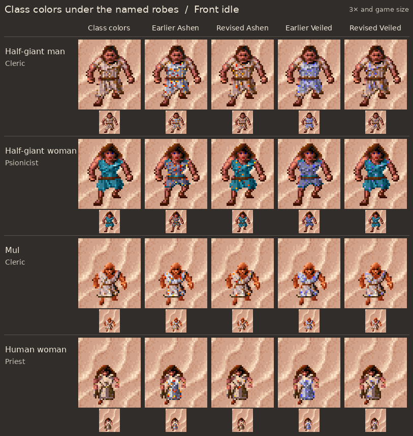

# The Ashen Robe and the Robe of the Veiled Alliance

Compare the half-giant man’s cream Cleric robe with the half-giant woman’s teal Psionicist tunic. The revised Ashen Robe adds ash-colored binding and ember highlights along the original folds. The Veiled robe adds lilac stitching and blue glints. Both keep the cut and colors of the class garment visible. The Mul Cleric and human woman Priest show the same treatment at smaller scales.

In front idle, either named robe keeps the original shade on 216 of the refitted Psionicist’s 230 teal pixels. The earlier treatment kept 35 of the 190 teal pixels in the earlier outfit. On the male half-giant Cleric, the number of cycling highlights falls from 36 to 12, leaving the cream folds visible between them. [Inspect the Psionicist’s revised hem](plate-fit.md#half-giant-psionicists-hem)

| Robe | Animation at game size and 3× |
|---|---|
| Ashen Robe | [Compare the earlier and revised ember highlights](named-robe-ashen.gif) |
| Robe of the Veiled Alliance | [Compare the earlier and revised cool highlights](named-robe-veiled.gif) |

Each animation shows front, rear and profile idle, all four profile walk steps and all three profile strike frames. Watch the shoulder, belt and lower folds as the arm passes in front. During the idle holds, the cloth stays still while the exposed enchantment cycles. The original Shattered Lands Priest follows the same pose at the top right.

The Psionicist wore both robes in DOSBox. The Cleric’s equipment was staged to reproduce the comparison because his class cannot normally wear them. Removing either robe restored the original class pictures on both figures. [Compare the two half-giants on the slave-pen floor](https://github.com/daaki85/darksun-obsidian-edition/blob/claude/class-outfits/playtest/logs/img/2026-11-26-half-giant-robes-dosbox.png)

The earlier pictures use the Loader from `63a8172`. Both versions read the named chest item and draw it over the same class on an arena floor tile. To regenerate the comparisons, run `python prototypes/namedrobereview.py GAME_DIR OUTPUT_DIR --previous-checkout CHECKOUT` with that revision in a separate checkout. [Armor dyes on class outfits and original party figures](armor-dyes.md)
