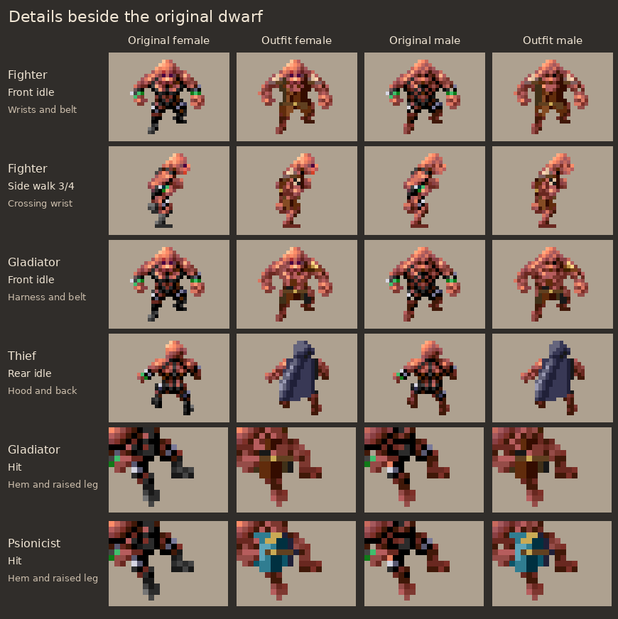
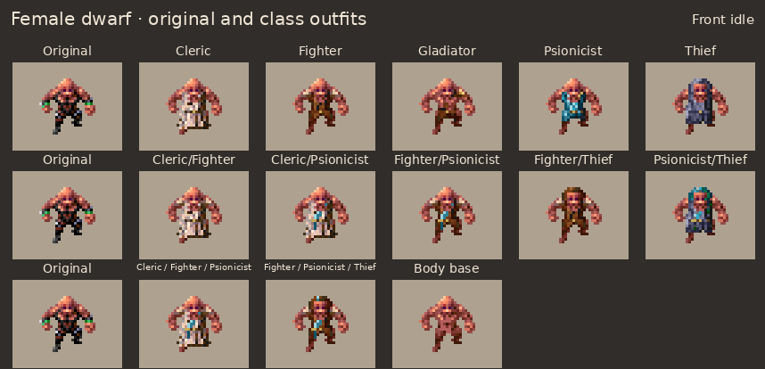
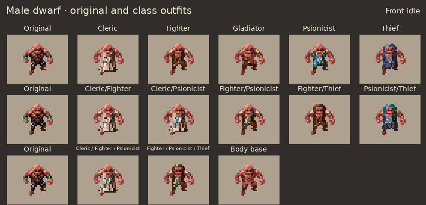

# The class outfits beside the original dwarves

The greatest difference is in how the original artist separated small forms. A dark turn under the ribs, a break at the belt, and a bright cuff make the waist and wrist legible even when the arm crosses the body. The Fighter now carries a two-pixel leather shadow behind the crossing wrist. On the Gladiator, the harness darkens where it tucks under the belt.

[Watch the final wrist, harness, and hem edits before and after at game size and 2×](https://github.com/daaki85/darksun-obsidian-edition/blob/d7f2076f5fa3bc4458c55bf5a81dd9237b0c3129/obsidian-edition/docs/class-outfits/dwarf-final-details.gif)

- **Fighter and Gladiator.** In front idle the stock harness narrows into a dark waist before the thighs flare out. The Fighter’s jerkin and hip flaps run together into a broader patch of brown. In side-walk step 3 the pale stitch follows the panel, and two darker pixels sit immediately behind the wrist. The Gladiator’s bronze rim picks out the shoulder while the short shadow at the bottom of the strap separates it from the waist wrap.
- **Cleric and Psionicist.** The dark fold down the cream robe and the bright diagonal across the teal tunic give each a strong internal detail. The original dwarf’s belt is easier to follow across the body. On the Cleric the long robe deliberately covers much of the original leg separation.
- **Thief and hooded multiclasses.** The side ridge follows the head into the shoulder, and the open front shows the face. In rear idle the hood, cloak, and covered waist make the two figures look particularly alike. In that pose the original female and male have 32 different-color pixels where both are opaque. The two Thieves have just two. The original female’s gray boots account for some of the difference in the stock art.
- **Recoil on both figures.** The original has open ground between the raised thigh and the lower leg. Trimming one pixel from the Gladiator and Psionicist hems restores that opening in the hit pose. The bottom two rows of the close-up show the result.

Across the twelve builds, all 29 poses, and both figures, every opaque pixel in the original silhouette remains opaque in the outfitted sprite. Every registered bow pixel retains its original palette color. Every unhooded outfit also preserves the original colors in its registered head region.

## Female dwarf

## Male dwarf

Each row starts with the original game figure of the same sex in the same pose. The first row shows the five single classes, the second the two-class builds, and the third the three-class builds and the bare body base. The original comes from the game's walk and combat art. The outfits come from the branch sprite loader with empty equipment slots. All panels use a common alignment within each pose and 3× nearest-neighbor enlargement. The female and male opening strikes follow their respective originals.
