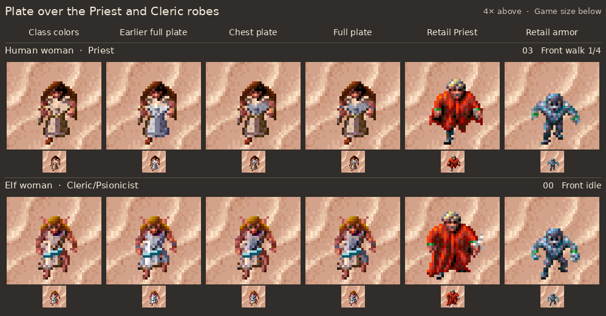
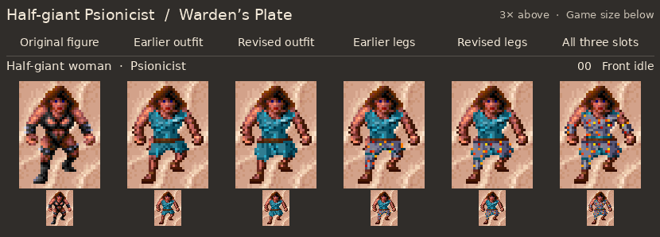

# Plate on the Priest and Cleric robes

The human woman is in front walk step one (03) and the elf woman is in front idle (00). These are the two poses from the earlier armor sheet. Read from the original cream garments and earlier full plate to the revised chest plate and full suit. The elf’s teal Psionicist sash marks the waist as the steel moves with the body. The last two columns show the red retail Priest (1563) and the blue armored figure (1342) in the same pose, at the same scale.

In the Priest’s front step, the cuirass follows the chest and her long robe hides the greaves. Equipping the full set changes 36 native pixels there, compared with 96 in the earlier fit. In the elf’s front idle, all 18 pixels of her teal sash keep their original shades with full plate equipped.

[Watch both women through all 29 poses](plate-fit-clerics.gif). The enlarged image is 4× and the small copy is game size. Follow the upper rim and shoulder through the turn, then look below the waist to see which areas of the garment the leg pieces cover. During the bow poses, the original bow passes in front where the arms cross. The retail armor sheet ends after the melee strikes and the retail Priest sheet ends after the bow poses.

## Half-giant Psionicist’s hem

Watch the raised knee on the viewer’s right in front idle. The original half-giant is followed by the earlier and revised teal outfit with empty equipment slots. The next two columns show the same change with the Warden’s leg armor alone. The last column adds the chest and arm pieces. [Inspect the hem and raised knee at 6×](plate-fit-half-giant-hem.png)

The three women also wore the individual pieces in DOSBox. All six removals restored the original walking and combat pictures. [Compare their front-idle poses on the slave-pen floor](https://github.com/daaki85/darksun-obsidian-edition/blob/claude/class-outfits/playtest/logs/img/2026-11-26-plate-fit-dosbox.png)

The earlier columns use the Loader and outfit archives from `d748d13`. To regenerate these comparisons, run `python prototypes/platefitreview.py GAME_DIR OUTPUT_DIR --previous-checkout CHECKOUT` with that revision in a separate checkout. [All armor slots on the party figures](magical-equipment.md) · [Ashen and Veiled robe comparisons](named-robes.md)
