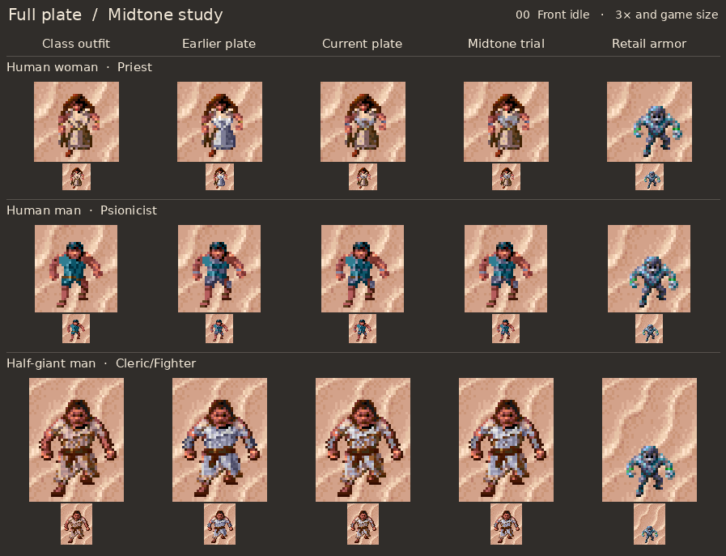

# Full plate on the midtones

The current softened ordinary plate and Warden’s Plate are approved. The midtone trial is closed.

This art study compares three outfits on the arena floor. Look at the half-giant’s chest just above the belt. In the trial, the cool gray joins up across the ribs, and the brown folds still separate the plates. On the human Psionicist the change is smaller. The teal wrap remains easy to follow across the waist. The human Priest is the tightest fit. Her steel reads chiefly on the chest in front view and becomes hard to see behind her hair when she turns.

[Watch all 29 walking and combat poses at game size and 3×](plate-midtone-poses.gif). The retail armored figure (1342) supplies corresponding poses through the melee strikes.

## Current magical plate

The right column equips all three pieces of Warden’s Plate on the same three figures. Watch the fire-colored glints while the front pose holds, then follow the chest, wrists and greaves through the walk. The center column shows ordinary full plate from the current Loader. [See front idle](current-warden-plate.png) · [Watch all 29 poses](current-warden-plate.gif)

## What the counts mean

Each number counts native pixels that change when all three ordinary plate pieces are equipped on the same front-idle drawing.

| Outfit | Earlier plate, before refitting | Fully tinted with the corrected fit | Current plate | Midtone trial |
|---|---:|---:|---:|---:|
| Human woman Priest | 98 | 38 | 18 | 28 |
| Human man Psionicist | 63 | 63 | 34 | 46 |
| Half-giant man Cleric/Fighter | 251 | 251 | 104 | 176 |

On the Priest, 67 of the 98 earlier pixels were on the hanging skirt. The corrected fit puts up to 34 pixels of steel on the torso and four at the wrists. The current front view already shows 14 on the chest. The trial brings the chest to 24 and keeps the linen skirt intact. [See the plate fitting](plate-fit.md)

The trial starts with the current steel highlights on each visible chest, arm and leg piece. It extends them onto the lighter neighboring folds, aiming for 70% of the pixels that the fully tinted **fitted** piece could change. A narrow cuff can already be fully visible. All 87 outfit/pose combinations were checked against both the current and fully tinted pictures. Every added pixel belongs to the fitted plate and uses its existing steel shade.

The game still uses the armor colors from `c411e62`. To regenerate the preview, run `python prototypes/platemidtones.py GAME_DIR OUTPUT_DIR EARLIER_CHECKOUT REFITTED_CHECKOUT` with `d748d13` and `b82788c` as the two comparison checkouts.
