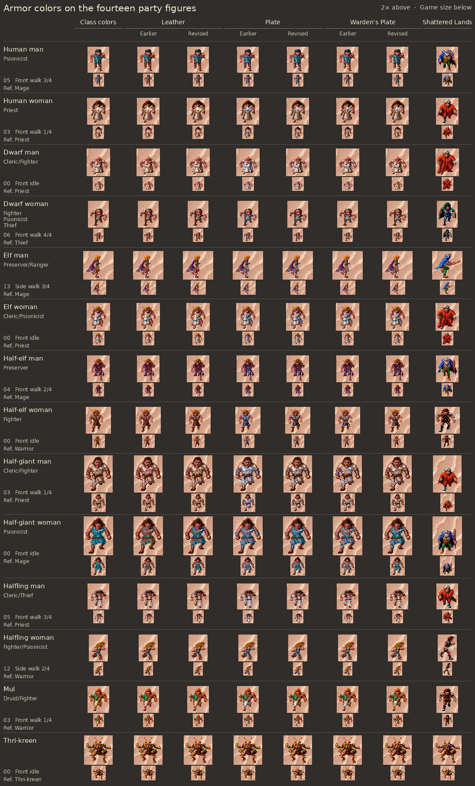

# Armor color on the class outfits

On the elf woman, follow the cream robe from the shoulder down to the teal sash. Plate catches the raised folds, and the fabric between them keeps its cream and brown shading. On the human man, the same treatment lets the teal cross his chest and wrap around his waist. The Warden’s Plate glints move through the game’s fire colors even when the wearer stands still.

The first column shows the class outfit with empty equipment slots. Each pair of columns shows the same three pieces equipped on the same frame, first at commit `b82788c`, then with the revised tint. Leather, ordinary plate and Warden’s Plate each cover the chest, arms and legs. The last column shows a retail *Shattered Lands* figure in the corresponding pose on the same floor tile.

[](armor-colors-all.png)

Across the 13 clothed figures pictured here, the revised leather returns 9,382 of its 20,101 previously tinted pixels to their exact unarmored color over 29 poses (46.7%). Ordinary plate returns 47.1%, and Warden’s Plate returns 45.9%. These counts compare the same pixel in the same garment and pose.

## See the folds in motion

Each loop plays all 29 poses with a 3× view and a game-size copy. Front, back and profile walks show whether a highlight stays on its fold. The strikes and bow poses show which parts disappear behind a raised arm or a hanging cloak. The retail NPCs have 27 matching poses. The last two poses show the party figure alone.

| Figure | Outfits in the loop |
| --- | --- |
| [Humans](https://github.com/daaki85/darksun-obsidian-edition/blob/d7f2076f5fa3bc4458c55bf5a81dd9237b0c3129/obsidian-edition/docs/class-outfits/armor-colors-human.gif) | Man Psionicist and woman Priest |
| [Dwarves](https://github.com/daaki85/darksun-obsidian-edition/blob/d7f2076f5fa3bc4458c55bf5a81dd9237b0c3129/obsidian-edition/docs/class-outfits/armor-colors-dwarf.gif) | Man Cleric/Fighter and woman Fighter/Psionicist/Thief |
| [Elves](https://github.com/daaki85/darksun-obsidian-edition/blob/d7f2076f5fa3bc4458c55bf5a81dd9237b0c3129/obsidian-edition/docs/class-outfits/armor-colors-elf.gif) | Man Preserver/Ranger and woman Cleric/Psionicist |
| [Half-elves](https://github.com/daaki85/darksun-obsidian-edition/blob/d7f2076f5fa3bc4458c55bf5a81dd9237b0c3129/obsidian-edition/docs/class-outfits/armor-colors-half-elf.gif) | Man Preserver and woman Fighter |
| [Half-giants](https://github.com/daaki85/darksun-obsidian-edition/blob/d7f2076f5fa3bc4458c55bf5a81dd9237b0c3129/obsidian-edition/docs/class-outfits/armor-colors-half-giant.gif) | Man Cleric/Fighter and woman Psionicist |
| [Halflings](https://github.com/daaki85/darksun-obsidian-edition/blob/d7f2076f5fa3bc4458c55bf5a81dd9237b0c3129/obsidian-edition/docs/class-outfits/armor-colors-halfling.gif) | Man Cleric/Thief and woman Fighter/Psionicist |
| [Mul](https://github.com/daaki85/darksun-obsidian-edition/blob/d7f2076f5fa3bc4458c55bf5a81dd9237b0c3129/obsidian-edition/docs/class-outfits/armor-colors-mul.gif) | Man Druid/Fighter |
| [Thri-kreen](https://github.com/daaki85/darksun-obsidian-edition/blob/d7f2076f5fa3bc4458c55bf5a81dd9237b0c3129/obsidian-edition/docs/class-outfits/armor-colors-thri-kreen.gif) | Original shell in all columns. These three sets leave it unchanged. |

The gallery uses both versions of the Loader’s picture builder and the original game palette. The animated color bands use RGB samples and cycling intervals measured in the Slave Pens. For the full outfit audit and individual equipment slots, see [armor dye measurements](armor-dyes.md) and [the three Warden’s Plate pieces](https://github.com/daaki85/darksun-obsidian-edition/blob/d7f2076f5fa3bc4458c55bf5a81dd9237b0c3129/obsidian-edition/docs/class-outfits/fitted-armor-slots.gif). The [named robe comparison](named-robes.md) shows the separate stitching on the Ashen and Veiled robes.

The half-giant Psionicist and human Priest are also shown in profile on the slave-pen floor. Each DOSBox session loaded a prepared copy of the corresponding equipped picture. [Compare the game captures](https://github.com/daaki85/darksun-obsidian-edition/blob/claude/class-outfits/playtest/logs/img/2026-11-26-soft-armor-dosbox.png)

[Archived midtone comparison and plate approval](plate-midtone-study.md)

## How much of the outfit color returns?

In the audit before the full half-elf import, across 198 fitted class outfits and 14 stock appearances, each full suit was compared with empty equipment slots in all 29 poses. The counts below include only pixels whose palette entry differs from the same unequipped figure. An exposed shin guard still contributes to the count even when the chest cloth above it keeps its original color.

| Full suit | Earlier recolored pixels | Revised recolored pixels | Reduction |
|---|---:|---:|---:|
| Leather | 256,325 | 148,360 | 42% |
| Bone scale | 285,805 | 161,664 | 43% |
| Plate | 275,963 | 157,271 | 43% |

Across all 18 loadouts, 88.9% of the sampled class-color pixels keep their original pigment, up from 79.4%. On the human woman Priest and the elf woman Cleric/Psionicist, a few folds reverse their light and shadow where steel meets the lighter cloth. The fitted guards on exposed wrists and shins keep their material color.

That audit checked the other half-elf outfits in the study renderer, which estimated the area under each piece of armor. All 48 outfits per figure now have fitted Loader artwork. [See both half-elves in the Loader’s equipment comparison](half-elves.md#equipped-clericpreserver-druid-and-thief)

To reproduce the sheets, run the following from the repository root. Supply a checkout of `b82788c` for `EARLIER_CHECKOUT`.

```sh
python prototypes/armormaterialreview.py GAME_DIR OUTPUT_DIR --previous-checkout EARLIER_CHECKOUT
```
