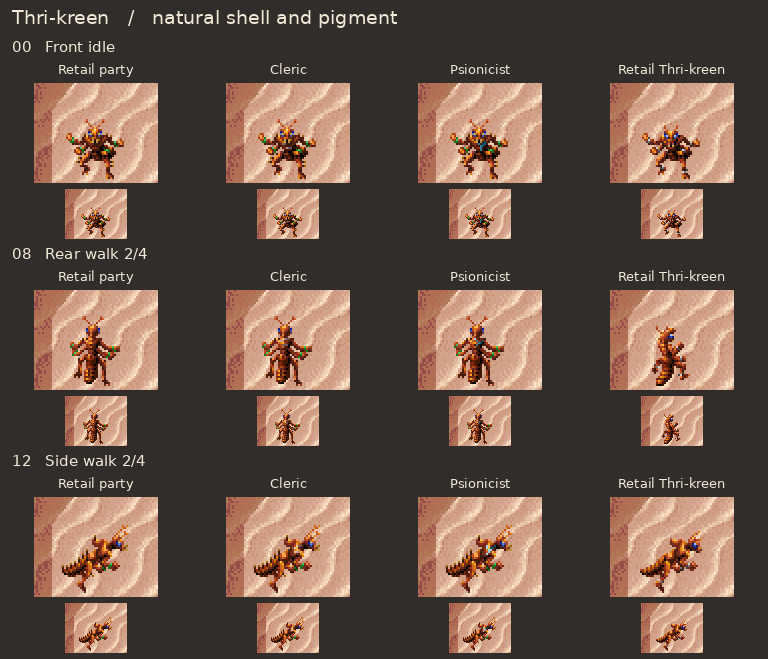

# Thri-kreen

**The original Shattered Lands party figure is approved for all sixteen Thri-kreen class builds.** At game size its blue eyes, four moving claws and alternating bands of light and shadow on the abdomen are the clearest features. The profile walk shows the abdomen rocking behind the striking limbs. The retail Thri-kreen NPC alongside it has the same movement and a slightly different shell finish.

## Shell pigment study

This earlier comparison tested a small patch of pigment that follows the ridges of the thorax. The Cleric has two broken ivory strokes. In front idle these largely merge with the warm chitin highlights. The Psionicist has a muted teal fork. Rear step two (08) and profile step two (12) show it catching the light as the shell rolls. In the second profile strike (22), the visible patch narrows where the claws pass in front. At 1× the teal cue is easier to pick out than the ivory.

[Watch all 29 poses on sand and paving](https://github.com/daaki85/darksun-obsidian-edition/blob/d7f2076f5fa3bc4458c55bf5a81dd9237b0c3129/obsidian-edition/docs/class-outfits/thri-kreen-markings.gif) · [Inspect each pose on the frame sheet](thri-kreen-poses.png)

The party has one Thri-kreen map figure, object 313, using walk picture 2097 and combat picture 2098. The fourth column uses retail NPC object 215, pictures 291 and 292. Its combat sheet ends after the three bow poses, so the NPC returns to front idle for the party's hit (27) and fall (28).

This is an art study. The Cleric changes four to eight existing shell pixels per pose and the Psionicist four to nine. Both use the game's palette and retain the original silhouette, eye colours, wrist markings and bow. The game continues to use the retail appearance. The race's equipment rules and existing weapon display are independent of the study. [Race and equipment rules](../../PLAYER-GUIDE.md#races)

## Playable roster

| Builds | Legal choices |
|---|---|
| Six singles | Cleric, Druid, Fighter, Gladiator, Psionicist, Ranger |
| Seven pairs | Cleric/Fighter, Cleric/Psionicist, Cleric/Ranger, Druid/Fighter, Druid/Psionicist, Fighter/Psionicist, Psionicist/Ranger |
| Three triples | Cleric/Fighter/Psionicist, Cleric/Psionicist/Ranger, Druid/Fighter/Psionicist |

[Multiclass table](../../PLAYER-GUIDE.md#more-than-one-class)
