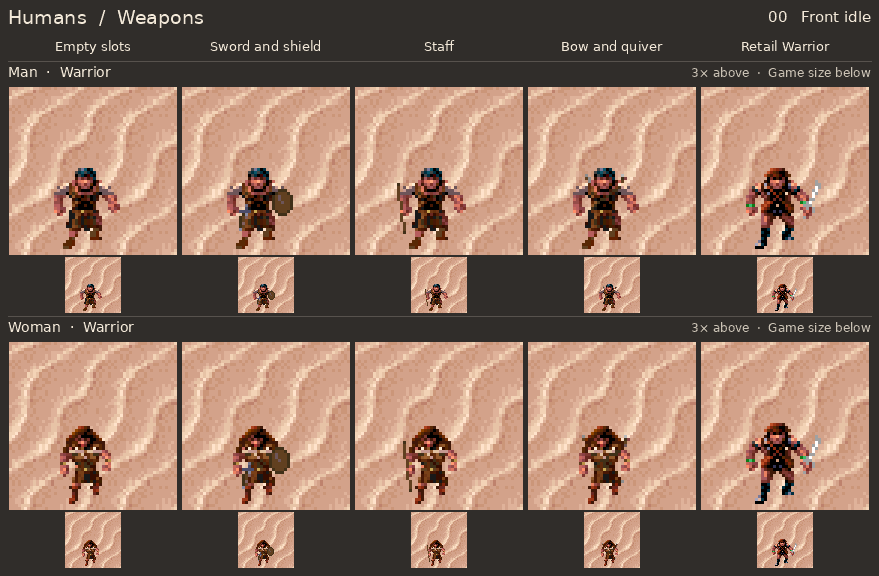
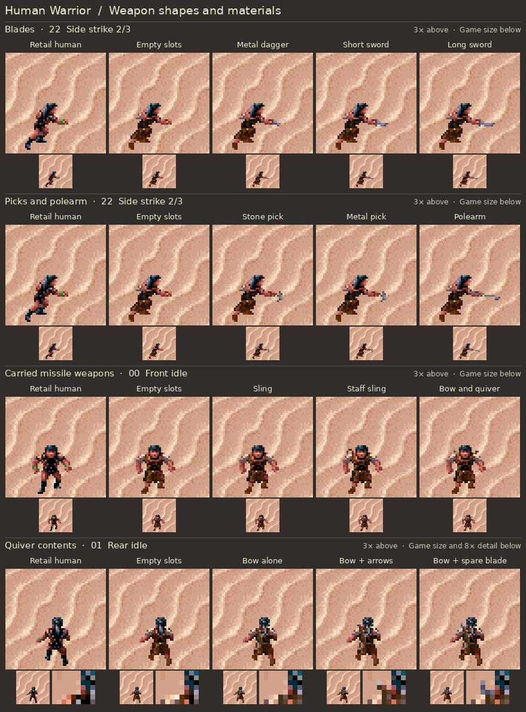

# Weapons in motion

Each column shows the same party figure on the arena floor. Follow the sword from the walking pose at the hip into the striking hand, the shield as it turns edge-on, and the staff as it swings clear of the feet. The bow and quiver ride on the back through the walk. In poses 24–26, the original attack artwork supplies the drawn bow. That bow appears even in the empty-slot column when the gallery displays those poses.

[Compare hip weapons through the walk, with one weapon, a pair and an outer cloak](hip-walk.md)

| Figure | 29-pose animation |
|---|---|
| Human man and woman | [Warriors](weapon-motion-human.gif) |
| Dwarf man and woman | [Fighters](weapon-motion-dwarf.gif) |
| Elf man and woman | [Fighters](weapon-motion-elf.gif) |
| Half-elf man and woman | [Fighters](weapon-motion-half-elf.gif) |
| Half-giant man and woman | [Fighters](weapon-motion-half-giant.gif) |
| Halfling man and woman | [Fighters](weapon-motion-halfling.gif) |
| Male Mul | [Fighter](weapon-motion-mul.gif) |
| Thri-kreen | [Original party figure with sword and shield, gythka, bow and quiver, and chatkcha](weapon-motion-thri-kreen.gif) |

## Weapon outlines and materials

The human Warrior holds the same side strike in the first two rows. Compare the reach of the three metal blades, then the hooked pick heads and the longer polearm shaft. In front idle, the ordinary sling hangs at the hip and the staff sling’s cradle rises just outside the shoulder. The left columns keep the retail human and the empty-slot Warrior beside every weapon.

In the bottom row, look just above the Warrior’s left shoulder. The bow alone has an empty case. A pair of arrow shafts and feathered tips project from the loaded case, and the spare metal short sword shows its hilt above the same opening. The 8× detail beside each game-size figure isolates those six pixels. All three columns use the same bow. [Watch the quiver through all 29 poses](weapon-motion-quiver.gif)

While Greenbright +2 hangs at the belt, its green glint catches the exposed fittings of the leather sheath. The drawn short blade carries the same enchantment through the strike. Deepbiter +1 has fire-colored highlights on its stone head. Each is shown alongside a mundane weapon of the same shape and material, including during the stationary hold. [Watch the enchanted weapons](magic-gear-weapon-comparison.gif)

The eight race galleries show each figure at 3× and at the original game size through three idle directions, twelve walking steps, nine melee strikes, three bow views, hit and fall. Their last column shows the retail Warrior (1252) or retail thri-kreen (291) for comparison. These NPC combat sheets end after the three bow views.

The party sprites come directly from the Loader's picture builder. The gallery holds the attack and recovery poses for inspection. [Equipment gallery](README.md#equipment) · [Magical equipment](magical-equipment.md)

## Weapon fit checks

The Loader rendered 40,078 pose and loadout combinations with two equipped hands. The check covered six paired loadouts across the roster and five additional combinations on the half-giants, who can wield two-handed weapons in one hand. The audit found zero equipped pixels outside the saved picture, zero disconnected pieces and zero changes to the original bow pixels in the firing poses.

The main equipment check covered 20 loadouts on each stock figure and all 198 figure and class-outfit combinations registered in the Loader. All 122,960 images matched the same pose drawn on an oversized canvas and cropped to the game frame. Every added piece connected to the figure, and the original bow kept its pixels in all 12,720 firing-pose comparisons. The empty outfit, enchanted cloak and plate also matched the previously approved artwork in all 6,148 figure and pose combinations.

In DOSBox, equipping and removing eleven loadouts on each party figure restored the original pictures in all 154 cycles. A halfling fired the last arrow in combat, kept the bow equipped and returned to the empty-quiver picture. [Read the live weapon and quiver checks](https://github.com/daaki85/darksun-obsidian-edition/blob/claude/class-outfits/playtest/logs/2026-11-25-class-equipment.md#weapons-shields-and-quiver-contents)

To regenerate the images, run `python prototypes/weaponmotionreview.py GAME_DIR OUTPUT_DIR` from the repository root. Run `python prototypes/studygeartest.py GAME_DIR OUTPUT_DIR --bounds-only` for the main equipment check. For the separate two-weapon check, run `python prototypes/studygeartest.py GAME_DIR OUTPUT_DIR --dual-bounds`.
