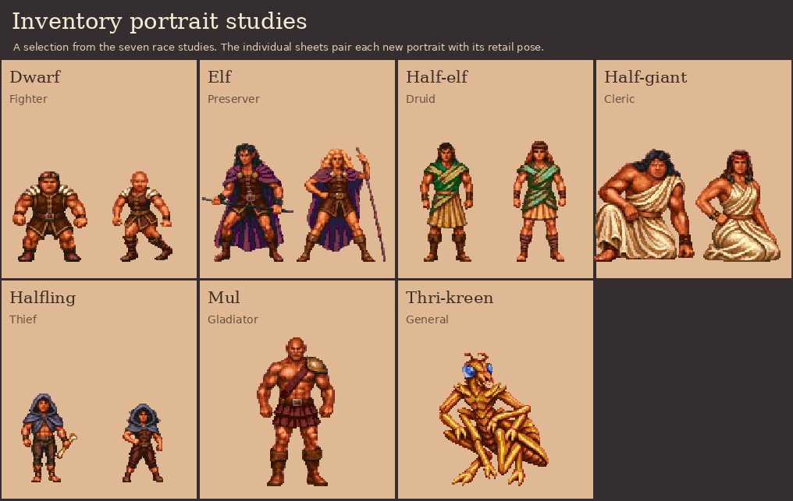

# Complete-figure inventory studies

These sheets cover the remaining playable Shattered Lands figures. Each outfit is painted as a complete figure and reduced to the corresponding retail inventory picture’s width and height. The comparison sheets pair the retail pose with the decoded study at 2×. The ZIP contains transparent PNGs at native size.

[View all 71 portraits on one native-scale sheet](native-roster.png)

| Race | Class outfits | Retail and redrawn figures | Full-resolution source art |
| --- | --- | --- | --- |
| Dwarf | Cleric, Fighter, Gladiator, Psionicist, Thief | [Comparison](dwarf-comparison.png) | [Male](dwarf-male-source.png) · [Female](dwarf-female-source.png) |
| Elf | Cleric, Fighter, Gladiator, Preserver, Psionicist, Ranger, Thief | [Comparison](elf-comparison.png) | [Male](elf-male-source.png) · [Female](elf-female-source.png) |
| Half-elf | Cleric, Druid, Fighter, Gladiator, Preserver, Psionicist, Ranger, Thief | [Comparison](half-elf-comparison.png) | [Male](half-elf-male-source.png) · [Female](half-elf-female-source.png) |
| Half-giant | Cleric, Fighter, Gladiator, Psionicist, Ranger | [Comparison](half-giant-comparison.png) | [Male](half-giant-male-source.png) · [Female](half-giant-female-source.png) |
| Halfling | Cleric, Druid, Fighter, Gladiator, Psionicist, Ranger, Thief | [Comparison](halfling-comparison.png) | [Male](halfling-male-source.png) · [Female](halfling-female-source.png) |
| Mul | Cleric, Druid, Fighter, Gladiator, Psionicist, Thief | [Comparison](mul-comparison.png) | [Male](mul-source.png) |
| Thri-kreen | One shared portrait for every class | [Comparison](thri-kreen-comparison.png) | [General figure](thri-kreen-source.png) |

The 70 single-class humanoid portraits and the one general thri-kreen are inventory art proposals. [Download all 71 native-size PNGs](native-portraits.zip).
