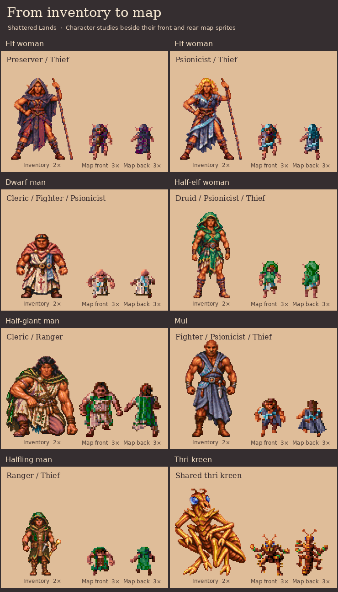

# Inventory portraits beside their map outfits

Each tile shows one character three ways. The inventory portrait is on the left at 2×. The front and rear map sprites are on the right at 3× so collars, sashes and cloaks are visible. All three use the Shattered Lands palette.

[Download the full-size multiclass study sheets](multiclass-source-sheets.zip). The filenames and numbered sheets follow the gallery order.

## Reading the comparisons

The map views use the Obsidian Edition Loader’s party-picture builder, the installed GOG artwork and the exact race, figure and class combination shown. Both views use idle frames with empty equipment slots. A cloak, weapon or piece of armor equipped on a saved character can change that view.

The gallery contains 204 new portraits for character-creation multiclasses and one for Cilla. The 70 existing nonhuman single-class studies and the shared thri-kreen appear alongside their map outfits too. For humans, Druid, Fighter and Gladiator use the supplied whole-figure sheet. The other five classes use the inventory art from the development branch. Humans who dual-class use their active class.

[Download all 205 new native-size transparent portraits](multiclass-portraits.zip) · [Earlier nonhuman single-class portraits](../README.md) · [Playable combinations in the player guide](../../../../PLAYER-GUIDE.md#more-than-one-class)

## Browse by figure

The multiclass links give the first and last combination on each sheet. Cl = Cleric, Dr = Druid, Fi = Fighter, Pr = Preserver, Ps = Psionicist, Ra = Ranger and Th = Thief.

| Figure | Single class or shared figure | Multiclass sheets |
| --- | --- | --- |
| Human man | [View](human-male-single.png) | Active class |
| Human woman | [View](human-female-single.png) | Active class |
| Dwarf man | [View](dwarf-male-single.png) | [Cl/Fi – Fi/Ps/Th](2-0.png) |
| Dwarf woman | [View](dwarf-female-single.png) | [Cl/Fi – Fi/Ps/Th](3-0.png) |
| Elf man | [View](elf-male-single.png) | [Cl/Fi – Fi/Ps](4-0.png) · [Fi/Th – Cl/Fi/Pr](4-1.png) · [Cl/Fi/Ps – Cl/Ps/Th](4-2.png) · [Cl/Ra/Th – Ps/Ra/Th](4-3.png) |
| Elf woman | [View](elf-female-single.png) | [Cl/Fi – Fi/Ps](5-0.png) · [Fi/Th – Cl/Fi/Pr](5-1.png) · [Cl/Fi/Ps – Cl/Ra/Th](5-2.png) · [Fi/Pr/Ps – Cilla](5-3.png) |
| Half-elf man | [View](half-elf-male-single.png) | [Cl/Fi – Dr/Ps](6-0.png) · [Dr/Th – Ps/Ra](6-1.png) · [Ps/Th – Cl/Pr/Th](6-2.png) · [Cl/Ps/Ra – Dr/Pr/Th](6-3.png) · [Dr/Ps/Th – Ps/Ra/Th](6-4.png) |
| Half-elf woman | [View](half-elf-female-single.png) | [Cl/Fi – Dr/Ps](7-0.png) · [Dr/Th – Ps/Ra](7-1.png) · [Ps/Th – Cl/Pr/Th](7-2.png) · [Cl/Ps/Ra – Dr/Pr/Th](7-3.png) · [Dr/Ps/Th – Ps/Ra/Th](7-4.png) |
| Half-giant man | [View](half-giant-male-single.png) | [Cl/Fi – Ps/Ra](8-0.png) |
| Half-giant woman | [View](half-giant-female-single.png) | [Cl/Fi – Ps/Ra](9-0.png) |
| Halfling man | [View](halfling-male-single.png) | [Cl/Fi – Dr/Th](10-0.png) · [Fi/Ps – Ps/Ra/Th](10-1.png) |
| Halfling woman | [View](halfling-female-single.png) | [Cl/Fi – Dr/Th](11-0.png) · [Fi/Ps – Ps/Ra/Th](11-1.png) |
| Mul | [View](mul-single.png) | [Cl/Fi – Dr/Th](12-0.png) · [Fi/Ps – Fi/Ps/Th](12-1.png) |
| Thri-kreen | [View](thri-kreen-single.png) | One portrait for all ten multiclass combinations |

## What carries across at game size

- **Elf Preserver/Thief**. The female portrait keeps the purple hood and cloak visible from both map angles. On the same sheet, Psionicist/Thief carries the blue waist wrap into the portrait but exposes blond hair where the map has a teal hood. Ranger/Thief has the same bare-head discrepancy against its green map hood. [Female elf comparison](5-1.png)
- **Half-giant Cleric/Ranger**. Cream linen and green outer cloth sit in the same order in both views. The portrait folds the robe around the knees and the map’s rear view confirms that the green panel is a cloak. On Cleric/Psionicist, the portrait shifts the teal band from the map’s waist up across the chest. [Female half-giant multiclasses](9-0.png)
- **Mul Druid/Fighter/Thief**. The portrait has the green mantle and ochre wrap, but the bald head breaks the silhouette of the map’s green hood. The nearby Cleric/Fighter/Thief does carry its cream hood across. [Mul multiclasses](12-1.png)
- **Mul Thief**. The blue-gray hood identifies the class in both views. The portrait ends the mantle at the shoulders and exposes the chest. On the map, slate cloth covers the torso and hangs down the back. [Mul single classes](mul-single.png)
- **Half-giant Psionicist**. The kneeling woman’s teal cloth gathers over the knees. The standing map figure has a much shorter, brighter wrap with the legs visible. The color family matches more closely than the hem. [Female half-giant comparison](half-giant-female-single.png)
- **Thri-kreen**. The one shared portrait preserves the antennae, compound eyes and four arms. The gold carapace is brighter and the green forearm markings visible on the map are missing from the portrait. The same figure covers the single classes, seven legal pairs and three triples. [Shared thri-kreen](thri-kreen-single.png)

Cilla’s starting Preserver/Druid/Thief is a preset exception. Her class tuple has no elf map costume in the Loader, so her comparison shows the stock map figure. [Cilla and the elf triples](5-3.png) · [Loader selection log](../../../../../playtest/logs/2026-11-26-class-outfits-loader.md)

## DOSBox evidence

The gallery tiles are offline renders. A previous DOSBox run changed Cilla to Preserver/Ranger/Thief and Cleric/Preserver/Thief and verified that both walking and fighting pictures matched the Loader output byte for byte. An earlier staged arena screenshot includes a female elf Fighter/Psionicist/Thief wearing boots. [DOSBox test record](../../../../../playtest/logs/2026-11-23-elf-outfits-live.md) · [Staged arena screenshot](../../elf-in-game.png)
