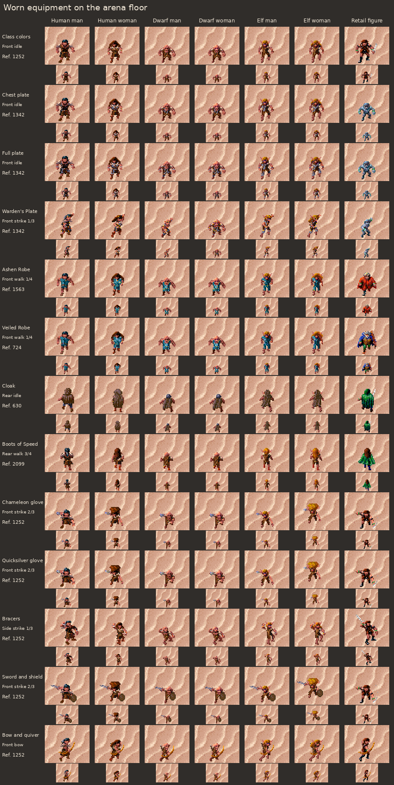
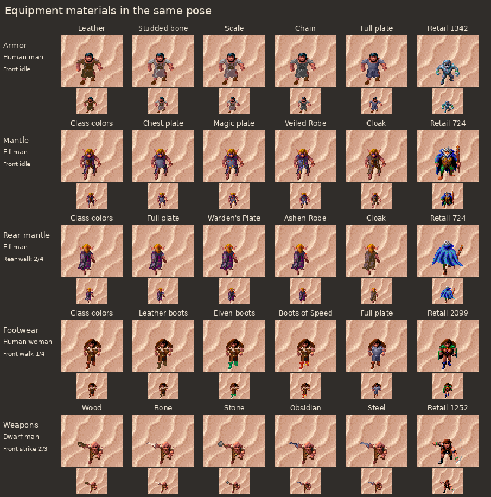
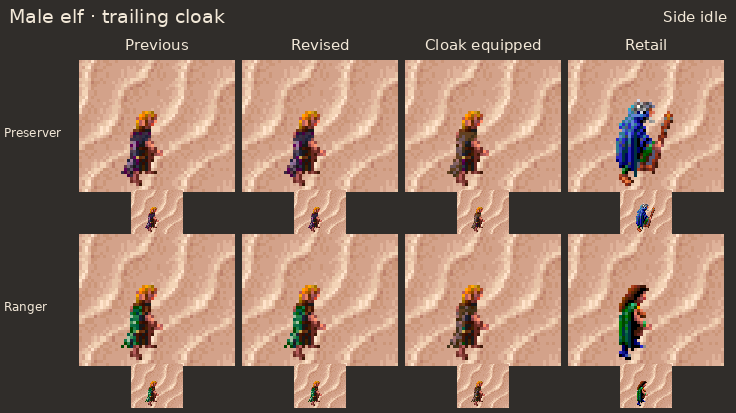
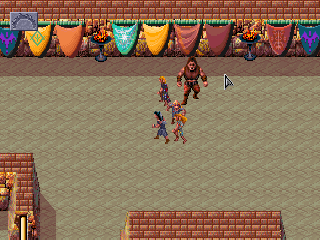

# Worn equipment on the six party figures

Read across a row for the same equipment and pose on the human, dwarf and elf, male then female. The last column is the retail comparison. The large pictures are 2×, the small pictures are 1×, and the ground is the same arena tile throughout. Compare the first three rows to see exactly where adding the arm and leg pieces changes the Fighter. The two robe rows use the same Psionicist, pose and lighting.

## Cloaks and chest plate in motion

On the human Thieves, side walk step 2 previously showed just one cloak pixel at or below the waist on each figure. The revised step shows 29 on the man and 44 on the woman. The fold starts at the shoulder, opens behind the elbow, and turns inward above the ankle. The dwarf’s shorter drape and the male elf’s tapered Preserver and Ranger hems keep their own lengths. The class cloth supplies the silhouette when worn alone. Equipping a cloak supplies the item dye, including on outfits that normally leave the back bare.

[All six equipped cloaks through side idle and four steps, before and after](cloak-stride.gif) · [Both male elf class cloaks beside retail figures, step by step](elf-class-cloak-stride.png)

On the chest plate, the broad reflection sits on the upper curve of the rib cage and the lower rim rolls into shadow. The light follows the torso through each step. Look at the two elf Fighters when the near arm crosses the chest, or compare the human woman from the front and side. Each pair shows the preceding build at left and the revision at right, enlarged with a native-size copy below. [Compare chest plate through the front, rear and profile walks](plate-stride.gif)

### Elf woman in profile

In the previous Fighter, chest metal covered the swinging upper arm and the belt. In step 2 it picked out alternating belt pixels. In step 3 it left a single steel pixel below the crossing wrist. The revised picture keeps the original exposed upper arm in front and ends the plate above the belt. Read the still from top to bottom for empty chest slot, previous plate and revised plate. The loop shows those three states left to right. Both use the loader’s picture builder.

[Watch the four-step plate comparison](elf-woman-plate-fit.gif) · [Inspect the four steps individually](elf-woman-plate-fit.png)

### Cloak fold study

The original Mage (724) gathers several bright marks across the shoulder. Farther down, one long shadow stays legible through the swing. On the original Thief (630), short ridges end at different heights above the hem. The male elf Preserver has less cloth visible below his hair. On that smaller panel the current scatter of lights makes a crease hard to follow.

The proposed mantle has two creases of unequal length. They start under the shoulder and spread as the hem swings out. The plum highlight breaks at the turn of the cloth. The equipped sample uses the same creases in the ordinary cloak’s six dye shades. This is an art study for rear and profile motion, with the existing outfit still used in play.

[Compare the current and proposed mantle with the retail Mage and Thief in motion](elf-mantle-fold-study.gif) · [See the class mantle and equipped dye side by side](elf-mantle-fold-study.png)

### How the cloak trails in profile

The original Mage and Thief lift the lower corner of their cloaks clear of the calf. In profile step 2 the previous Preserver proposal moved the trailing edge, but kept the old plum hem across the raised thigh and the space between the legs. That leftover panel took the equipped cloak dye as well.

The corrected study reveals the Preserver’s leather tunic, bent leg, and open ground wherever the hem lifts away. A short seam below the hairline carries the cloth over the shoulder when the near arm crosses it. Follow the same plum fold behind the elbow into step 3. The ordinary equipped cloak follows that outline in its own dye.

[Compare the previous proposal, the same Preserver with the mantle removed, and the corrected mantle in steps 2 and 3](elf-mantle-midstride.png)

[Watch the four-step profile loop at game size and 3×](elf-mantle-swing.gif) · [Inspect every step, including the equipped cloak dye](elf-mantle-swing.png)

### Cloak hems on the other figures

The [profile comparison sheet](cloak-hem-audit.png) shows class colors, an equipped green cloak, leather boots, and the same boots under the cloak. Yellow marks the pixels discussed below. In the human woman’s Mage row yellow marks the lower garment that keeps its own color. In the two elf step-2 rows it marks the lower cloth that changes when the class mantle is removed. [Watch all six figures at game size and 2×](cloak-hem-audit.gif).

| Figure | Finding |
|---|---|
| Human man | In profile step 2 the Mage, Ranger, and Thief share an eight-pixel strip between the legs. It is separated from the main visible cloak, takes the cloak dye, and occupies open ground in the original human drawing. This is the closest human match to the lifted-hem problem. |
| Human woman | In profile step 3 the Mage’s purple thigh detail keeps its class color when the cloak turns green. Her Warrior and Gladiator do have an equipment overlap in profile idle. Three Warrior boot pixels and four Gladiator boot pixels take the cloak dye. |
| Both dwarves | The equipped cloak covers five pixels of the raised boot in profile step 2 and two in step 3. The same coordinates recur on the Fighter, Gladiator, Psionicist, Fighter/Psionicist, Fighter/Thief, and Fighter/Psionicist/Thief. Toggling the cloak on an already booted Fighter makes the overlap visible on each dwarf. |
| Male elf | In step 2 the Ranger covers 31 of the 33 lower-hem pixels identified on the base Preserver, and the Thief covers 20. In step 3 the corresponding counts are 29 and 17 of 31. Preserver/Ranger and Preserver/Thief inherit the full lower patch in both steps. These counts compare each outfit with its own mantle removed. The single-class Preserver correction above is an art study. |
| Female elf | In step 2 the crossing arm divides the visible cloth. On the Preserver, 23 of the 33 pixels below the waist in the larger panel trail outside the stock body. Cutting that whole panel would remove the trailing cloak. A clearer defect is the Ranger’s single dye pixel beside the leg in step 4. It occupies open ground on her mantle-off drawing. The same isolated pixel occurs on 22 of her outfit masks, including some that show it only with a cloak equipped. |

The audit compared ordinary and green cloak dyes through the party picture builder for all 114 figure/outfit combinations. The changed pixels matched the registered cloak in all 1,710 idle and walking poses. That check establishes which garment owns a pixel. The profile comparisons above also use the surrounding walk steps, uncovered artwork, or boot toggles to judge whether a patch belongs there. Front and rear masks were screened for overlaps. The illustrated findings concern the profile walk and idle. These are loader renders from the branch, with the earlier Preserver study shown separately above.

## What the items look like

| Item | What to look for on the map | Retail comparison |
|---|---|---|
| Chest plate and full plate | Chest plate leaves the lower jerkin or skirt in the class color. Equipping chest, arms and legs together carries steel into the registered shoulder and lower garment. The steel highlight follows the source shading. Bare arms, uncovered calves and the face stay visible. Boots and a helm are separate items. | The blue figure in picture 1342 has brighter, tighter alternating marks on its back. The party steel has a darker outline and broader, quieter planes. |
| Warden’s Plate | The actual four-piece set adds the headpiece. Short steel highlights and sparse, icon-colored glints separate magical metal from ordinary steel. Look at the elf Preserver from behind in the materials sheet. The plum mantle stays plum over the armor. | Compare the grip, face, silhouette and shoulder highlight with 1342 in the same strike. The Warden set uses the game’s cycling colors when displayed in DOSBox. |
| Ashen Robe | Ash gray with pale binding and ember glints. It colors the visible chest and existing lower garment. Its length follows the class outfit. A mantle can hide most of the robe from behind. | The red retail Priest (1563) has a fuller silhouette and more variation within a broad fold. The ash binding is clearest against a shadow in front. |
| Robe of the Veiled Alliance | Night blue with a narrow gold binding and cool glints, following the inventory icon. The edge changes sides on screen as the torso turns. The class hood, skin, feet and foreground hand keep their colors. | The retail Mage (724) has a much larger area of blue cloth. On a small Psionicist the gold binding distinguishes the Veiled Robe from the Ashen Robe more readily than the shine. |
| Equipped cloaks | The item dye now picks up the light and dark folds in the underlying cloth. On a Thief the back stays readable through the rear walk. A cloak can extend beyond an uncovered Fighter’s shoulders. | The green Thief (630) has more closely spaced vertical folds and a brighter ridge. The party cloak is still coarser, especially under the elves’ hair. |
| Boots | Each exposed boot takes its own shadows and highlights. A lifted or hidden foot keeps its pose. A pair can show only one boot when the other foot is occluded. The footwear row shows plain leather, Boots of Elvenkind and Boots of Speed in the same step. | The retail human woman (2099) has strongly separated blue boots. Compare the space between her feet and the direction of the lifted toe. |
| Gloves and bracers | Chameleon Gloves give the equipped fist blue-gray leather. The Quicksilver Glove shows a silvery face on a brown palm. One glint sits on visible glove pixels. An occluded hand can hide the entire glove. Bracers use the registered arm patch farther up the limb. | The retail Warrior (1252) uses a few contrasting pixels to separate wrist, grip and blade. At 1× the glove silhouette is the wearer’s hand and the two glove colors can be hard to tell apart. |
| Weapons and shield | The sword has a lit cutting edge and a darker spine. A great axe has a broader head and wooden haft. Staff and polearm read through their length. The shield shows a boss in front, straps from behind and a narrow far side in profile. The bow and quiver are carried until the game's own drawn-bow pose takes over. The sling hangs in a pouch, while the chatkcha shows an angled tip at the belt. | Compare the white edge of the retail Warrior’s weapon with the carried and drawn weapons. At this size bone, obsidian and steel are distinguished primarily by edge color. [All fourteen weapon families in motion](worn-weapons.gif) |

## Each figure in motion

Each link opens all 29 native poses. Each tile is labeled with its equipment and has a game-size copy below. Frames show a fixed palette phase for magic items. The game also animates those palette entries between poses.

| Figure | Detail to follow |
|---|---|
| [Human man](worn-human-man.gif) | Watch the steel cross the waist when leg plate goes on. The wide shoulders and dark skirt show this especially well. In the robe views the visible chest can narrow to just a few pixels. |
| [Human woman](worn-human-woman.gif) | In full plate, lit and shaded steel now separate across the skirt. Her long hair still obscures the upper back. The sling attachment follows her waist in the side stride. |
| [Dwarf man](worn-dwarf-man.gif) | In the shorter recoil, the long weapon turns across the body. The staff butt clears the soles on the first side step. |
| [Dwarf woman](worn-dwarf-woman.gif) | Follow her distinct opening strike. The glove travels with the leading fist and a heavy axe stays joined to its haft through the swing. |
| [Elf man](worn-elf-man.gif) | In profile walk steps 2 and 3, the Preserver and Ranger retain the outward swing while the last three rows of the trailing corner fold toward the knee. The class and equipped cloaks share that edge. |
| [Elf woman](worn-elf-woman.gif) | The braid covers much of the rear robe. Its binding is easier to see from the front and side. The chatkcha and sling meet the belt as the hips turn beneath the shoulders. |

[Inspect the second step as a still](worn-elf-profile.png). The taper changes two poses on each of 22 male elf single- and multiclass outfits. The middle of the drape still passes behind the elbow. Where the taper reveals pixels at the ankle, boots or leg armor now color the newly exposed part. The other five figures retained their unequipped artwork in this review.

## Texture at native resolution

The table and CSV record the earlier equipment pass at `a7912ae`, before the profile and breastplate corrections above. Each entry gives the percentage of fully sampled 2×2 squares that have one palette index, averaged by pose, before and after this pass. Full plate uses the Fighter’s covered chest, arm and leg regions. Cloak uses the Thief’s visible registered cloak pixels. Both comparisons use identical coordinates before and after.

| Figure | Full plate, before → after | Worn cloak, before → after |
|---|---:|---:|
| Human man | 17.7% → 4.5% | 20.6% → 3.7% |
| Human woman | 20.0% → 3.1% | 9.8% → 6.2% |
| Dwarf man | 10.0% → 1.9% | 18.2% → 5.7% |
| Dwarf woman | 9.7% → 1.8% | 18.1% → 5.1% |
| Elf man | 15.7% → 0.9% | 31.2% → 7.8% |
| Elf woman | 16.2% → 1.8% | 31.8% → 6.9% |

For retail context, an 8×8 rear-idle sample across the back of the Warrior (1252) had 7.7% flat squares and ten colors. The Priest (1563) had 2.0% and fourteen colors. The Mage (724) had 0% and twelve, and the Thief (630) had 0% and ten. Those are local swatches from original figures. On the complete party render, ordinary steel averages about eight to nine colors in its visible equipment regions. Cloak dyes have six steps. Their folds are consequently subtler than the retail Thief’s even where the silhouette is similar.

[Per-pose material measurements](worn-measurements.csv) include color counts and the proportion of pixels differing from all four orthogonal neighbors. The robe comparison measures the chest coordinates shared by the old and revised render. Poses with no sampled pixels are omitted. Magic palette entries count as individual colors.

## In the game and in the renderer

This native DOSBox capture stages ordinary full plate on a male human Warrior, Warden’s Plate on a female dwarf Fighter, the Veiled Robe on a male elf Preserver and the Ashen Robe on a female elf Psionicist. The large arena NPC is original. The inventory records selected both named robe dyes and the Warden pieces through the loader’s worn-item reader. This run verified the resulting pictures on the map. Live attachment for changing inventory in that session was blocked by read-only process memory.

The renderer review covered 114 figure/outfit combinations and 29 poses. Twelve loadouts covered individual ownership regions, bow preservation, visible boot coverage, restoration after removal, and the class silhouette. A separate sweep exercised fourteen weapon families in all 3,306 outfit poses. It compared the normal frame with a larger canvas extending below the soles and checked for disconnected pixels and changes to the native bow. This caught the dwarf’s low recoil and the detached hip weapons. The revised sweep passed all 46,284 weapon renders.

To regenerate the equipped comparison, materials sheet and animations from an original game installation, run `python prototypes/wornreview.py GAME_DIR OUTPUT_DIR` from the repository root.
