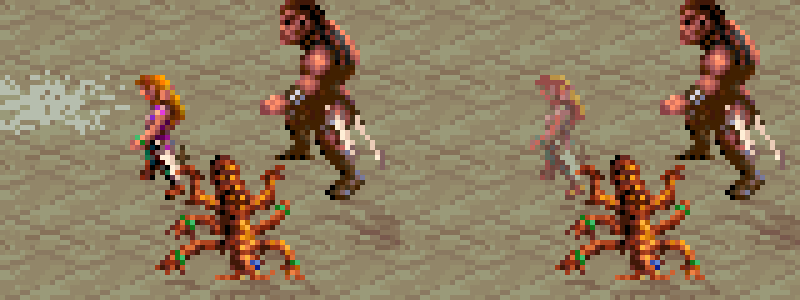
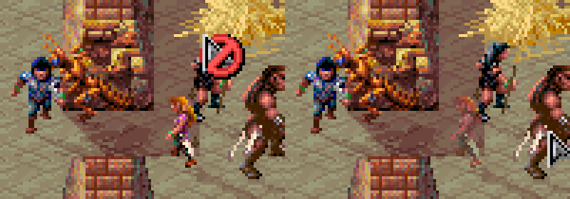
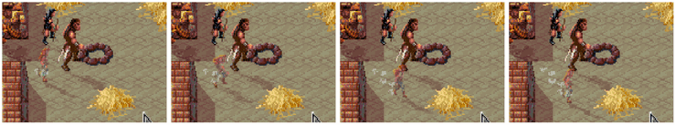
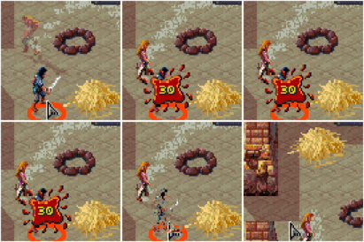

# 2026-11-05/06: the hiding and pickpocket sounds and the see-through figures from their real triggers; VEC_GHOST took VEC_AC's vector

**Under test:**
- the purse sound from a real picked pocket;
- in a fight, a thief hiding: the see-through look and the hide sound;
- walking pace with a see-through figure, and any smear.

**Setup:**
- `pens-after-scar`, with DOSBox's sound recorded (`PT_AUDIO`).
- Cilla's thief level raised to 12 in memory (`sheetedit.py 3 level2=12`), so she hides at 95. Nothing was saved from this run.
- The fights: Kurzak's alarm, from being late to his call. The routes are `toalarm.sh` and then `restalarm.sh` (scratch scripts: rest at the east hall's fire ring, then wait him out).

## Seen

1. **Picked pocket.** Cilla used the Pick Pockets button on Kalzith: "d100 = 19, needs 70 -> success", and lifted a scroll. The recording matched `pick.wav` (r 0.995; `hide.wav` 0.042).
2. **Invisibility, for real.** In the first fight, Cermak cast it on Cilla ("Cermak gives Invisible to Cilla"). She was drawn half see-through at once. 
3. **First fight.** Cilla hid twice (6 and 35 against 50) but was heard both times (66 and 98 against 57). She went down and the party lost.
4. **Second alarm fight: a full hide.** "Cilla hides in shadows: d100 = 40, needs 95 ... hidden; moves silently: d100 = 39 ... unheard".
   - The hide sound played: `hide.wav` r 0.997 at 5.0 s into the last 20 s of the recording; `pick.wav` 0.044.
   - She was drawn see-through on the spot. In the picture, left is before her turn and right is hidden. 
   - She hid again on later turns (65/36, then 84/41 against 95); each time she turned see-through.
5. **Walking pace.** Her map position was read every 50 ms from the click (scratch `walktime.py`):
   - hidden (see-through): 15 steps in 1.1 s, 7 steps in 0.40 s;
   - not hidden (solid, the turn Kurzak stood beside her): 16 steps in 1.05 s.
   - So both walk at about 0.07 s a step, the same pace.
6. **No smear.** The pale bits behind her as she walks are the mod's dust (`dust.py`: walking figures raise puffs on sand). They show behind solid figures too and are gone once the view is drawn whole. 
   - With her END menu up after a walk, a puff stayed over her old place until the menu closed. The menu keeps the view from being redrawn.
7. **Solid again at her attack.** Hidden, Tab chose Kurzak and Return sent her: "Cilla attacks Kurzak BACKSTAB with Bone Long Sword ... HIT, 30" (6 x4 +7 STR -1 bone).
   - She walked up see-through and was solid from the blow on. 
   - Kurzak died of it. The run was never saved.
8. **Not explained.** In one hidden walk that ended beside K'ratchek and Gerakis, her last two frames (of 15) were drawn solid. She was see-through again when she stopped.
   - DSCLOG's GHOST_ON, STEALTH and its palette copy did not change through a later walk, and the game's other callers of the picture routine draw screen panels only.
   - Not seen again: the frames were overwritten before they were looked at closely. Next: walk a hidden thief into a square beside a party member, with frames kept.

## A bug found on the way: every attack on the party at AC 255

- The dice log gave "target AC 255" for every enemy attack on the party, Kurzak's and the Arena Guards' alike. So they hit on anything but a 1.
- The party's counted ACs were 0-6 (`counted_ac`). On 2026-11-02 the same line gave a real AC (6).
- **Cause:** the see-through figures' probe took `VEC_GHOST equ 0x62`, which is VEC_AC's (PROBE_AC, at the end of the game's AC routine).
  - DSCLOG installs PROBE_GHOST after PROBE_AC, so INT 62h went to PROBE_GHOST. The live table showed C91B:C62D, deep in DSCLOG.
  - Every attack's AC then went through the see-through probe: a garbage AC (255), plus a call of the game's picture routine with whatever was on the stack.
- The test `test_ghost_dispatch` had found the install's bytes twice ("the same bytes come earlier, by chance"). That was PROBE_AC's install, taken for chance.
- **Fix:**
  - `VEC_GHOST` is now 0x80, in dsclog.asm and gamepatch.py. 78h-80h read 0000:0000 in the live table; 66h-6Fh are out (the game calls them looking for drivers), and so are 70h-77h (IRQs).
  - A new test, `test_vectors_distinct`, checks each of dsclog.asm's vectors is used once, none is in 66h-77h, and gamepatch's VEC_ names match. It fails on the old 62h.
  - `test_ghost_dispatch` now wants the install's bytes exactly once.
- **Seen after the fix:** INT 62h goes to C91B:08EA (PROBE_AC) and INT 80h to C62D (PROBE_GHOST), and the drawing site reads `CD 80 90`. An attack after the fix went through the AC routine at a real AC: Gerakis on Cilla, "target AC 5", her counted AC (the rest script's click landed on her with the sword pointer, out of a fight: a slip of the tool, not the game).
