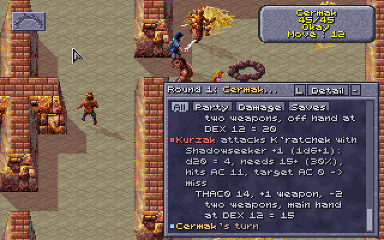

# 2026-11-06: do the game's people fight with their weapons and armour?

**Question (the user's):** people carry their gear in the backpack list (`npcgear.py`, the pens:
all 25, nothing worn or held), so is their AC 10 and their attack bare only out of a fight?

**Setup:** `toalarm.sh`, the eye pointer, `restalarm.sh`: the alarm fight with the pens' guards.
Cilla's thief level 12 in memory; nothing saved.

## Seen

1. **At the fight's start**, every person's gear still in the backpack (`npcgear.py` with the
   fight on, turn 1): 30 creatures, nothing worn or held.
2. **Before acting:** Kurzak was backstabbed by Cilla before his turn: "target AC 10" (his
   leather armour and helm in his pack); a Guard likewise AC 10 (it had two clubs in its pack).
3. **Once they act:** the party passed its turns; when Legcrusher and an Arena Guard attacked,
   `npcgear.py` read: Legcrusher worn Leather Inixhide +1, held Wooden Club, Wooden Club; Arena
   Guard worn Leather Chest Armor, Wooden Arrows, Leather Arm Armor, held Obsidian Long Sword,
   Wooden Bow. The dice log: "Legcrusher attacks Gerakis with Wooden Club (1d6)" (twice),
   "Arena Guard attacks Cermak with Wooden Bow (1d8)", "Arena Guard attacks Cermak with Obsidian
   Long Sword (1d8): ... THAC0 18, +1 STR, -2 obsidian = 19". (Earlier the same day: "Kurzak
   attacks Cermak with Shadowseeker +1 (1d6+1) ... -4 two weapons, off hand".)
4. **Their armour counts once worn:** Cilla's backstab on Legcrusher afterwards: "target AC 8"
   (10, his Leather Inixhide +1; no DEX from behind).

## What it shows

The game equips its people itself, on each one's first action in a fight: weapons to the held
list (+0Ah), armour and ammunition to the worn list (+08h). Before that (out of a fight, or in a
fight before its turn) all is in the backpack (+0Ch): AC 10 with no armour counted, and the Look
box, which lists the held list's weapons, shows none. The champions (`champions.py`) are equipped
as they come on, so they show theirs from the start. The docs that said the game's people "carry
all theirs there, fighting with their bare numbers" (HOW-THE-GAME-WORKS, champions.py) are wrong.

## The opening blow, and the fix (later the same day)

- **The opening blow is struck before the game's fight begins.** Out of a fight, the sword pointer
  on Legcrusher: "Gerakis attacks Legcrusher with Leather Sling (1d4) ... target AC 9 -> HIT" with
  `fight_on` False (`orderwatch.py`, every 10 ms), then "Help! Somebody sound the alarm!", and the
  fight on only once that box was clicked. So equipping at the fight's start would be too late:
  `people.py` equips as people come on the map.
- **Loaded with `people.py`:** every person with gear wore and held it at once (`npcgear.py`):
  Kurzak Shadowseeker +1 and his obsidian sword in hand, helm and leather on, the key packed; the
  Templars brigandine and shields; Kalzith his robe and staff; fruit, rings, a cloak packed.
- **Kurzak in the alarm fight**, armed from its start: "Kurzak attacks K'ratchek with Obsidian
  Long Sword (1d8) ... -4 two weapons, off hand", then "with Shadowseeker +1 (1d6+1) ... +1 weapon,
  -2 two weapons, main hand = 15". The combat log in detail, expanded, with him on screen:
   (now docs/combat-log-detail.png, in FEATURES).
- **Picking Shadowseeker from his hand:** reloaded, Cilla's thief level 12 in memory, walked to
  his stop (1592, 504), U, Cilla's portrait (108, 108), the purse (157, 145, a slow press), the
  talk pointer on Kurzak: "Cilla picks Kurzak's pocket: d100 = 19, needs 95 -> success / Cilla
  lifts Metal Shadowseeker +1 from Kurzak unnoticed. / Cilla receives 200 experience points!".
  Afterwards Cilla's backpack held it (type 115, cell 14) and Kurzak held only his obsidian sword.
  Nothing saved.
