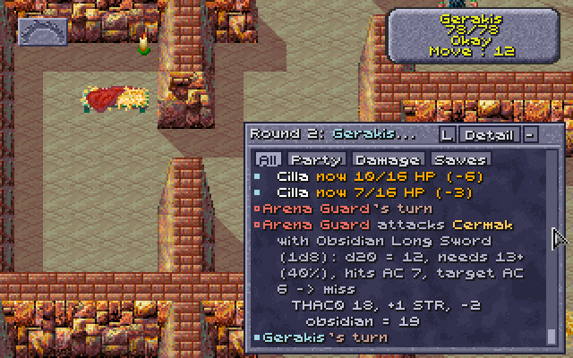

# 2026-11-06: do the game's people fight with their weapons and armour?

**Question (the user's):** people carry their gear in the backpack list (`npcgear.py`, the pens:
all 25, nothing worn or held), so is their AC 10 and their attack bare only out of a fight?

**Setup:** `toalarm.sh`, the eye pointer, `restalarm.sh`: the alarm fight with the pens' guards.
Cilla's thief level 12 in memory; nothing saved.

## Seen

1. **At the fight's start**, every person's gear still in the backpack (`npcgear.py` with the
   fight on, turn 1): 30 creatures, nothing worn or held.
2. **Before acting:** Kurzak was backstabbed by Cilla before his turn: "target AC 10" (his
   leather armour and helm in his pack); a Guard likewise AC 10 (it had two clubs in its pack).
3. **Once they act:** the party passed its turns; when Legcrusher and an Arena Guard attacked,
   `npcgear.py` read: Legcrusher worn Leather Inixhide +1, held Wooden Club, Wooden Club; Arena
   Guard worn Leather Chest Armor, Wooden Arrows, Leather Arm Armor, held Obsidian Long Sword,
   Wooden Bow. The dice log: "Legcrusher attacks Gerakis with Wooden Club (1d6)" (twice),
   "Arena Guard attacks Cermak with Wooden Bow (1d8)", "Arena Guard attacks Cermak with Obsidian
   Long Sword (1d8): ... THAC0 18, +1 STR, -2 obsidian = 19". (Earlier the same day: "Kurzak
   attacks Cermak with Shadowseeker +1 (1d6+1) ... -4 two weapons, off hand".)
4. **Their armour counts once worn:** Cilla's backstab on Legcrusher afterwards: "target AC 8"
   (10, his Leather Inixhide +1; no DEX from behind).

## What it shows

The game equips its people itself, on each one's first action in a fight: weapons to the held
list (+0Ah), armour and ammunition to the worn list (+08h). Before that (out of a fight, or in a
fight before its turn) all is in the backpack (+0Ch): AC 10 with no armour counted, and the Look
box, which lists the held list's weapons, shows none. The champions (`champions.py`) are equipped
as they come on, so they show theirs from the start. The docs that said the game's people "carry
all theirs there, fighting with their bare numbers" (HOW-THE-GAME-WORKS, champions.py) are wrong.
