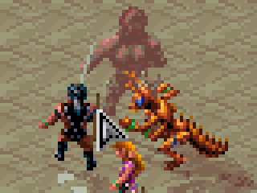
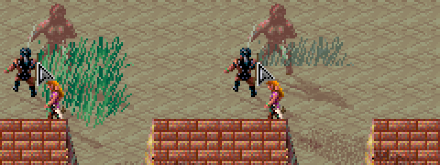

# 2026-11-06: the see-through figures after the 192-run cap

**Under test:** the see-through drawing after commit 98653ee. GHOST_DRAW now stops noting runs at
192 (GH_SPANS_MOST) and draws what it has, where it had written on past its block in upper memory.

**Setup:**
- Loaded `pens-after-scar` and started the watchdog. The window was 320x240.
- Build check:
  - The new compare (`81 7E F4 50 37 73`: `cmp word [bp-0Ch], 3750h / jae`) was in memory at
    D5966h, the same place as in `dos/DSCLOG.EXE` (C7D6h less its 20h header, from C91B0h).
  - INT 62h went to C91B:08EA (PROBE_AC) and INT 80h to C91B:C62D (PROBE_GHOST).
  - `ghostchk.py` showed GHOST's block at E99B:0 with GHOST_ON 1 (the tables made).
- Before anything was drawn see-through, `pastblock.py save` kept the 4 KB past the block
  (E99B0h + 885 paragraphs = ED100h).

## Seen

1. **The leader marked** (`ghostchk.py 0`): Gerakis drawn half see-through over the floor, with the
   others solid beside him. 
2. **More than 192 runs.** No thing near the party has a frame over 192 runs: the most was a
   thing far off with 164 (`bigthings.py`). So K'ratchek (thing 1) was given picture 459
   in memory (`setpic.py 1 459`). That picture is a tuft of grass, 52 x 50, one frame of 563 runs.
   - Marked see-through (`ghostchk.py 0 1`), only its top part was drawn: up to the 192nd run.
   - Unmarked, it was drawn whole. In the picture, left is solid and right is see-through.
     
   - The 4 KB past the block were unchanged after each draw (`pastblock.py cmp`: 0 bytes changed),
     and DOSBox kept running.
   - Before the fix, the same frame would have written 371 spans (2,968 bytes) past the block.
3. **Walking.** K'ratchek was put back (`setpic.py 1 2476`). Then the leader, see-through, walked
   west 80 map units (5 steps in 0.26 s). He stayed see-through all the way, with the dust behind
   the party as for any walker. The memory past the block was still unchanged.

Nothing was saved. The marks and the picture were memory only.
