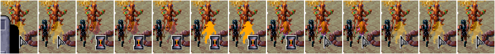
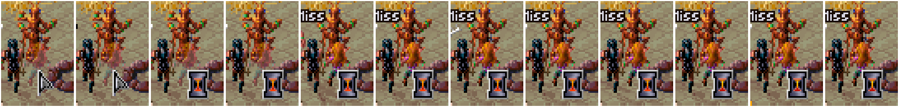

# 2026-11-06: a hidden thief solid as soon as her turn ends (the fix seen in DOSBox)

**Under test:** DSCLOG's GHOST_UNION (commit "a hidden thief drawn solid at the enemies' first step"):
a party member drawn see-through while hidden, and hidden no longer, has the game's next redrawing
of what moved take in the whole view. Before it, Cilla kept her see-through picture through the
enemies' turns, about 1.4 s, until Gerakis's turn (logs/2026-11-06-solid-frames-turn-end.md).

**Setup:** the build checked in memory first: GHOST_UNION's bytes once in the image (D694Ch), and
the vectors 80h, DDh and 62h each their own handler (C91B:C630, BEE8, 08EA). `toalarm.sh` (its last
walk now to 1896,888; it still stopped at 1832,856, and a click on the room's floor at screen
240,160 took the party in), the eye pointer, `restalarm.sh`: rests 5, one call, the alarm fight.
Round 1: Legcrusher, K'ratchek, Gerakis, Cermak, Guard, Kurzak, Cilla, Guard. Cilla's thief
level 12 in memory; nothing saved. Frames with scratch `sampler.py` (as walkprobe.py, no click):
each window grab with her position, whose turn and STEALTH.

## Seen

1. **Her first END TURN came back to her.** The guard after her was the round's last; he did
   nothing that moved, and round 2 began with Cilla (30), who hid again (d100 80 and 11). Frames:
   see-through through the guard's 0.2 s (STEALTH already 0: nothing moved, so the game redrew
   nothing and GHOST_UNION never ran), the game's orange flash of the new turn, solid at 1.18 s,
   see-through again with the new hide at 1.38 s. 
2. **Her second END TURN, Kurzak next:** the turn passed at 1.10 s, STEALTH 0 at 1.13 s, and she
   was **solid at 1.22 s, in Kurzak's turn** (he attacked Cermak twice: the "Miss" labels), not at
   Gerakis's turn (1.71 s). 
   (Frames at 1.05, 1.10, 1.13, 1.17, 1.22, 1.30 ... 1.82 s.)

## What it shows

- The fix works: solid within about 0.1 s of the Loader ending the hiding, while the enemy acts.
- Left as it is: if the next combatant does nothing that moves (a short turn with no step or
  swing), nothing is redrawn and she turns solid at the next turn of the party's, as before.

## Tool notes

- After the session's worker restarted, Xvfb was gone too, and `start.sh` run in the background
  (setsid) didn't bring it back: every xdotool call failed ("Can't open display") and the load
  went nowhere. Start Xvfb by hand (`setsid nohup Xvfb :55 -screen 0 1024x768x24 &`) after a restart.
- `memberpos.py`'s spot missed the figure twice in this fight (it opened nothing, or walked
  Cilla a step): about 12 pixels higher (y - 24 from the feet) opened the END menu; check a shot.
