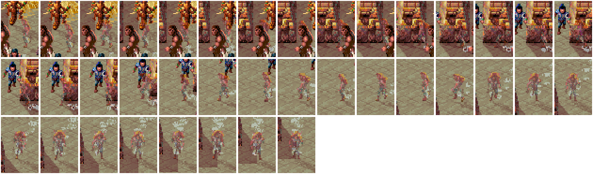
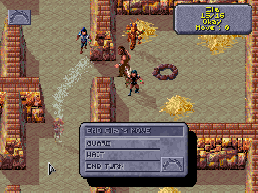
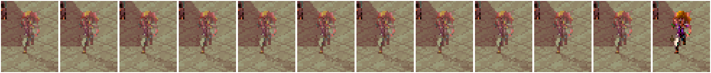

# 2026-11-06: are Cilla's solid frames her turn ending? (open item)

**Under test:** the user's idea: the two solid frames at the end of a hidden walk (2026-11-05) were
her Move running out, the turn passing, and the Loader ending her hiding (dicelog.py's turn_lines
clears STEALTH the moment whose_turn changes; DSCLOG's PROBE_GHOST draws see-through only while
her STEALTH bit is set).

**Plan:** toalarm.sh + restalarm.sh (alarm fight, Cilla's thief level 12 in memory, hides at 95);
on her turn, once hidden and unheard, walk her until her Move runs out with `walkprobe.py` (new:
each window grab with her position, whose_turn and the STEALTH word), then set the frames against
the turn passing and the dice log's turn lines.

## Steps
1. `toalarm.sh`: loaded pens-after-scar, Cilla thief 12 in memory; the party stopped at (1832, 856)
   outside the fire room: walkto (1896, 856) gave NO PATH FROM HERE though the door was open.
   A look click on the open door closed it (the gold pole is the closed door; the user spotted it):
   a second look click opened it, and a walk-arrow click on the room's floor (screen 240,160)
   took the party in, to (1896, 888). Pointer set to the eye, then `restalarm.sh`.
2. `restalarm.sh`: rests 5, one call, the alarm fight (FIGHT-ON, Cermak's turn). Round 1: Cermak 31,
   K'ratchek 31, Cilla 29, Kurzak 25, Arena Guard 25, Gerakis 20.
3. Cermak's and K'ratchek's turns passed by their END menus (a click on K'ratchek's figure
   from `memberpos.py` missed once and E opened Effects; Escape, and the view was still in place).
4. **Cilla's turn:** "hides in shadows: d100 = 37, needs 95 -> hidden; moves silently: d100 = 85,
   needs 95 -> unheard". STEALTH 8 (her bit).
5. **The walk** (`walkprobe.py 3 60 170 walk1 8`): from (1900, 856) west past Gerakis and
   K'ratchek, out of the fire room's door and south, 38 steps in 1.70 s, to (1800, 932), where
   her Move ran out (Move : 0). Whose turn stayed 3 and STEALTH stayed 8 in all 392 samples.
   Every step's frame shows her see-through, including the steps beside Gerakis and K'ratchek
   at the start. 
6. **Move 0 doesn't pass the turn.** The game stopped her and opened END CILLA'S MOVE, and waited
   there, her still see-through. 
7. **E (END TURN), frames kept** (scratch `sampler.py`): the turn passed to an Arena Guard (47) at
   1.16 s; STEALTH went to 0 at 1.18 s (the Loader's next pass). She stayed see-through on screen
   through the guards' turns (47, then 35) and was drawn solid at 2.6 s, when Gerakis's turn (0)
   began.  (Frames at 1.98 to 2.69 s.)

## What it shows

- **The turn ending does make her solid, as designed, but not during a walk.** Running out of Move
  doesn't end the turn: the game stops the walk and waits on the END menu. So the turn can't pass
  under a walking figure, and the user's idea doesn't explain the 2026-11-05 frames.
- **She goes solid late, not early.** The Loader clears the hidden flag within one pass of the
  turn passing, but the view is drawn again from the map's main loop (`VIEW_REDRAW`, DSCLOG
  21266), which doesn't run during the enemies' turns: she kept her see-through picture for about
  1.4 s, until a party member's turn. Cosmetic; noted, not changed.
- **The 2026-11-05 solid frames are not reproduced** on the current build (now three tries: 15
  frames on 2026-11-06 morning, 38 here, including steps beside Gerakis and K'ratchek). That run
  had VEC_GHOST on VEC_AC's 62h, so every AC the game worked out went through the see-through
  probe and called the game's picture routine with whatever was on the stack: a likely source of
  stray drawing. Fixed since (80h). Closing it as not reproducible after that fix.

Nothing saved (Cilla's thief level raised in memory). DOSBox left in the fight.
