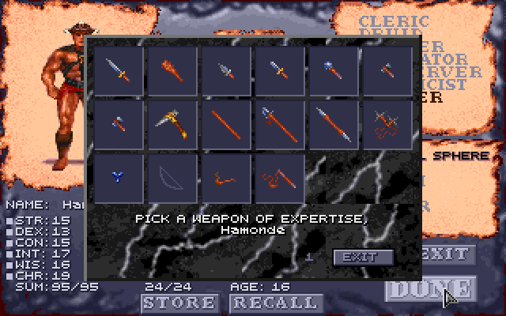

# A ranger's weapon window: "PICK A WEAPON OF EXPERTISE" (2026-11-11)

The user's report: a ranger at creation's DONE was asked to "PICK A WEAPON SPECIALTY", though a
ranger takes expertise (each weapon's box already said "EXPERT IN"). DSCLOG's title was fixed text;
`LV_TITLE_OF` now picks it as `PK_WORD` judges the first kind. DSCLOG 69,424 bytes, `buildcheck.py` OK.

- `start.sh`, clicks through the intro to the main menu. **The mouse wasn't captured**:
  `click.py` read the pointer stuck at (160,100) and clicks did nothing. `xdotool windowfocus W`,
  then a click on the window (`xdotool mousemove --window W 160 30 click 1`) captured it.
- CREATE CHARACTERS (165,92), a right-click on the first slot (64,52), NEW (110,57): a human
  fighter, Hamonde. FIGHTER off (250,29), RANGER on (250,61), DONE (279,183): the window reads
  **"PICK A WEAPON OF EXPERTISE, Hamonde"** ().
- A fighter's, a gladiator's and a Justifier's title stays "PICK A WEAPON SPECIALTY,", a Battle
  Mage's is expertise: test `test_pick_title`.
- The character not kept (the game killed after).
