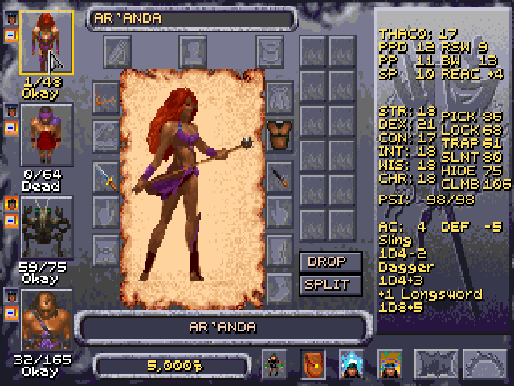
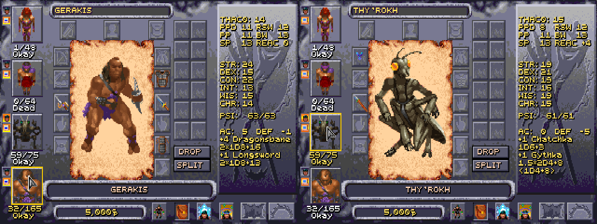

# Test log: THAC0, saves and thief skills on the inventory, Wake of the Ravager (2026-11-20)

Under test: DSCLOG2's PROBE_CHAR (patch `inventory`, 91286h, SL's 6F6BFh: INT D1h for the "add sp,0Eh"
after the panel's weapon lines) drawing THAC0 and the five saves above STR, REAC and DEF, and a thief's
skills beside STR..CHA.

## Found first

- The sequel's inventory panel is SL's, its code at the same distances: the text routine and the
  character's selector read from the code before the patch (-99h, -8Bh), the character at [sel:0B44h].
- The thief tables at load + 449Bh (DS-relative 449Bh - 47E0h): base 0-7, race rows from +8, DEX's
  low, high and top at +A0h, +A8h, +B0h, the armour penalty at +B8h. The sequel's routine (8C647h) takes
  DEX and the thief level from functions of its own; for Ar'anda they give the sheet's (DEX 21, level 7).
- DEX's reaction and defence tables at DS:084Ch and DS:0866h (SL's 7DCh, 7F6h).

## In the game (ravager-roost, about 00:15 UTC)

- I, Ar'anda (thief, DEX 21): THAC0 17, PPD 12 RSW 9 PP 11 BW 13 SP 10, REAC +4, DEF -5; PICK 86, LOCK
  68, TRAP 61, SLNT 80, HIDE 75, CLMB 106. `ravthief.py 0` (the game's own routine run in an emulator)
  gives the same six with the mod's thief_slots fix in (which the sequel's Loader applies): 86, 68, 61, 80,
  75, 106. (At 1x the font's 6 looks like a 5: zoom before reading a number.)
  
- Gerakis (DEX 15): REAC 0, DEF -1, no thief rows. Thy'rokh (DEX 21): REAC +4, DEF -5, no thief rows.
  
- Nothing overlaps: CLMB's three digits fit before the screen's edge.

## Not done

- The Loader's STATS rules, the age and a ranger's stealth (SL's DSCLOG has them) aren't in the
  sequel's version: the sequel has none of the mod's rules yet.
- No water found: the play stayed on the inventory screen.
