# Wake of the Ravager figures: before and after (six-beat walks)

2026-11-20. Branch `claude/ravager-sl-figures`. Previews only: **not yet built into the game files
or tested in the game**.

**The figures:** the nine Ravager people with no good Shattered Lands body to dress them on: the five jann, the revenant, the two knights and the lord.
They keep Ravager's own art, restyled to Shattered Lands' size and colours
(`darksun-recompiled/tools/proto/restyle/restyle.py`).

**The problem:** Ravager walks them toward and away from the camera on two frames, with the standing frame between
them (step, stand, step, stand). Shattered Lands' party man has four walking frames per direction and never shows his standing
frame mid-walk. Ravager's side walk is six beats (its four frames, the standing frame twice), so
the toward and away walks also ran faster than the side one. Read from each figure's `SCMD`:
all nine have the same layout (frames 0 / 1 / 2 the standing frames toward / away / side; 4, 5 the
toward steps; 6, 7 the away steps; 8-11 the side steps).

**The change:** toward and away become six beats like the side walk: lift, halfway, stride, then the same for
the other leg (`4, TA1, TA, 5, TB1, TB` toward; `6, AA1, AA, 7, AB1, AB` away). The four new
frames per direction are the figure's own standing frame with its pixels moved, nothing painted:
- **Stride:** the forward leg 2 pixels lower (toward) or higher (away), the back leg the other way, and the arms swung opposite.
- **Halfway:** the same moves, half as far.
- **Gaps:** where a moved part leaves a gap, it is filled from the pixel above.
- **The lord:** his robe takes 1 pixel, not 2.
- **Finding the parts:** the legs are the bottom fifth of the standing frame, split at the feet's middle; the arms are the outer three columns from the chest to the hips.

**Also fixed:** Ravager's script places toward step 4 by its head but step 5 by its feet, so
the head jumped 3 pixels up every other step (in the original game too). Step 5 is now placed at
the standing frame's head height, a one-number change in the script.

## The animations

The top row in each is Ravager's walk as it is (restyled), and the bottom row is the new walk. In each row:
toward the camera, away, then sideways (unchanged, for comparing the pace). Drawn at 4x, 160 ms a beat.

### 2458: jann: black hair, orange trousers

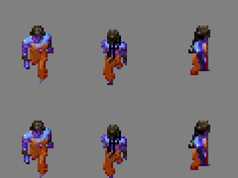

### 2413: jann: bald, yellow-ochre trousers

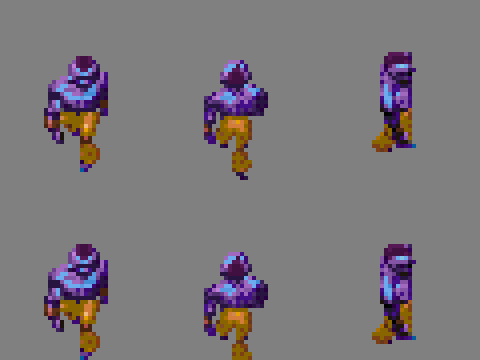

### 2457: jann (as 2413): bald, yellow trousers

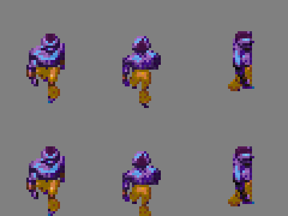

### 2459: jann: bald, pale grey trousers

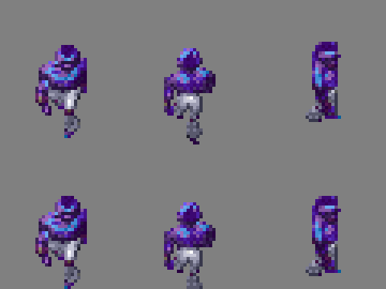

### 2460: jann: dark maroon hair, green trousers

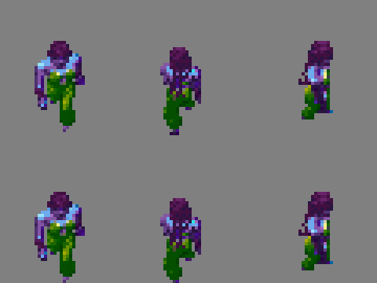

### 2536: revenant

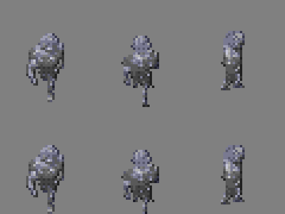

### 3605: white knight in silver plate

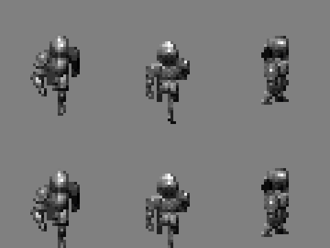

### 3606: black knight in blue-black plate

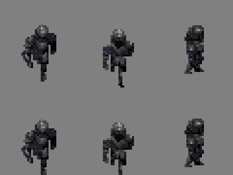

### 2575: lord in black (cloak and armour)

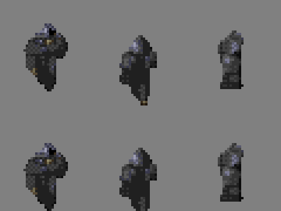

### 2539: soulshard (grey stone man)

A restyled monster that walks exactly as the people do (same frame layout), so it gets the same six beats.

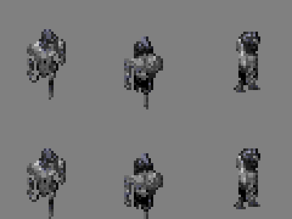

## Restyled monsters

Of the 45 monsters restyled from Ravager's art, most walk on frames of their own. 21 have 3 frames per direction, and 12 have 4 to 6. None of them show the standing pose mid-walk, so they're left alone. Eight don't walk: five statues and objects, the seated beggar, the crouched mushroom lady and Generoe.

The aurumvorax was first listed here as frozen in one direction. That was a misreading of its script: it has 4 frames in every direction.

The soulshard (above) walks like the people, so it takes their fix. The two golems are a different case.

**The golems (693 magma, 2394 obsidian):** toward and away, they swap between two stride frames (A B A B), while sideways they have four. Between the strides now go passing frames (A, P1, B, P2), made from the standing frame:
- **Swinging leg:** the leg swinging through is lifted 2 pixels.
- **Arms:** moved 1 pixel, part way through their swing.

The top row in each animation is as it was and the bottom row is new. Each row shows toward, away, then sideways (unchanged). Drawn at 3x, 200 ms a beat.

### 693: magma golem

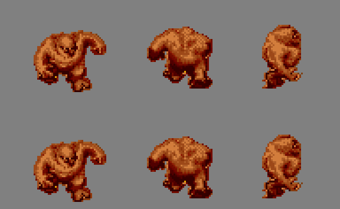

### 2394: obsidian golem

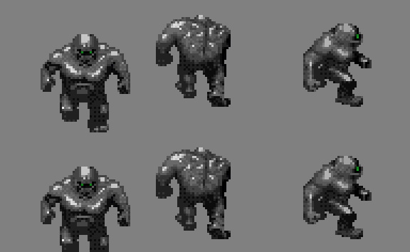

Their frames, toward `A, P1, B, P2` then away:

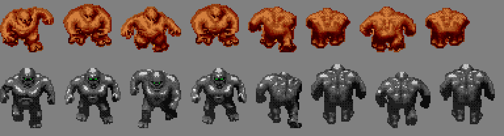

## Test: six dressed people restyled instead (2026-11-21)

**The problem:** Ravager draws its people fighting unarmed (fists, an overhand blow, a lunge) or with a
bow. The Shattered Lands bodies they are dressed on each carry a weapon of their own, so a dressed
townsman fights with whatever his body came with.

**The test:** these six, with the most visible mismatches, are restyled from Ravager's own art
instead:
- the six-beat walk;
- standing frames loosened, shown only when standing now: the arms a pixel off the body, the forearms out and up another, the feet a pixel apart;
- Ravager's own combat frames, restyled.
- the side frames leaned forward from the hips, 3 pixels at the crown and nothing below the hips moved. The Shattered Lands man walks with his head about 3 pixels ahead of his hips, Ravager's people about 1.

**The animations:** each is at 3x. The rows are the Shattered Lands party man (for scale and style), the figure
as dressed now, and the figure restyled with the walk fix. The columns are standing, walking toward the camera, sideways, and the first
six fighting frames.

### 2411: thief: white shirt, red headband (dressed on SL 630: a sword)

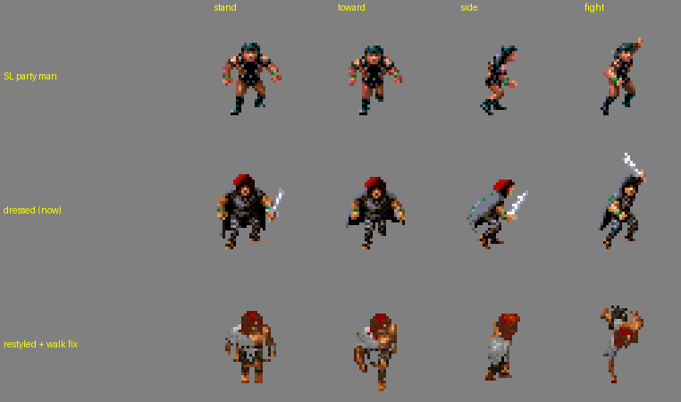

### 2414: Draxan soldier, red shirt (SL 239: an axe)

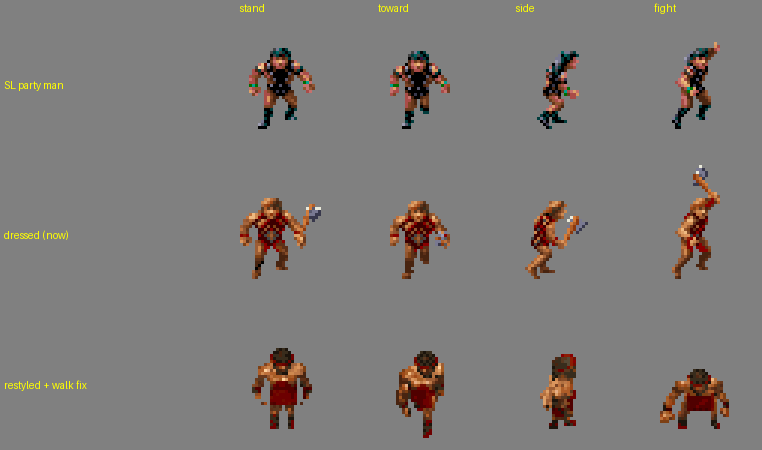

### 2420: templar, purple robe (swapped for SL object 18: a sword)

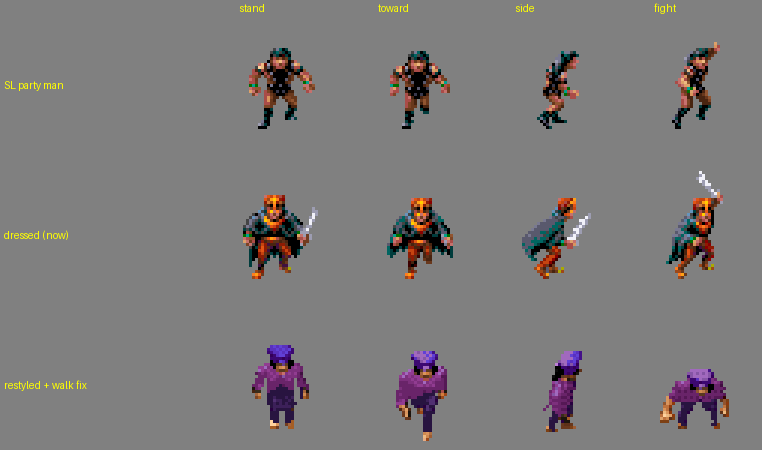

### 2432: man in a green tunic (SL 630: a sword)

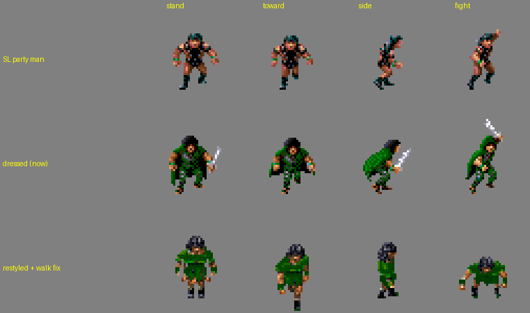

### 2421: bald man, blue loincloth (SL 559: a staff)

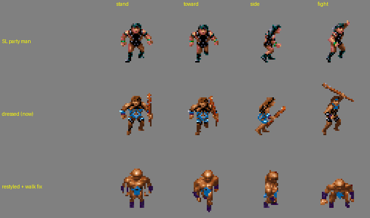

### 2428: bald man with wristbands (SL 563: an axe)

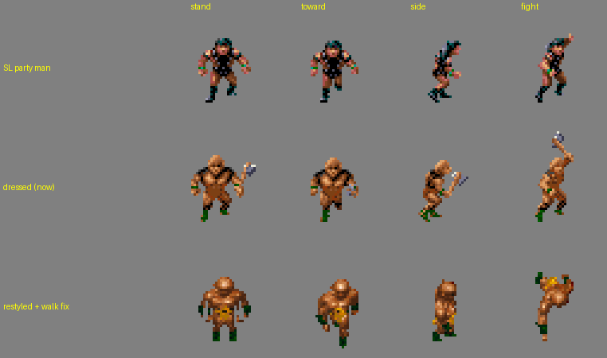

**Not yet done in this test:**
- The side standing frame (2) is leaned but not loosened: Ravager also uses it mid-stride in the side walk.
- Nothing here is in the game files yet.

## The new frames

Each figure on one row: toward `4, TA1, TA, 5, TB1, TB`, then away `6, AA1, AA, 7, AB1, AB`.

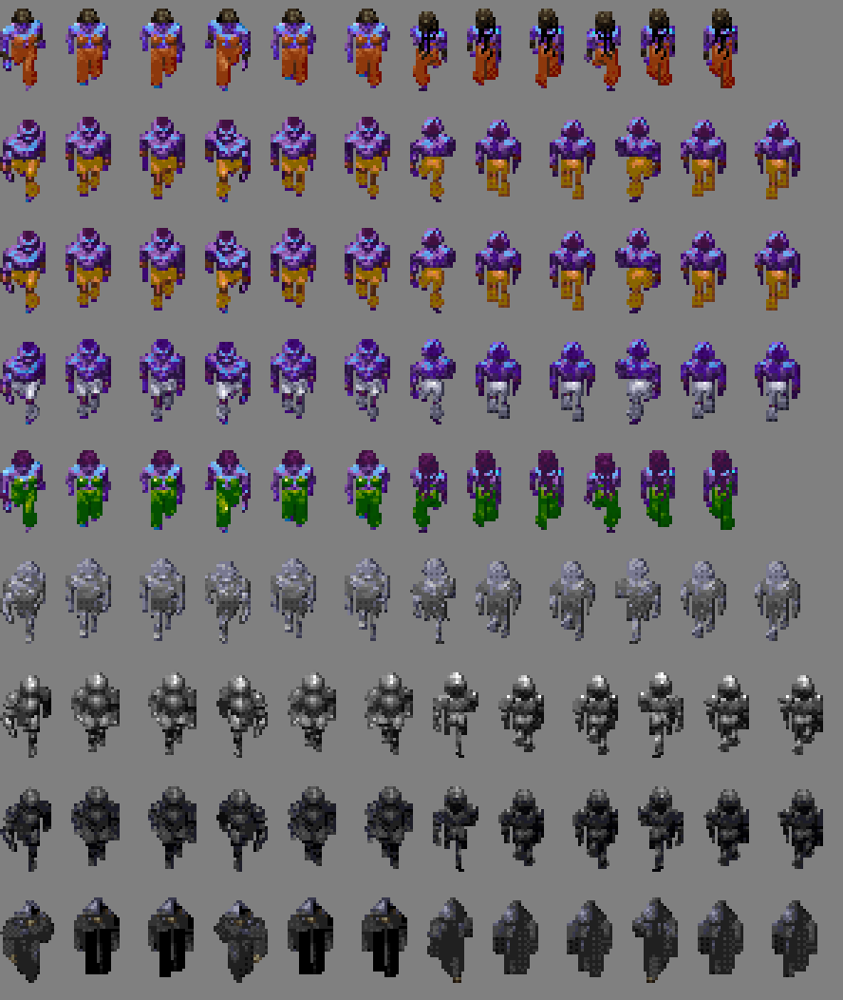

The soulshard's:

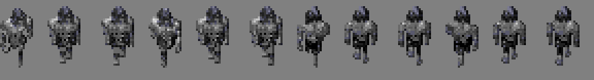

## Still to do
- **A pixel tidy:** the edges of the moved legs are a little blocky.
- **Into the game:** the new frames are appended to each `BMP`. Each `SCMD`'s toward and away cycles are rewritten to the six beats, with step 5's anchor fixed. Then test in the game: walking each way, standing, turning, and a fight.
- **The standing frames:** loosening them (arms off the body, feet apart) was tried for the jann. Once the walks no longer show the standing frame mid-step, it can be done without the arms flapping.
