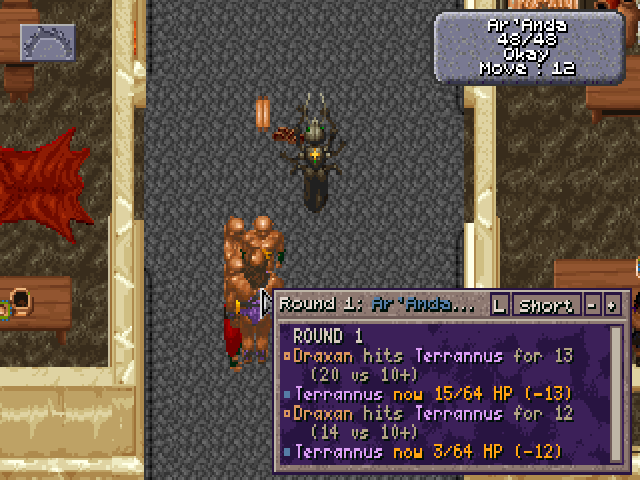
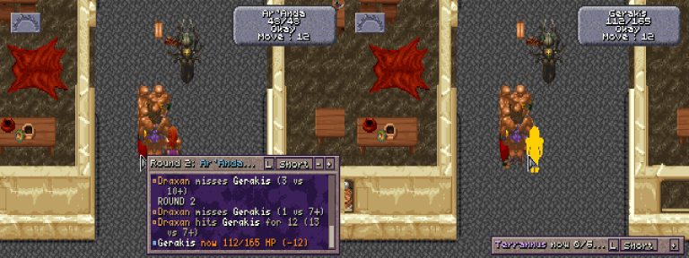
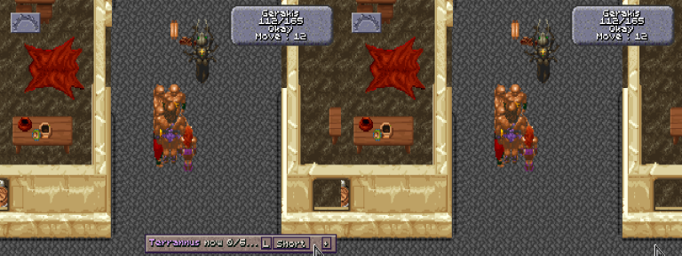
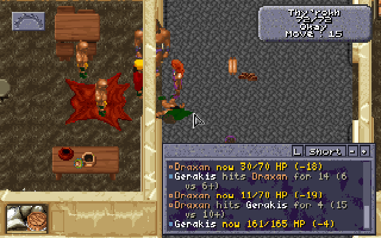
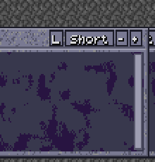

# Test log: the combat log's panel, Wake of the Ravager (2026-11-21)

Under test: DSCLOG2's PANEL (DSCLOG's combat log panel over the map) with two new interrupts,
FLIP_SITE (`panel_flip`, 16974h: INT D5h, the game's flip of its two screens) and PROBE_POINTER
(`pointer`, 3326Ah: INT D6h, the game drawing its pointer), the main loop's pass (PROBE_SCROLL, from
the labels), an INT 16h hook for L, and the Loader's dice log drawing combatlog.py's panel
(ravlog.RavDiceLog._panel_pass).

## Found first

- The sequel's twins: the flip at 16974h (the page routines' segment 0BF3h, SL's 0980h; the screen
  shown still [118Eh] there), the pointer routine 2D72:0942 (3326Ah its stack check; SL's
  28D1:093D), its variables DS:332Ch (hidden), A10Dh (where it goes), A115h (where it was), A155h (its
  kind), the pointer's other screen DS:3330h, 33B6h, 33B8h (SL's each - 91Ah or - 2Ah); the routine
  centring the view 1C5F:01F3 (219E3h, SL's 191F:0281).
- **A fight on**: the game's flag is a byte at DS:13FAh (16 of SL's 1168h uses matched by their code),
  the fight's state 3C10h:19h (the main loop's own test); without them the panel had no lines (the
  dice log adds a fight's lines only in one).
- **The game's clock**: DS:9C0Ah its scale (1), DS:9C0Ch the far pointer to it (SL's 9B70h, 9B72h):
  without it no "Round N" header.
- The helper's header gains DSCLOG's panel fields (+140, +164, +326 to +349) and its own +240 (the
  palette's changes counted, for the panel's colours: SL counts its shadows' palettes). The picture
  is in the far block after the palette (36,280 bytes all told, in the HMA).
- When the view scrolls, the whole view is drawn again (DSCLOG's VIEW_AGAIN). Drawing again only
  where the game's copy of the panel went (as the labels do) left that copy for a second and more.

## In the game (a new game, `RAV_LOADER=1 sh ravscare.sh`, the Draxans' ambush, about 01:45 UTC)

- `ravdice.py`, then L on the map: the panel opens, bottom right. `ravfight.py fight`: each attack and
  hit point change in it, "Round 1: Ar'Anda..." in the header, "ROUND 2" between rounds.
  
- It hides while the game's windows are up (END MOVE, NO PATH), as Shattered Lands' does, and comes back.
- A click on its "-" collapses it to one line (the newest), and the party doesn't act on that click.
  
- L hides it; the view under it is drawn back.
  
- After a scroll a copy of the panel can show beside it for a moment (fixed below).

## The rough edges fixed (about 01:30 to 02:10 UTC)

- **Colours**: SL's combatlog picks the nearest of palette entries 16 to 223, and in the sequel the
  interface's blue-greys are 232 to 239 (224 to 231 warm greys, 240 to 253 greys; only 1 to 15
  cycle, the same in the street and the Roost). `ravlog.apply_layout` sets `combatlog.LAST` to 253:
  the panel is Shattered Lands' grey-blue in Tyr's street.
  
- **The copy beside it after a scroll**: frames captured about 20 a second through a fight
  (`import -window`, 400 of them), the panel's well colour (56,56,77) counted outside the panel.
  Before: copies 3 to 12 frames (0.15 to 0.6 s), up to 32 rows above or 8 pixels right. The view
  moves by two routes: the centring routine 1C5F:01F3 (the only code writing CAM_X with a MOV), and
  the following of a figure, three routines passing CAM_X and CAM_Y's addresses to 262C:0D80 and
  drawing with 262C:06C4. The game's drawing of a moved view scrolls what is on the screen and draws
  only what came into view, so the panel goes along. Forcing the centring routine's "draw it whole"
  flag didn't help (that drawing scrolls too). Now DSCLOG2 draws the view again at once after either
  route moves it (PROBE_CENTRE, INT D7h at the centring routine's end, 21A5Ah; PROBE_FOLLOW, INT D8h
  for the "add sp,8" after each 262C:06C4 call, 1E3ECh, 20193h, 2143Eh): one fight, 24 redraws, no
  copy but a 2-frame (0.1 s) sliver at the panel's right edge once.
  

## Not yet

- That sliver: a third route moving the view a few pixels sideways, not found.
- The mouse wheel over the panel and the drag of its scrollbar were not tried.
- No water seen: the street in Tyr only.
