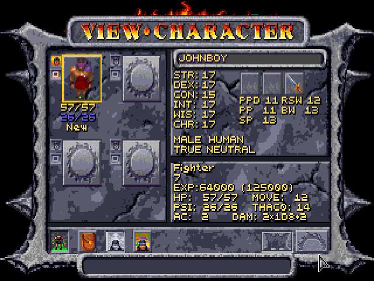

# Test log: a new character's hit points, Wake of the Ravager (2026-11-21)

Reported in review: the creation screen showed 7/7 HP for a 7th-level fighter on every roll.

## What it was

- The creation screen's HP line is the sheet's +8 (the most) and the creature's +0. Its die (6D5DFh)
  works out the least and most the classes allow (6D1EDh: DS:42D8h, 42D6h) and rolls each level's hit
  die (94F60h, 0x690:0x20), which adds the roll to the sheet's +0Ah and returns. +8 was never set from
  it: it kept the least the screen opened with (7, before the scores).
- **Not only the display: DONE gave the new fighter 7/7 HP on View Character.**
- SL's hit die routine (872xxh) ends by working out the most again (874B0h) and raising the creature's
  hit points by the rise (87362h-87391h). The sequel cut that tail and does it only in its level-up
  (957E0h: 95193h, the same routine, then the creature's set). So creation never got it.
- The roll at 95CCEh is not a level-up: it is in a routine that sets the XP for a lower level and takes
  the rolled hit points off (a level lost). The level-up rolls through 94F60h (called from 9574Bh),
  so PROBE_HP_BEST (95025h) already covers it. Don't hook 95CCEh with the better-of-two rule: on a
  loss it would take more off.

## The fix

DSCLOG2's ROLL_MAX_HP (INT E3h at 9506Ch, the "add es:[bx+0Ah],cx"): the add, then the sequel's own
95193h called far at the INT's CS (the same overlay segment, so loaded), the result put in +8 and the
creature's hit points raised by the rise, as SL's.

## In the game (about 06:55 UTC)

The title menu, CREATE CHARACTERS, a new 7th-level fighter, the die five times (sheet +8, the
rolled +0Ah, the least and most): 51 (37, 21-84), 71 (43, 35-98), 54 (47, 14-77), 53 (32, 28-91),
57 (50, 14-77): each the rolled dice plus CON's bonus a level. DONE: View Character 57/57.

## Notes

- A click on the HP line or its square didn't change the hit points in the sequel (SL's click dial,
  63A24h, has its code in the sequel too at 6B7xxh: not reached that way).
- **`flock /tmp/playtest/dosbox.lock -c "... ravstart.sh ..."` hangs the next flock**: when ravstart
  starts Xvfb itself, Xvfb inherits the lock's descriptor and holds it as long as it runs. Start Xvfb
  first, or run the Wake of the Ravager tools without flock when no other agent shares DOSBox.
- No water: the creation screen only.
