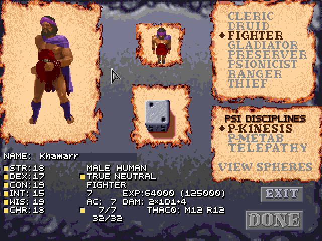
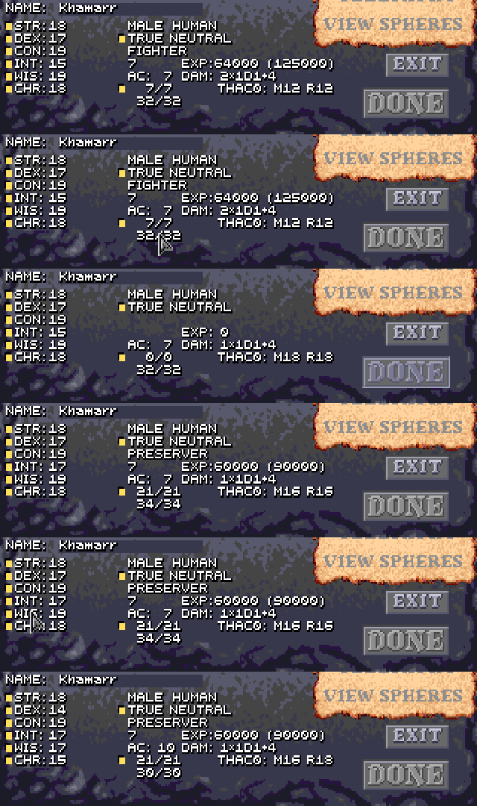

# Test log: the creation screen's additions, Wake of the Ravager (2026-11-21)

Under test: SL's two creation-screen additions on the sequel: the ability labels' colour fix
(gamepatch "cr_labels") and THAC0 beside the hit points ("cr_thac0_box", "cr_thac0_hp", "cr_thac0_hp2").

## Found first

- Getting there: the title menu's CREATE CHARACTERS (160,92), a right-click on the roster's first
  slot (70,56), NEW (110,57). EXIT is at (280,160). The classes list: FIGHTER at (255,29), PRESERVER
  at (265,45). A human has one class: click the chosen one off, then another. The die: (145,92).
- The labels' routine is SL's (6CD32h, SL's 6511Fh): it draws STR: to CHR: in the ink at DS:2D14h
  (SL's 326Eh). The ink was F0h (white) on the creation screen each time it opened, even after it was
  set to 90h on the roster screen: the sequel sets its own white on the way in. The labels were white
  in every look. SL's bug was the mod's own (2.3.0: a character screen's yellow left behind), so
  **no fix is needed** here.
- The hit points' draws: the sequel's routine at 6C87Bh (SL's 64C6Bh) is called from 6B743h,
  6B849h and 6BC5Fh (SL's 639BAh, 63AC0h, 63ED7h). PSP's draws after them: 6D6AEh (the die, a choice,
  the screen opening; SL's 65A89h) and 6B79Ch (a click on CON; SL's 63A13h). The creation screen's
  boxes are SL's, at DS:11F4h on (the hit points' the 7th, DS:1224h: 86,172 to 140,178). The records'
  far pointers: the sheet DS:1429h, the creature DS:142Dh, the window DS:1431h (SL's 119Ch, 11A0h,
  11A4h). STR's to-hit table is at DS:0832h (SL's 7C2h, the same bytes).
- The creature's THAC0 (+16h) follows the classes as they change (20 with none, 18 for a 7th-level
  preserver), so the sequel needs no PROBE_THAC0: the number is read straight from it.

## In the game (title menu, about 03:20 UTC)

- The new character opened with "THAC0: M12 R12" (fighter 7, THAC0 14; STR 18 and DEX 17 take 2 each).
  
- Then, top to bottom: a click on PSP, FIGHTER clicked off (M18 R18), PRESERVER (M16 R16), a click
  on CHR, the die (DEX 14: M16 R18). Each redraw clean, nothing left behind.
  
- A click on the hit points themselves and on CON were not tried (their sites are the same code).
- No water: the creation screen only.
