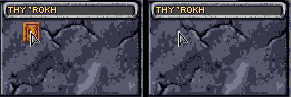

# Test log: spells kept on the Effects screen, Wake of the Ravager (2026-11-21)

Under test: SL's "effects_click_low"/"_high" at the sequel's 8B08Fh and 8B09Fh (the same bytes:
7C51h to 7C73h, 7D41h to 7D63h), and the Options switch (`effects_kept`, ravager.skipped).

## Found first

- The Effects screen's handler for an effect's icon is SL's (likeness 40 of 48 at 8B05Fh): the psionic
  powers' range EBh-10Ch (SL's 8Ah-ABh), the effects 10 bytes each at selector 370h:24Fh, the way out
  at 8B104h. The two "not a psionic power" jumps now go there, as in SL.
- The rest of SL's Effects screen (the weapon kinds, the kits' pages: ef_rows, ef_click) waits on
  the mod's weapon specializations and kits, which the sequel doesn't have yet.

## In the game (ravager-roost, about 03:15 UTC)

- USE (22,17), Thy'rokh's portrait (70,117), the cast icon (97,171): CLERIC LEVEL 1 (hovering names
  each spell in the bar: Bless, Curse, Cure/Cause Light Wounds, Entangle, Invisible to Undead,
  Protection from Evil, Remove Fear, Cause Fear, Sanctuary). Protection from Evil (195,73), then her
  portrait (70,110): cast. EFFECTS (122,171): its icon at (175,58).
- Two clicks on the icon: the spell stays. Control (`RAV_SKIP=effects_click_low,effects_click_high`):
  one click and it is gone.
  
- A psionic power's click (still ends it) not tried.
- No water seen: the Roost's room only.
