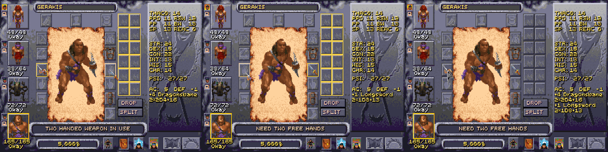

# Test log: half-giants' two-handed weapons, Wake of the Ravager (2026-11-21)

Under test: DSCLOG2's TWO_HANDED (INT E4h at 77976h and 77A0Dh, SL's PROBE_TWO_HANDED at 6F33Fh and
6F3CCh): with RULE_HALF_GIANT (the Options tab's "half_giant_hands") a half-giant may hold a two-handed
weapon in one hand and something in the other.

## Found first

- The sequel's inventory routine that puts an item in a hand is SL's (7761Bh): the character on show at
  (load + 3E71h):0B44h (its own read at 77636h, the selector 370h's; DSCLOG2's USE_WHO_SEG/OFF already),
  the item types 0Fh bytes at DS:19CDh with the two-handed bit at +0Bh 40h (SL's +0Fh), the messages
  "Two handed weapon in use" (77976h: the other hand's item) and "Need two free hands" (77A0Dh: the one
  going in). "Cannot use two heavy weapons" (over 30 each, +2) stays the game's.
- The sheet's race at +12h (5 a half-giant: Gerakis). The sequel has no cahulaks, so SL's exception for
  them isn't needed.
- Two-handed in the starting party: only Thy'rokh's weapon (type 52, the Bone Dragonsbane); Gerakis's
  own two weapons are one-handed.

## In the game (ravstart.sh, RAV_LOADER=1, about 08:55 UTC)

Gerakis's right-hand weapon made type 52 in memory (a test edit; DOSBox stopped after, nothing saved),
the inventory (I) and Gerakis's box. The rule switched by writing DSCLOG2's header (the dice log's
set_rules, 0x80008205 on, 0x80008005 off).

- Rule on: the Longsword taken out of the left hand and put back: taken; again with the two-handed
  weapon taken out and put back beside the Longsword: taken. The helper's count went 3, 4, 5.
- Rule off: the Longsword back beside the two-handed weapon: "TWO HANDED WEAPON IN USE", refused; the
  two-handed weapon back beside the Longsword: "NEED TWO FREE HANDS", refused.
  
- No water: the street in Tyr only.

## Not done

- A fight with a two-handed weapon in one hand and a weapon in the other (the two-weapons rule then
  takes the second as the off hand's, as in SL).
