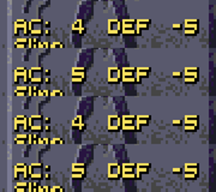
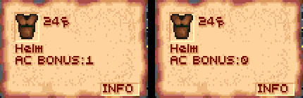

# Test log: helms count AC 1, Wake of the Ravager (2026-11-21)

Under test: SL's helm rule (RULE_HELMS, the Options tab's "helm_ac") on the sequel: DSCLOG2's
PROBE_HELM_AC at the AC function's two reads of a worn item's type's AC (5D663h, 5D67Bh) and
PROBE_BOX_AC at the item box's AC BONUS (9A4B7h), and RavGameData.counted_ac for the Loader's window.

## Found first

- The sequel's helms, from the items in OBJEX.GFF (their type +0Ah, name +14h) and the type table in
  memory (15 bytes a type, AC at +0Eh, 80h at +0Bh: counts for AC; slot +05h, 06 the head):
  - type 55, AC 0: ten Helms (some +1, one +3) **and two Hats** (name 27h);
  - type 56, AC 1 of its own: one Helm and the Helm of Domination.
  So SSI already gave one kind of helm AC 1. The rule makes a type-55 item **named Helm** (24h)
  count AC 1; a hat of the same type stays 0.
- SL's helm types (5, 89, 109) aren't the sequel's (its 5 is Scale Armor): the window's AC
  (game.counted_ac) had been reading type 5's AC as a helm's. HELM_TYPES is now () for the sequel.
- The AC function keeps its worn list at [BP-324h], 10 bytes an entry, the item at +0 (DI the index).
- No helm in our saves: the test made Ar'Anda's worn "Armor" (item 0, type 32, AC 1) a Helm or a Hat
  by a memory edit (type and name), never saved.

## In the game (ravager-roost, about 04:20 UTC)

- The inventory's AC for Ar'Anda, top to bottom: as saved (4); a Helm, rule off (5); a Helm, rule
  on (4); a Hat, rule on (5).
  
- A right click on the Helm: "AC BONUS:1" with the rule on, "AC BONUS:0" off.
  
- The Loader's own count (counted_ac) agreed each time: 4, 5, 4, 5.
- No water: the Roost's room only.
