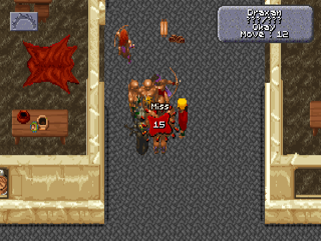
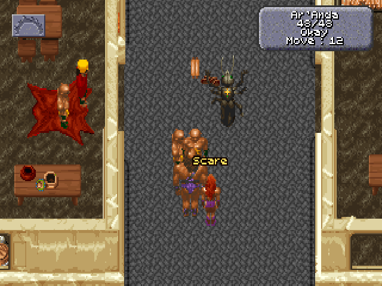

# Test log: names over figures, Wake of the Ravager (2026-11-21)

Under test: DSCLOG2's LABELS (DSCLOG's names floating over figures) with three new interrupts:
PROBE_CAST (`spell_cast`, 80585h: INT D2h, a spell cast recorded), PROBE_SCROLL (`scroll`, 20230h: INT
D3h, the map's main loop: labels placed and erased), PROBE_TICK (`tick`, 3DA2Ch: INT D4h, the timer:
labels put again), and the Loader's dice log writing labels.py's slots (ravlog.RavDiceLog: the slots
made writable, their time ticked off).

## Found first

- The sequel's twins: the cast routine 80580h (SL's 772A5h; its spells run to 148h), the main loop's
  "call far 35B9:0034" at 20230h (SL's 3118:002E at 1CAACh), the timer handler's first instruction at
  3DA2Ch (SL's 3925Ch), the routine drawing a rectangle of the view again 21E0:128Ch (SL's 1DF3:142Fh;
  the game's own call at 2CB06h, the same eight arguments).
- DS: the view CAM_X/CAM_Y 1408h/140Ah, the map's object list (far pointer) 67B7h, its count 264Eh,
  SCREEN_IS 0DABh (1 on the map, read in play), the map things from 67BBh, 25h bytes each (SL's 32): the
  feet at +0Ah/+0Ch (SL's +9/+0Bh; `ravfight.py`'s +3/+5 is the figure's top left, about 30 above).
- DSCLOG2's header now has DSCLOG's +238 (the DAC's offset in its far block: DSCLOG2 reads the palette
  about once a second, for the labels' colours) and +1834/+1838 (the slots' segment and offset: in
  DSCLOG2's own resident part, not a tail).
- Unlike DSCLOG, which draws the whole view again when it scrolls, DSCLOG2 draws again the label's two
  possible places (where it was, and where the game's copy of the screen moved it).

## In the game (a new game, `RAV_LOADER=1 sh ravscare.sh`, the Draxans' ambush, about 00:25 UTC)

- `ravdice.py` (now given the sequel's folder for its font) attached; `ravfight.py fight` ran the party.
- **"Miss"** over the figure an attack missed (33 misses in the log; the frames caught several), gone
  after 1.5 s with the floor and figures drawn back cleanly.
  
- **"Scare"** over Ar'anda as she cast it from USE (level 2, the third icon), staying over her as the
  view scrolled to the target, no trace left after.
  
- Test labels over party members 0-3 (a separate script, the helper's memory only): drawn over their
  heads; cleared, the view drawn back with no marks.
- The party then lost the fight, as it does when left to the script (the LOAD screen).

## Not done

- The charge lines' labels ("Armor: 7 left") need the effects' pass, not ported yet; the archers'
  arrows-left labels (quiver.py) too.
- No water seen: the street in Tyr only.
