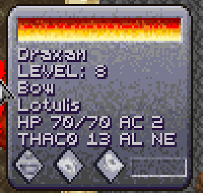

# Test log: the monster's lines in the Look box, Wake of the Ravager (2026-11-21)

Under test: DSCLOG2's PROBE_LOOK (patch `look`, 640FBh: INT DAh for "mov si,ax / mov word
[bp-0Ah],0"; SL's 5FCDAh) and RavDiceLog's answer (ravlog.monster_lines).

## Found first

- The Look box's routine is SL's a little rewritten: the combatant in DI (SL's [BP+0Ah]), the status
  lines' count in [BP-0Ah] (SL's DI), the text routine -20h from the patch, the box's colours F3h, AFh.
  Found by its "push dword 001E0006h" (the first status row's place), the only one in the program.
- The sequel's damage resistance isn't SL's kinds table. Its routine (85052h) reads a class byte at
  the creature's +0Fh (0 for people, 2 the Giant Skeletons): DS:2588h a word a class (18) of kinds it
  takes none of (its weapon kinds only from weapons below the magic its bits B000h say), DS:25ACh a word
  for each of the first 7 of kinds halved. Class 2: 7FFh (every spell: they carry 200h; psionics) and
  half from cold and edged; 9 and 10 need +1 and +2 weapons; 16 FFFFh. Then it halves or stops some
  kinds by the creature's own active resistances, which the box doesn't count.

## In the game (`RAV_LOADER=1 sh ravscare.sh`, the Draxans' ambush, about 03:00 UTC)

- `ravdice.py` running, Escape from the USE screen, right-clicks to the eye (arrow, sword, eye), a
  slow press on a Draxan in the house left of the street (its place from `ravfight.py state`, the
  body about +5, +8 of it): the box shows the game's LEVEL 8, Bow, Lotulis, then "HP 70/70 AC 2" and
  "THAC0 13 AL NE"; the dice log says "Look: Draxan: HP 70/70, AC 2, THAC0 13, 2 attacks a round,
  neutral evil."
  
- Draxans are class 0: no defence line. The Giant Skeletons (class 2) are far off in this fight and on
  the town's side: their "IMM SPELLS PSI" is from the unit tests only.
- No water seen: the street in Tyr only.

## Not done

- DSCLOG's PROBE_UNLOOK (the whole description in the dialogue window as the box closes).
- A creature's own resistances (its active effects), as SL's box doesn't count them either.
