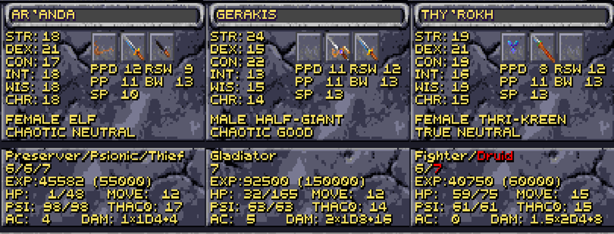
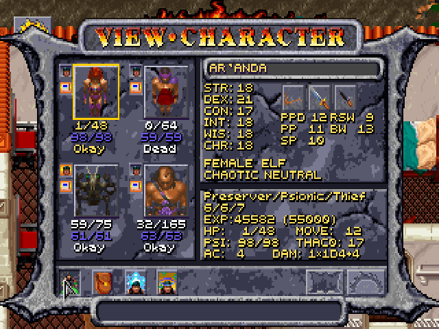

# Test log: saves, MOVE and THAC0 on View Character, Wake of the Ravager (2026-11-21)

Under test: DSCLOG2's PROBE_VIEW (patch `view`, 987FBh, SL's 8A471h: INT D9h for the "push dword
000B0140h" after View Character's panels are drawn), the port of DSCLOG's.

## Found first

- The sequel's View Character screen is SL's, and so is its code: the text routine, the window's
  segment and the character's selector at the same distances before the patch (-1A9h, -1B4h, -19Bh),
  the character at [sel:0B44h] (as on the inventory).
- The creature's movement at +13h (SL's +1Bh), THAC0 +16h, the saves the sheet's +31h to +35h.
- The game's text routine changes ES: the saves are read before the first line is drawn (the first
  try showed PPD right and the other four as garbage, ":5", ":0").

## In the game (ravager-roost, `sh ravload.sh ravager-roost`, about 02:30 UTC)

- The bar's top-left icon (22,17), then VIEW CHARACTER (47,171). The portraits on it at game (70,56),
  (120,56), (70,117), (120,117).
- Ar'anda: PPD 12 RSW 9 PP 11 BW 13 SP 10, MOVE 12, THAC0 17 (the inventory's numbers, 2026-11-20).
  Gerakis: 11 12 11 13 13, MOVE 12, THAC0 14. Thy'rokh: 8 12 11 13 13, MOVE 15, THAC0 15. Placed as in
  Shattered Lands: under the item icons, and right of HP and PSI.
  
  
- No water seen: the Roost's room only (as before).

## Not done

- SL's GEAR_WAIT (the screen drawn again once the Loader gives a new character gear) isn't ported:
  the sequel's creation screen gets no gear from the Loader yet.
- The numbers are the sheet's (no Loader's STATS with effects), as on the inventory.
