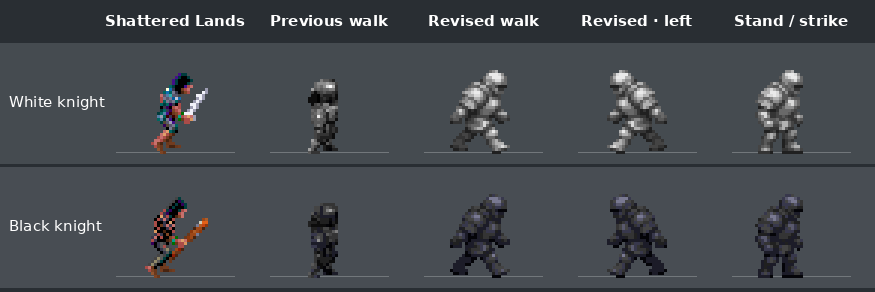
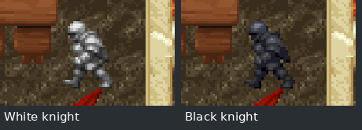
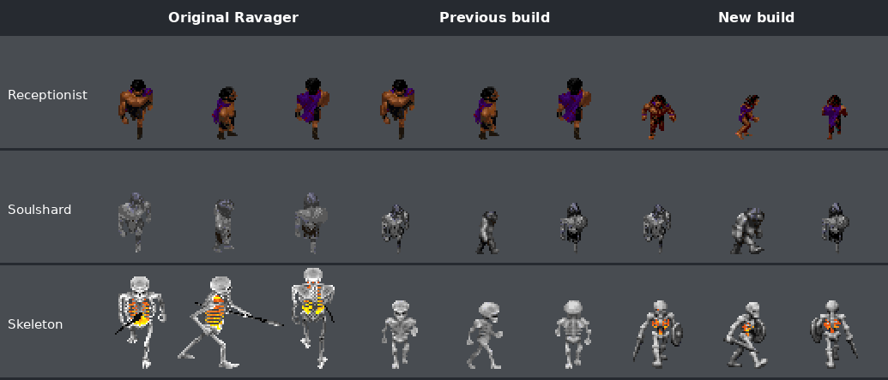
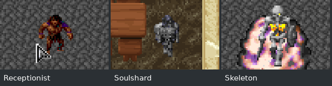

# Wake of the Ravager figures in the Shattered Lands style

(The pictures this log links to show the games' art: they are kept in the owner's private repository, not
in this public one, so the links here lead nowhere.)

Project handoff, 22 November 2026. The goal is to make *Wake of the Ravager* characters read naturally beside the *Shattered Lands* party while preserving the details that identify them in Ravager. This review build changes **18 picture IDs**. The white and black knight profiles have the owner's approval. **The next revision is the Soulshard**: its side silhouette looks heavier than its front, and the approach walk still feels stiff.

The implementation lives in the companion builder repository. This project log holds the visual decisions and playtest evidence. [Builder snapshot](https://github.com/daaki85/darksun-recompiled/tree/82d7d6f857a891651bc531c9b78576150e8be08d) · [Figure catalog](https://github.com/daaki85/darksun-recompiled/blob/82d7d6f857a891651bc531c9b78576150e8be08d/docs/RAVAGER-FIGURES.md)

## Art direction and process

1. **Identify the game picture before choosing a replacement.** Several named actors can use one picture. Inspect the regular frames, combat frames and animation script. The receptionist has a single interleaved bank of 27 poses, while its Ravager counterpart stores the same drawings across two banks.
2. **Choose a body by silhouette and action.** For human characters, start with a Shattered Lands counterpart and recover the Ravager costume and signature actions. For monsters, redraw around the original Ravager silhouette using the steeper viewing angle. The approved knights are an exception among humans: their rounded plate and enclosed helmets carry their identity.
3. **Compare at game scale and in motion.** Decode the stock and revised data, align the feet, use the same Ravager palette, and show a Shattered Lands reference at the same enlargement. Inspect the front-to-side change, foot contacts, mirrored gait, and recovery after a strike. A good still can conceal a disappearing helmet or a torso that changes volume when it turns.
4. **Encode and test.** Convert the artwork to indexed game frames and connect each pose to its script slot. Check frame references, anchors, mirroring, movement and return-to-stand steps. Decode the output again for the review GIF. In DOSBox, use opening-scene actors as stand-ins to check scale and readability against Tyr's ground. A stand-in check establishes what appeared on that map; the actual encounter remains a separate test.

## What changed

| Picture IDs | Figure | Current state |
|---|---|---|
| 3605, 3606 | White and black knights | Approved profiles. Redrawn side stance, mirrored walks, melee and recovery. Both walks seen in Tyr. |
| 2424 | Receptionist | Dressed Shattered Lands body used by the 2408 recipe. Purple sash and all 27 slots retained. The fall and three bow poses use scaled Ravager art. Seen as a stand-in. |
| 2539 | Soulshard | Six-beat front and rear walks, redrawn stone shoulder in side walk and idle. Profile seen in Tyr. Proportion and gait review open. |
| 1753 | Plain skeleton | Orange ribs, shield and sword restored through the directional walk. Seen as a stand-in. |
| 1754 | Skeleton warrior | Red cloak clears the shin and the sword reads in profile. Walk verified in game data. |
| 2411 | Thief | Ravager headband, pale shirt and original unarmed attack with a revised side walk. Walk verified in game data. |
| 2555 | Umber hulk | Raised forward claw, clearer feet and a longer planted beat. Walk verified in game data. |
| 2850, 2852–2855, 2858–2861, 2863 | Ten verini colors | Shared stocky gait and low tail with variant-specific shading. White seen in Tyr; all ten verified in the built frames. |

### Why the knight profiles changed

The first side stance stacked the helmet, pauldron and boots into a narrow column. In the approved pass the visor projects past the near shoulder, the legs separate on contact and the helmet remains visible through recovery. The black plate uses consistent highlights through the walk and strike.





### How the human and monster approaches differ

Each column below shows front, side and rear movement. The receptionist keeps the sash on its new body. The skeleton carries its shield and blade as it turns. The Soulshard's new side shoulder recovers a feature lost in the previous pass. Comparing its side and front in the right column also shows the current thickness mismatch.





[Receptionist and Soulshard profile captures](img/ravager-figure-redraws/Ravager-receptionist-and-monsters-side-test.png) · [Ten verini color variants](img/ravager-figure-redraws/verini-built.png)

### Earlier comparisons

These studies document how the decisions were made. They predate the final knight profiles and the receptionist, skeleton and Soulshard revision above.

- [Original Ravager, revised and Shattered Lands creature walks](img/ravager-figure-redraws/three-way-creatures.gif)
- [Three-way comparison for the thief, tan verini and knights](img/ravager-figure-redraws/three-way-thief-verini-knights.gif)
- [Front, right, left and rear walks beside the Shattered Lands party man](img/ravager-figure-redraws/ravager-walks-built.gif)
- [Eleven additional named picture records](img/ravager-figure-redraws/eleven-ravager-records.png) and [the psurlon and dust devil in both games](img/ravager-figure-redraws/eleven-shared-creatures.png). Keep the existing Ravager animations for those two visually shared designs.

## Reproducing the review build

Use the linked builder snapshot and the existing local playtest setup: stock Ravager in `/tmp/playtest/rav`, Shattered Lands in `/tmp/playtest/inst`, and the Obsidian Edition party build in `/tmp/playtest/sl_mod`. From the builder checkout, with Pillow, NumPy and the Obsidian Edition loader available to Python, run:

```sh
PYTHONPATH=/path/to/darksun-obsidian-edition/obsidian-edition \
  python tools/proto/build_review_figures.py /tmp/playtest/rav/OBJEX.GFF OBJEX-reviewed.GFF
```

The review builder selects the 18 IDs above from the broader figure build. A clean run against stock reproduced every game-resource payload in the reviewed download; the GFF index may lay out equivalent chunks at different offsets. Use the output in a test copy of the game. [Earlier setup and playtest notes](2026-11-20-ravager-sl-figures.md) · [Dressed people and stand-in tests](2026-11-21-ravager-dressed-people.md)

## Plan and outstanding work

| Priority | Work | How to judge the result |
|---|---|---|
| 1 | **Soulshard proportions and motion.** Compare shoulder and chest width across front contact, passing pose, side contact and idle. Redraw the front transition with a visible transfer of weight and opposite arm swing; tune the side thickness against it. | A front-to-side turn reads as one stone body. The approach alternates supporting legs at native resolution. Verify the new sequence in DOSBox on the grey Tyr street. |
| 2 | **Validate the remaining walks.** Check the thief, red-cloaked skeleton warrior, umber hulk and remaining verini variants in this build. Revisit the hulk's green eyes and the head-to-shoulder separation on the verini. | Record the exact build, picture, facing and actor used. Check walking, turning, stopping and combat recovery in representative terrain. |
| 3 | **Extend the humanoid pass.** Use the roster and existing dress recipes to select subsequent figures. Review red Draxan and templar attacks, the Wren and mul strikes, and costume cues such as the cloth and apron. | The selected body fits the camera angle and retains the character's distinguishing clothing and action. Verify actual slot order before adding each ID to the review build. |
| 4 | **Triage exceptional creatures.** Inspect the intellect devourer's feet at native size. Capture the Tarrasque assembly, earth drake on its terrain and Rybochka's two-pose transition in their encounters. | Establish how each resource is used in play before deciding on a redraw. |

The wider catalog also records party replacements, creature swaps and dressed NPC experiments. Branch-wide tests can involve different builds. In particular, the separate shade-reduction experiment recorded its own skeleton, Soulshard and tan verini observations. [Shade-pass playtest](2026-11-22-restyled-creatures.md)
