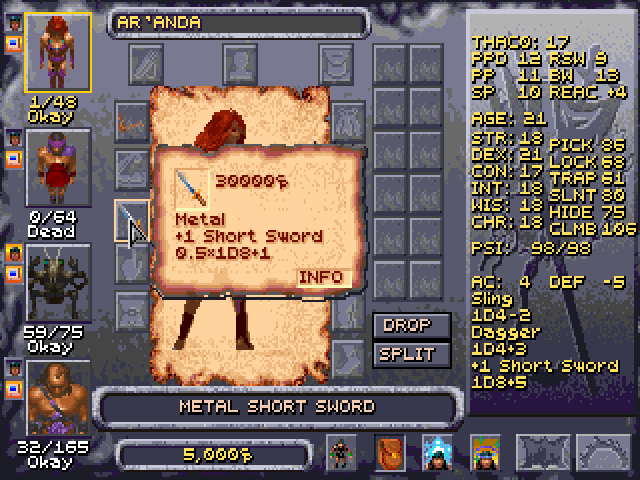
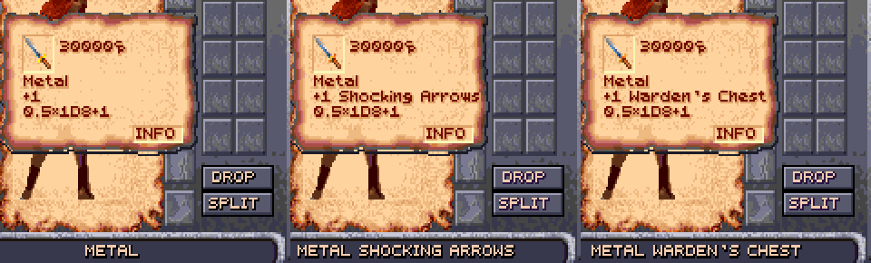
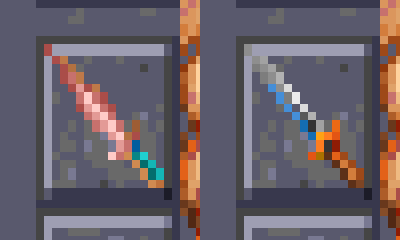
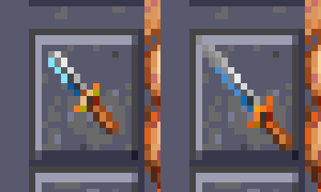

# Test log: the mod's item names in Wake of the Ravager (2026-11-22)

Under test: DSCLOG2's ITEM NAMES (SITE_NAME, site 42). The party transfer's items need names the sequel
lacks (49 of the mod's alone), and adding lines to the game's list breaks the game
([the item types' log](2026-11-22-ravager-item-types.md)).

## Found first

- The names' loader (68F03h-6E04Fh in the file): TEXT 1000 read into a block (DS:55BEh), then a table
  of 256 far pointers at DS:56F3h, all first pointed at an empty string, then one a line (line k is
  name k + 1; name 0 is the first line too, "Tombstone"), with no bound. That is why more lines broke the game: they ran past the table.
- An item's name is a word (+14h), and the game reads the table in 7 places, each
  `push dword [bx+56F3h]` with BX the number x4 (file 5E496h, 768A3h, 7B036h, 7B081h, 98CAAh, 9A227h,
  9A252h).
- So the 7 reads became SITE_NAME: below 256 the game's entry; 256 to 415 DSCLOG2's ITEM_NAMES, which
  the Loader writes as it attaches (header +196 the offset, +198 the room: 160 names of 16 bytes); past
  them an empty name. The mod's names sit at 256 + their SL entry less 142h (the Short Sword at 258).

## In the game (ravager-roost, the Loader's way, `ravdice.py` attached, about 23:35 UTC)

- Test edit (never saved): Ar'anda's +1 Longsword's name word set to 258. The box, the name line and the
  stats column read **"+1 Short Sword"**, "METAL SHORT SWORD". 
- 1000 (past the room): an empty name ("+1", "METAL"); 300: "+1 Shocking Arrows"; 270: "+1 Warden's
  Chest", the Loader's names at their places. 
  (A first build pushed name 0 for 1000, which showed "Tombstone": fixed to an empty name.)
- Control: 26, the sword's own: "+1 Longsword", "METAL LONGSWORD".
- DOSBox and the dice log stopped by pid, nothing saved.

Water: no new area.

## Icons: Shattered Lands' pictures in the sequel (about 23:50 UTC)

- The sequel's item pictures are its own format (a 0FFh row, "PLNR": wotrart.py), but **it draws a
  Shattered Lands picture as it is**: in a copy of the game folder, the Longsword's icon (BMP 2028)
  replaced by SL's long sword's (object 1013) showed in Ar'anda's hand, in the wrong colours (pink and
  teal: SL's palette numbers in the sequel's palette). Left, beside the sequel's own:
  
- With its colours mapped to the nearest of the sequel's 104 stable colours (RESOURCE.GFF's PAL 1000
  entries that no region palette changes; the inventory's palette is PAL 1000 for 173 entries), the
  mod's Short Sword (2427) shows in its own steel and brown, beside the sequel's longsword:
  
- So each transferred item's picture can be Shattered Lands' own (the mod's icons too, made at the
  Loader's run from the player's files), its colours mapped. DOSBox stopped by pid, nothing saved.
