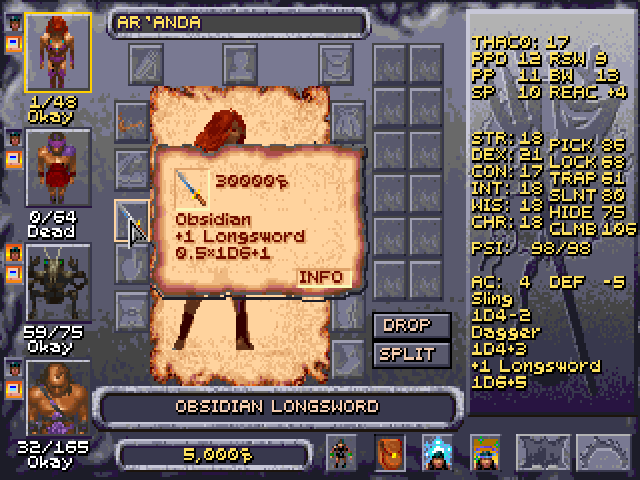
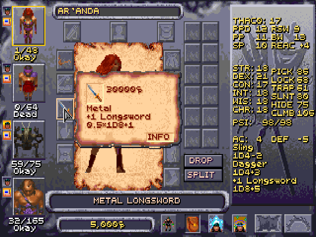

# Test log: the mod's item types in Wake of the Ravager (2026-11-22)

Under test: the Loader's copy of the sequel's OBJEX.GFF (D:\OBJEX2.GFF, opened in place of OBJEX.GFF by
DSCLOG2's PROBE_DOS_OPEN, bit 4 in COPIED). The copy has the mod's 33 item types after the sequel's own
(`ravager.objects_fixed`). This is the first step of the party transfer
([the design](../../reports/wake-of-the-ravager-party-transfer.md)).

## Found first

- **The sequel's item types are data, not program**: OBJEX.GFF's chunk ALL 4, 1,530 bytes, which is 102
  types of 15 bytes. The far pointer DS:19CDh points at it in memory (72B9:0004 in ravager-roost), and
  the item names' block (ALL 5, "Tombstone", "Olive Branch"...) follows it there.
- **The game reads the chunk at its own length**: in a copy of the game folder with 3 types added (copies
  of type 97 with a marker byte), memory held 105 types and the names after them. So the Loader needs no
  hook to add types: it writes a longer chunk.
- Shattered Lands' 20-byte types convert to the sequel's 15 bytes: the words at +2, +4 and +6 become
  bytes (none of the mod's is over 250), and +8 to +12h move up 4. The mod's SL types 115-147 become the
  sequel's 102-134 (`ravager.mod_type`).

## In the game (ravager-roost, about 22:55 UTC)

- `ravload.sh ravager-roost` started the Loader's way. Memory held 135 types, and 102-134 were byte for
  byte the converted mod types.
- Test edit (never saved): Ar'anda's +1 Longsword (item 2, type 97) given type 107 (the mod's obsidian
  short sword, SL's 120). Inventory (I), her portrait, a right click on the sword: the box reads
  **"Obsidian +1 Longsword 0.5x1D6+1"** and the name line "OBSIDIAN LONGSWORD"; the stats column
  "+1 Longsword 1D6+5". 
- Control: the type set back to 97, the box reopened: **"Metal +1 Longsword 0.5x1D8+1"**, "METAL
  LONGSWORD", "1D8+5". 
- So the game reads a type past its own 102, its material and its dice. DOSBox stopped by pid, nothing
  saved.

Not seen yet: a fight with a mod type (the dice log's damage), and the class bits (who may use it).
Those come with the transferred items.

Water: no new area.
