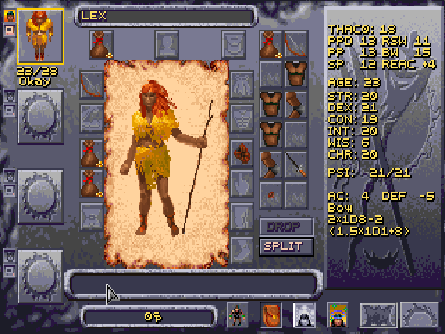

# 2026-11-22: the transferred party's items in Wake of the Ravager

*Branch `claude/ravager-party-transfer`. The transfer with the Loader's own objects
(`dsloader/ravitems.py`, `ravtransfer.with_added`), played in the sequel with a control.*

## The run (about 23:00 UTC)

- `python -m dsloader.ravtransfer saves/trap-user RAVAGER_FOLDER SL_FOLDER DOS_FOLDER` on a copy of the
  sequel's folder: every item of the party that has no ITEMS.BIN pair became an object of the Loader's
  (20000 + its SL object), written to `dos/RAVITEMS.GFF`; the Loader's OBJEX2.GFF took them in.
- The sequel started the Loader's way (`ravstart.sh`, `ravdice.py` attached, so DSCLOG2's item names are
  written). Title menu, CREATE CHARACTERS, a slot's ADD, Lex (the transferred fighter), ADD, the
  inventory icon.
- Lex's inventory: **20 Shocking Arrows** in the quiver, **Ring/Protection+1** on a finger, **Bone Short
  Sword** in hand (its box: "0.5x1D6-1 Hit -1", the mod's bone blade), the **Pot of Water** as a keepsake
  with Shattered Lands' own picture, and the paired Gem and Leather Armor as CHARTRAN gives them. Each
  picture in its own colours (mapped to the sequel's stable ones).
  
  The item boxes: 
   

## Control

- The same save transferred without the SL folder (CHARTRAN's way): money bags in the quiver, the hand
  and the finger, where the arrows, the sword and the ring were.
  

## Still to do

Scrolls' spells (the item power is 0 for now), spell-made weapons, free roster slots, aging, and the
mod's effects (groups B-G of reports/wake-of-the-ravager-party-transfer.md). Not yet seen: the sword's
dice in a fight (the dice log doesn't yet name items past 256).

DOSBox and the dice log stopped by pid, nothing saved. Water: no new area.
