# 2026-11-22: the transferred party's items in Wake of the Ravager

*Branch `claude/ravager-party-transfer`. The transfer with the Loader's own objects
(`dsloader/ravitems.py`, `ravtransfer.with_added`), played in the sequel with a control.*

## The run (about 23:00 UTC)

- `python -m dsloader.ravtransfer saves/trap-user RAVAGER_FOLDER SL_FOLDER DOS_FOLDER` on a copy of the
  sequel's folder: every item of the party that has no ITEMS.BIN pair became an object of the Loader's
  (20000 + its SL object), written to `dos/RAVITEMS.GFF`; the Loader's OBJEX2.GFF took them in.
- The sequel started the Loader's way (`ravstart.sh`, `ravdice.py` attached, so DSCLOG2's item names are
  written). Title menu, CREATE CHARACTERS, a slot's ADD, Lex (the transferred fighter), ADD, the
  inventory icon.
- Lex's inventory: **20 Shocking Arrows** in the quiver, **Ring/Protection+1** on a finger, **Bone Short
  Sword** in hand (its box: "0.5x1D6-1 Hit -1", the mod's bone blade), the **Pot of Water** as a keepsake
  with Shattered Lands' own picture, and the paired Gem and Leather Armor as CHARTRAN gives them. Each
  picture in its own colours (mapped to the sequel's stable ones).
  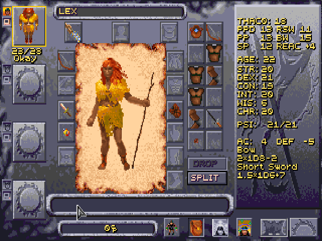
  The item boxes: 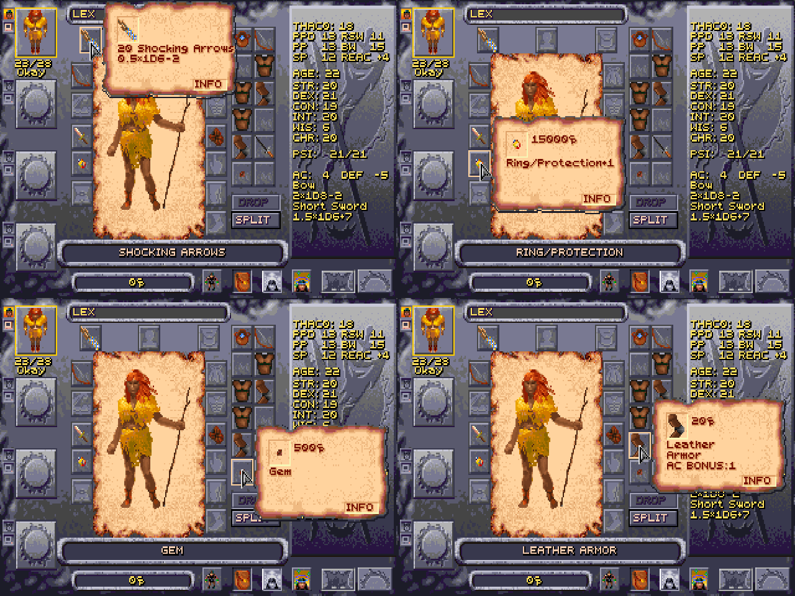
  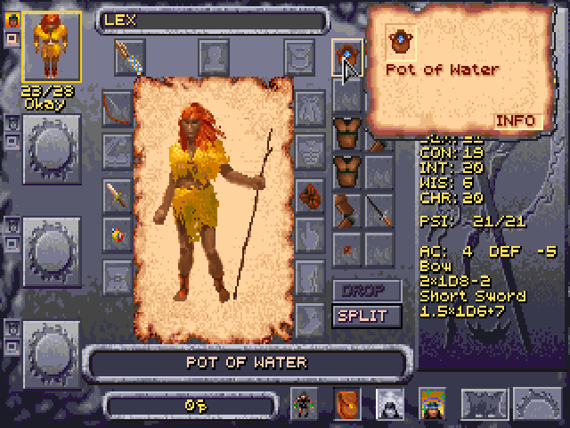 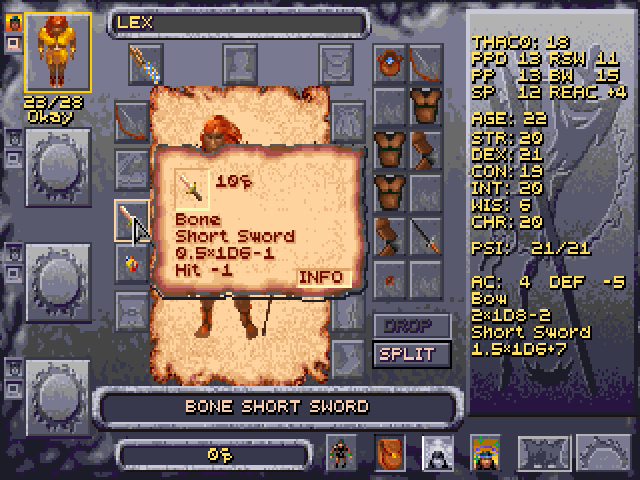

## Control

- The same save transferred without the SL folder (CHARTRAN's way): money bags in the quiver, the hand
  and the finger, where the arrows, the sword and the ring were.
  

## Still to do

Scrolls' spells (the item power is 0 for now), spell-made weapons, free roster slots, aging, and the
mod's effects (groups B-G of reports/wake-of-the-ravager-party-transfer.md). Not yet seen: the sword's
dice in a fight (the dice log doesn't yet name items past 256).

DOSBox and the dice log stopped by pid, nothing saved. Water: no new area.

## Scrolls keep their spell (about 00:10 UTC, 23 November)

- What the files say: SL's wizard scrolls (type 60h) and priest scrolls (63h) name their spell at +2, one
  past SL's number. The sequel's (types 4Dh and 4Eh) name it at +2 and at +10h, by its own numbers:
  a wizard spell's SPST place plus one (all of ITEMS.BIN's wizard pairs agree, but for 3 pairs where SSI
  chose another spell), a priest spell SL's word plus 97 (all 10 priest pairs). Its wizard scrolls are
  of two kinds: "One-use Scroll" (313xx, +0Eh 1) and "Spellbook" (310xx, +0Eh 0).
- CHARTRAN gives each SL scroll *object* one sequel object, whatever spell the item names (a defiler's
  scroll, object 1400, would come across as a scroll of spell 1), and Kalzith's scrolls (1440-1445) a
  money bag. The Loader's way (`ravtransfer.Sequel.scrolls`): the sequel's scroll of that spell (the
  one ITEMS.BIN gives, else the lowest), else its first One-use Scroll with the spell set; a spell the
  sequel lacks (the mod's new spells, the four dropped ones) gives a keepsake.
- grate-user transferred: Cromwell (fighter/preserver) carries Kalzith's Shield scroll. In the
  sequel's inventory: **One-use Scroll, 3000, the Shield icon**; its summary reads "SHIELD: Negates
  enemy magic missiles...". 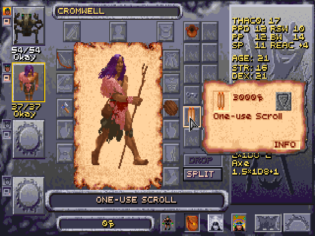
  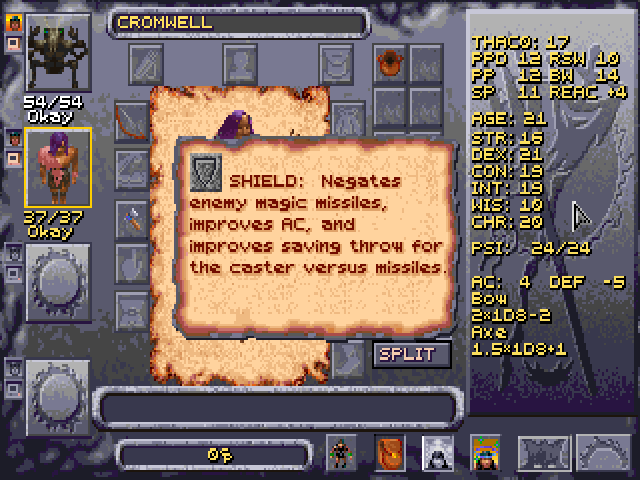 Without the Loader it is a money bag (the trap-user
  control above, and the file: `lacking` names 1440).
- Learning from it: **not seen yet**. With Shield taken out of Cromwell's spells in the copy's roster
  (a test copy, never the player's), a click on the spell icon did nothing, at the roster screen and in
  the game, for the One-use Scroll and for a Spellbook alike (the record changed to 31002 in the copy).
  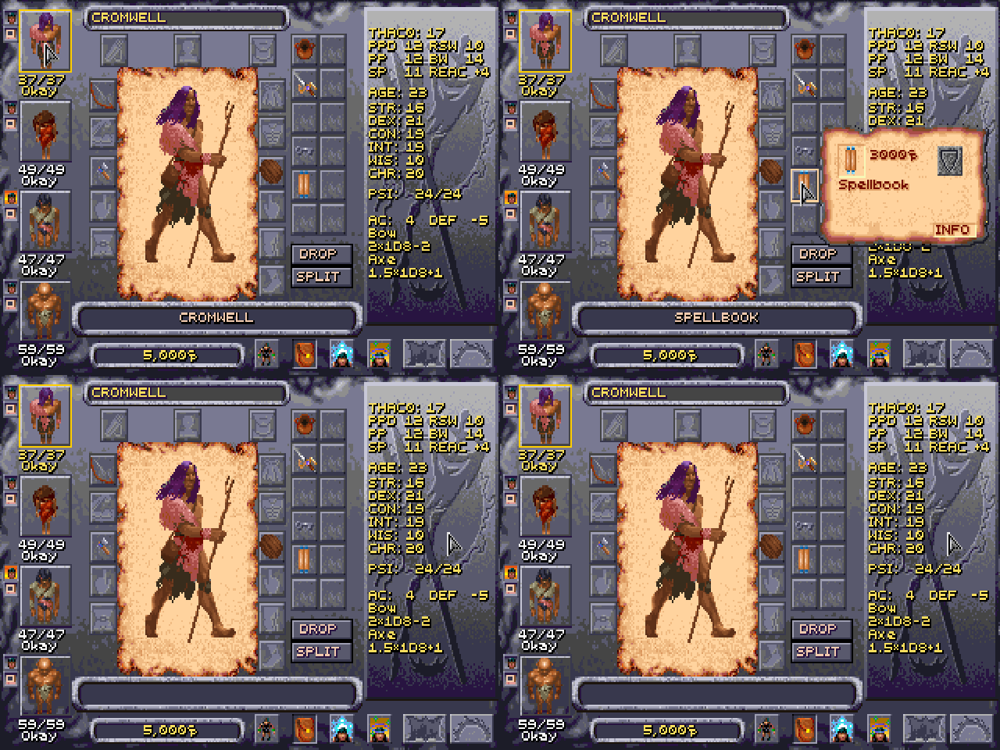 The transferred One-use Scroll had 0 uses
  (CHARTRAN copies SL's +0Eh), the sequel's own have 1: the Loader now keeps the object's. To try next:
  the sequel's own scroll as a control, out of a fight.
- **The whole transferred party in a new game**: Cenna, Finster, Balthbeorn and Cromwell added from the
  roster, START GAME: they start in Tyr (Cromwell leading), the mod's items in their packs (Finster's:
  the Warden's pieces with their pictures). 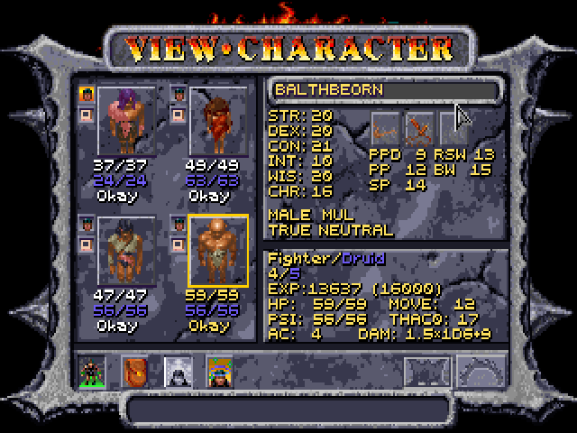
  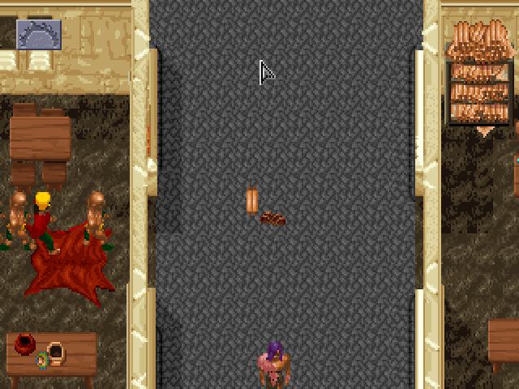 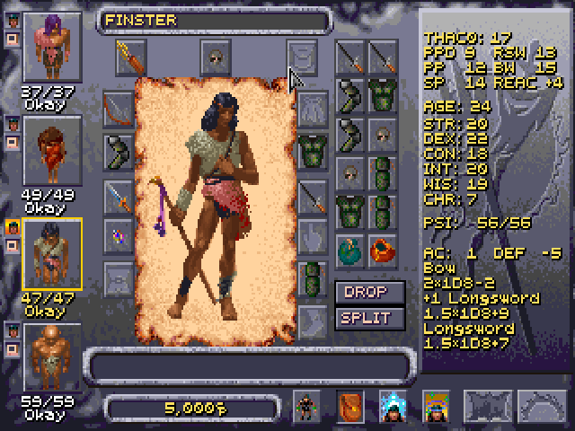
  A first try with Cromwell alone went back to the title menu soon after the opening talk: the
  opening fight (a party of one, lost). Nothing saved.
- Water: the first scene in Tyr has a red pot and a jug on the table in the room to the west (not
  looked at yet).

DOSBox and the dice log stopped by pid, nothing saved.

## The roster's places (about 00:40 UTC, 23 November)

- The install's CHARSAVE.GFF has CHAR 29-43 and 50-53, but the ADD list showed only the transferred
  four (32-35) and Clk'whrr, Meggyn, Zontorra and Borzak (36-39). The install's own 32-35 (Frin'kal and
  others) have CACT 0 and aren't listed.
- The transferred party written to CHAR 44, 45, 46 and 60 (CACT and all) instead: **none listed**, only
  36-39. 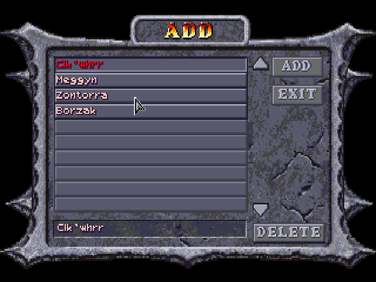 So the roster is CHAR 32-39, a place listed while
  its CACT isn't 0.
- Borzak deleted in the game (ADD list, DELETE, YES): CHARSAVE.GFF at once has CACT 39 = 0, his CHAR
  kept. 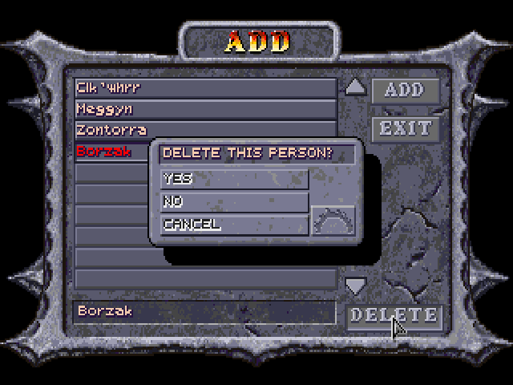
- So the Loader's transfer (`ravtransfer.places`): each member takes its earlier copy's place (same
  name), else the lowest free places (CACT 0 or none), member 0 the highest as CHARTRAN's; with too few
  it stops and says to delete characters in the sequel first. CHARTRAN writes 32-35 whatever is there.

DOSBox stopped by pid, nothing saved (the test copy's roster only).

## Ages and the months between the games (about 01:00 UTC, 23 November)

- SL keeps a member's age at the sheet's +17h (packed sheets); the sequel's Loader reads it at +41h,
  which CHARTRAN leaves 0. So in the runs above the Loader's age pass gave each transferred member a
  new random age on arrival (Cromwell 21, then 17, 13, 23 in turn), not their own.
- The Loader's way now carries it, and ages the party for the gap: `ravtransfer ... 12` (12 months:
  each member a year older for sure). grate-user's Cromwell (23), Balthbeorn (18), Finster (20) and
  Cenna (39): the report says 24, 19, 21 and 40, and the sequel's inventory shows **AGE: 40** for Cenna
  and **AGE: 24** for Cromwell (her +1 Shadowseeker and +1 Hayneedle named too).
  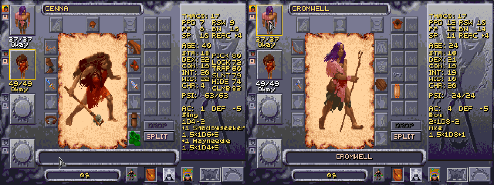
- The age categories' score changes (aging.changes, on the sheet and the creature) and the one year
  that would reach the race's most are in the tests (none of the kit's members crosses a category
  in a year).

DOSBox and the dice log stopped by pid, nothing saved.
