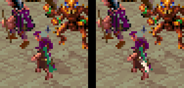

# Elf class outfits changed live in the game

Under test: the Loader dressing an elf party member in her class outfit while the game runs, and
redressing her when her classes or her gear change (what the [2026-11-22 test](2026-11-22-elf-outfits.md)
couldn't do: its Loader couldn't attach). Build: `claude/class-outfits` at c5829d6 (Codex's
revised elves), the Loader attached through `start.sh` as usual (the dice log). Save:
`pens-after-arena`, with `"autosave": false, "quick_save": false` in `obsidian-edition/settings.json`
(the test edits memory). Window 320x240.

- **The ready-made party's elf gets no outfit.** Cilla (member 3, object 305, the elf woman 2059) is a
  Preserver/Druid/Thief (class bytes 11, 6, 17). The elf outfits (`classoutfits.ELF_ROLES`) cover
  the classes an elf can take at creation, which has no druid, so `for_sheet` gives no role and she
  keeps her own clothes (the Loader's gear still drawn on them). A question for the outfits' design,
  not a fault in the Loader.
- **A class change, live**: her druid byte set to 13 (ranger) in memory: the Loader rewrote its copy
  of SEGOBJEX.GFF within a second, and both pictures of object 305 (2460 walking, 2461 fighting)
  were byte for byte `Pictures.build` of the Preserver/Ranger/Thief outfit with her sling and long
  sword. On the map she showed the slate hood, the plum mantle and its green Ranger lining at once.
  The same for Cleric/Preserver/Thief (1 for the druid), and back to 6: her own figure again, as
  built.
- **Gear changes, live**: her long sword (slot 3) taken off (slot byte 50) and put back, four times
  (`outfitcycle.py 3 3 4 6`) and twice more with the byte compare: each time the copy was rewritten
  and matched the build; the sword went from her hip and came back on the map (picture below:
  off, then on); the figure stayed drawn; the picture store took one slot more once (203 to 204,
  one STALE), then reused it.
- Not covered: the male elf (no party here has one: object 304), a cloak or boots put on live
  (the party has none to wear), and the fight pictures seen in a fight (only compared as bytes).

Tool: `outfitlive.py MEMBER classes=C1,C2,C3 slot=SLOT` does the class change and the gear
toggle with the byte compare, and puts the class bytes back at the end.

Water: nothing new (the slave pens, as in [ROUTE.md](../ROUTE.md#water-for-resting-an-idea-for-later)).
