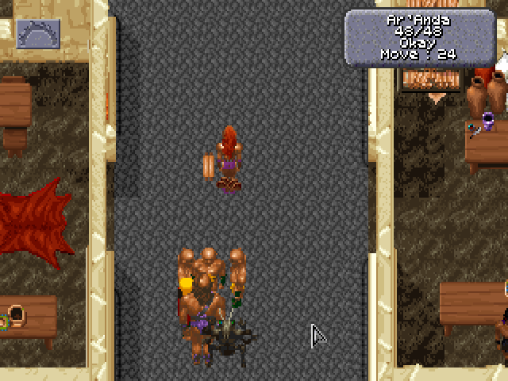

# 2026-11-23: the Boots of Speed in Wake of the Ravager (effects group E)

*Branch `claude/ravager-party-transfer`. reports/wake-of-the-ravager-party-transfer.md, group E.*

## What changed

DSCLOG2 now has SL's BOOTS_AC and BOOTS_MOVE, ported with the sequel's numbers. The boots are the
mod's type 132 (SL's 145), worn on the feet (slot 13).

- **Movement.** In a fight, a wearer's movement for its turn is doubled (BOOTS_MOVE, from CAH_MOVE at
  5B838h, where a turn's movement is stored).
- **AC.** In a fight, the wearer's AC is 2 better, unless it is Cannot Move (66), Paralyzed (69) or
  Slowed (52 or 91: the sequel has two). This is PROTECTION's site 43, putting the 2 into the AC
  function's [BP-6]. The IN_COMBAT byte (DS:13FAh) tells whether a fight is on, so the boots give
  nothing out of a fight.
- **Tests.** Checked in an emulated CPU (tests/test_ravprotect.py `test_boots_of_speed`):
  - in a fight, the boots give 2;
  - out of a fight, nothing;
  - with each of the four effects, nothing;
  - with another effect (Blessed), 2;
  - a turn's movement 60 becomes 120 on the feet, and stays 60 with the boots in another slot.

## In the game (about 00:50 UTC)

`RAV_LOADER=1 sh ravhold.sh` (the Draxans' ambush), with the dice log `--all` attached. The item edits
below were made in memory as test edits. DOSBox was stopped before the fight ended, and nothing was
saved.

- **Movement.** Ar'anda's and Thy'rokh's carried items in slot 2 were made Boots of Speed on the feet.
  Then every turn was ended until Ar'anda's next one. The turn's movement words were:

  | member | boots | movement |
  |---|---|---|
  | Ar'anda | yes | 240 (the panel's **Move : 24**) |
  | Terrannus | no | 120 |
  | Thy'rokh (thri-kreen, 15) | yes | 300 |
  | Gerakis | no | 120 |

  
- **AC.** The Draxans' attacks on the party, as the dice log works them out. Its "other" is the game's
  own AC less the log's model, which doesn't know the boots.
  - Terrannus, before the edit (no boots): "AC 2 (base 10, armour -5, DEX -3, **other +0**)", 15
    attacks.
  - Then his leg armour was made Boots of Speed on the feet: "AC 1 (base 10, armour -4, DEX -3,
    **other -2**)", 4 attacks. The -2 is the boots, and the leg armour's 1 is gone.
  - Thy'rokh, with boots: "AC -2 (base 5, armour +0, DEX -5, **other -2**)".
  - Gerakis, without boots: other -1, his own (it didn't change across the edit).

  The control is the same member before the edit, in the same fight, not a run of the old build.
- **Water:** none new (the same street).

DOSBox and the dice log were stopped by pid.
