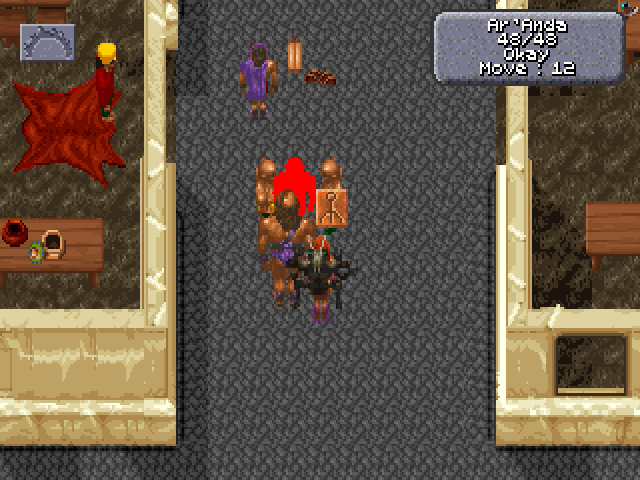
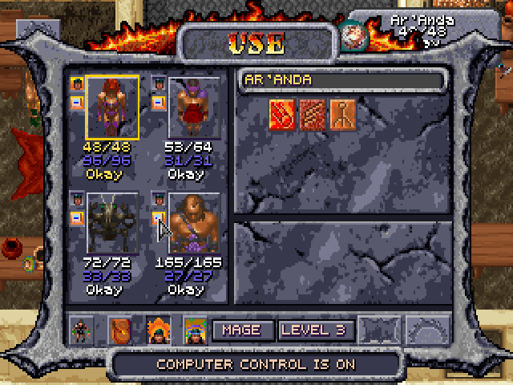
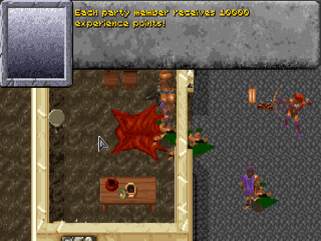

# 2026-11-23: the girdles and the Amulet of Magic Resistance in Wake of the Ravager (effects group F)

*Branch `claude/ravager-party-transfer`. reports/wake-of-the-ravager-party-transfer.md, group F. The code
is commit 1f8cbd6 (DSCLOG2's ITEM_REAR in the attack set-up, site 45 `amulet_resistance`); this log is
its play.*

## The display first (about 00:45 UTC)

The X display had hung after DOSBox vanished on a Hold Person cast (RESEARCH.md). With the user's
go-ahead it was restarted (`setsid nohup Xvfb :55 -screen 0 1024x768x24 &`: the old Xvfb was already
gone). Then the same cast on the same build (`RAV_LOADER=1 sh ravhold.sh`, Hold Person at a Draxan):
DOSBox kept running, through that cast and two more. So the earlier loss was most likely the display,
not the new code.

## The Amulet of Magic Resistance (about 00:55 UTC)

The Draxans' ambush (`RAV_LOADER=1 sh ravhold.sh`), test edits in memory, never saved:

- Draxan 26 given the amulet (its leg armour made type 131 on the neck, slot 8); Ar'anda's Hold
  Person at another Draxan: saved (16 against 13), DSCLOG2's `amulet_count` **0**.
- Then every Draxan given the amulet, and the same Draxan targeted again:
   saved (15), `amulet_count` **1**: the sequel's magic
  resistance routine (84AB5h) now ran with 15% for the wearer. By the end of that fight the count was
  4 (the party's other spells on the wearers).

No resisted spell was seen: at 15% that needs more casts than one fight gave. The roll itself is not
in the dice log (it has no line for magic resistance yet).

## The Golden Girdle of Urnst (about 01:12 UTC, the controlled run)

The ambush again, with `ravdice.py --all --numbers` (new: each target's combatant number, since the
foes share a name). Test edits, never saved:

| combatant | wears |
|---|---|
| Draxan 23, Draxan 26 | the Golden Girdle of Urnst (type 130, waist slot 5) |
| Draxan 27, Draxan 21 | nothing new (the control) |
| Terrannus, Gerakis | the Girdle of Back Defense (type 129, slot 5) |
| Ar'anda, Thy'rokh | nothing new |

Computer Control for all four , the fight to its end
 (DOSBox stopped there, nothing saved: SAVE01.SAV still
00:25). The attack bonuses (files/2026-11-23-ravager-girdles-attacks.txt):

| attacker, weapon | on 27 or 21 (no girdle) | on 23 or 26 (Urnst) |
|---|---|---|
| Gerakis, Obsidian Dragonsbane +4 (a long sword) | +8 | **+5** (4 attacks) |
| Gerakis, Longsword +1 | +3 | **+0** (1) |
| Ar'anda, Longsword +1 | +3 (the earlier runs) | **+0** (1) |
| Terrannus, Longsword +1 | +4 | not seen in this run; **+1** in the run before (3 attacks) |
| Thy'rokh, Bone Gythka +1 (not a sword) | +4 | +4 |
| a Draxan, Stone Lotulis (not a sword) | | +1, as on anyone |

So a sword's attack on the wearer is 3 worse, any other weapon's is not. `girdle_count` 6: the six
sword attacks on 23 and 26.

## The Girdle of Back Defense

Not yet seen as a line in the log: in this run nobody struck from behind at all (0 "from behind"
lines). The run before (01:03 UTC) had the Girdle of Back Defense on Ar'anda, Terrannus and Gerakis
and the Golden Girdle on three Draxans: `girdle_count` 19, of which 14 were the sword attacks on the
Urnst wearers. The other 5 are the Back Defense girdle turning off a rear attack or a backstab on
its wearers, and no "from behind" line appeared against them. That is the counter, not a sight of
it: a fight where a foe gets behind a wearer and a non-wearer (as the thieves in the alley did in
2026-11-20-ravager-dicelog.md) would show it. Left for the full play.

## Water

None new (the same street).

DOSBox and the dice log were stopped by pid each time. Nothing was saved.
