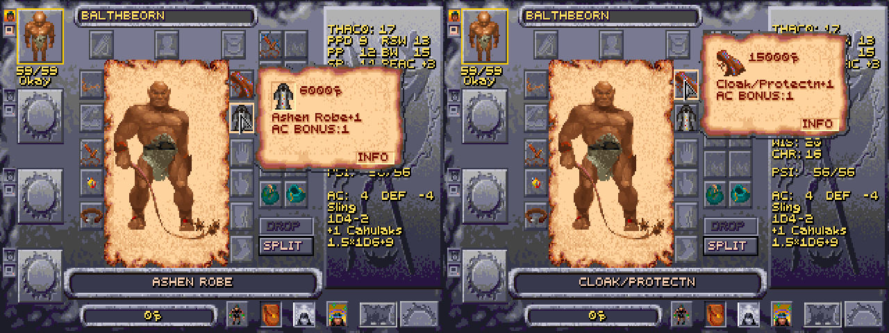
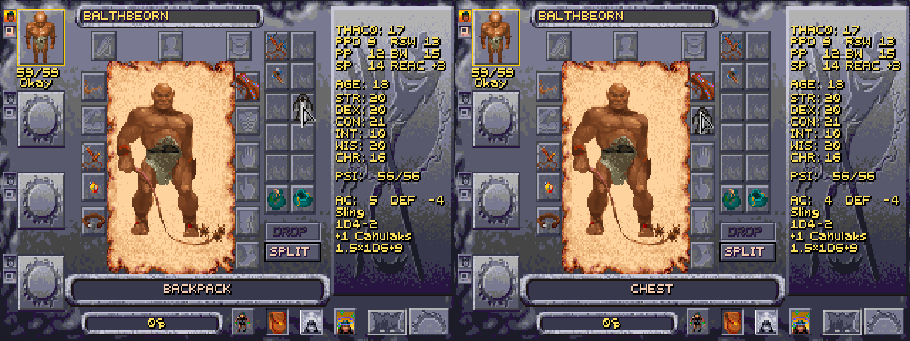
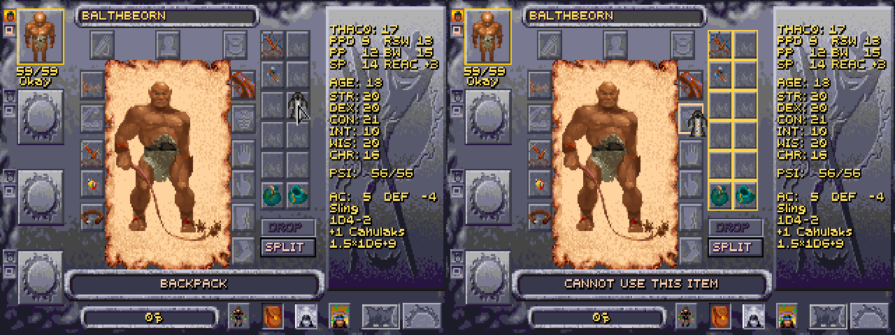

# 2026-11-23: who may wield the mod's items in Wake of the Ravager (effects group B)

*Branch `claude/ravager-party-transfer`. reports/wake-of-the-ravager-party-transfer.md, group B.*

## What changed

- DSCLOG2's class restrictions (CLASS_FORBIDS, ported from SL's restrict.py) knew the sequel's 102 item
  types only: the mod's 33 (OBJEX2.GFF's 102-134, from the transfer) had no weapon kind, so a
  psionicist could wield a mod great axe, and its Ashen Robe, bracers and Cloak of Protection counted
  as armour, which a druid, a lone preserver or a thief may not wear.
- Now `kind_of_type` goes on with the mod's kinds (SL's, specialize.KIND_OF_TYPE), and ARMOUR_TYPE
  (restrict.is_armour) leaves out bracers, robes and the cloak, for CLASS_FORBIDS and for a multiclass
  preserver's casting in armour (ARMOUR_WORN).
- Checked in an emulated CPU against SL's Python rules: every mod type for 30 class sets, human and
  not (tests/test_ravrestrict.py, 1,584 cases), and ARMOUR_TYPE on every mod type.

## In the game (about 02:20 UTC)

- grate-user transferred the Loader's way; Balthbeorn (a mul fighter/druid) added from the roster,
  his inventory: the Ashen Robe +1 on the chest and the Cloak of Protection +1. 
- The robe taken off (AC 5) and put on again: **CHEST, AC 4**, worn.
  
- Control, the build before (git's DSCLOG2.EXE): the robe off, then on again: **"CANNOT USE THIS
  ITEM"**, the robe left on the pointer, AC 5. 

DOSBox and the dice log stopped by pid, nothing saved (the test copy's roster only).
