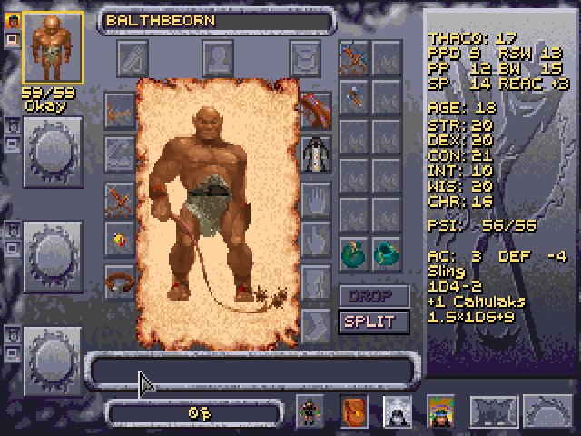
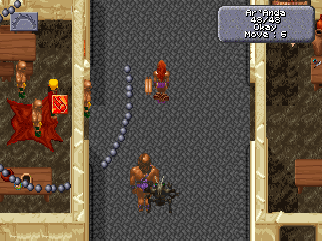

# 2026-11-23: rings, cloaks, bracers and robes of protection in Wake of the Ravager (effects group E)

*Branch `claude/ravager-party-transfer`. reports/wake-of-the-ravager-party-transfer.md, group E.*

## What was wrong

- A transferred Ring of Protection +1 is the sequel's Ring (type 45), which has no AC flag (+0Bh 0).
  The sequel's AC function skips any worn item without that flag, so the ring did nothing. Seen before
  this change: Balthbeorn's AC stayed 4 with the ring taken off.
- The mod's cloak of protection, bracers of defense and robes (types 103, 110 and 127) have the flag,
  so the sequel counted their plus. But it counted them whatever else was worn, with none of AD&D's
  limits.
- Nothing added a ring's or a cloak's plus to saving throws.

## What changed

DSCLOG2's PROTECTION is SL's RULE_PROTECTION (DSCLOG's PROBE_RING_AC, PROT_SCAN, RING_PLUS and
ROBE_PLUS) ported with the sequel's numbers. It uses two sites:

- **Site 43, `protection_ac`**, at 5D61Ah. This is where the AC function asks whether a worn item counts
  ("mov al,es:[bx+0Bh] / mov ah,0"). The rules:
  - A ring of protection (a Ring with a plus) counts only without magical armour, and of two rings only
    the better one counts (the left hand's if they are equal).
  - A cloak of protection counts only without magical or metal armour and without a shield.
  - Bracers of defense count only without armour (a helm counts as armour).
  - A robe's plus goes into the function's other total ([BP-6]), on top of the rest, as in SL.
- **Site 44, `protection_save`**, at 8360Eh. This is the start of the save modifiers ("mov si,[bp+6] /
  xor di,di"; SL's 79D47h). It adds:
  - the better ring's plus, whatever the armour;
  - the cloak's plus, under the same limits as for AC;
  - +1 on every save for the Veiled Robe;
  - +1 against a spell for the Ashen Robe (spells 0-234; the psionic powers start at 235).
- **Tests.** Both sites were run in an emulated CPU on every mix of the following, 1,152 cases in
  tests/test_ravprotect.py:
  - two rings (none, +1, +2, or a cursed -1 on the left);
  - a cloak;
  - bracers;
  - a robe (Ashen or Veiled);
  - armour (none, leather, magical leather, or metal);
  - a shield.

## In the game (about 00:00 UTC)

- **The setup.** The grate-user party was transferred earlier into `$WORK/ravT`. Balthbeorn, a mul
  fighter/druid, was added from the roster. He wears no armour, and has on the Ring/Protection +1
  (left hand), the Cloak/Protectn +1 and the Ashen Robe +1.
  
- **With the new build** (each item taken off, then put back):

  | worn | AC |
  |---|---|
  | everything | **3** |
  | ring off | 4 |
  | robe off | 4 |
  | cloak off | 4 |

  
- **Control** (`RAV_SKIP=protection_ac,protection_save`):

  | worn | AC |
  |---|---|
  | everything | 4 |
  | ring off | 4 (the ring does nothing) |
  | cloak off | 5 |

  
- **The limits on AC** (about 00:20 UTC, at the coordinator's ask). These are test edits of
  Balthbeorn's items in memory, made with a scratch script on the roster screen, and never saved. Each
  setup was read three ways: everything on, the ring taken off, then the cloak taken off.

  | setup | AC: all / ring off / cloak off | control |
  |---|---|---|
  | robe made leather armour +1 (magical) | **4 / 4 / 4**: the ring and cloak don't count | 3 / 3 / 4: the cloak counts |
  | robe made metal chest armour +0 | **3 / 4 / 3**: the ring counts, the cloak doesn't | |
  | robe made plain leather +0; a leather shield in the left hand | **3 / 4 / 3**: the ring counts, the cloak doesn't (the shield) | 3 / 3 / 4: the cloak counts |

  Base AC 6 (DEX 20), leather 1, metal chest 2, the shield 1.
  
  
  
   (control: magical armour, then the shield)
- **Saving throws in a fight** (about 00:35 UTC, `RAV_LOADER=1 sh ravhold.sh`, the Draxans' ambush,
  the dice log `--all` attached). Three Draxans of the same sheet and scores (DEX 20) were given items
  in memory, as test edits, and DOSBox was stopped before the fight ended, with nothing saved:
  - combatant 26: a ring +2 on the left finger and a cloak +3;
  - combatant 27: the same, and metal chest armour +0;
  - combatant 23: nothing.

  Ar'anda's armour was put in her pack (she is a multiclass preserver: "YOU CANNOT CAST SPELLS" in
  armour), then her Fireball hit all three. 

  The game's own save totals (PROBE_SAVE) less the d20:

  | Draxan | d20 | total (needs 13) | modifier | what it is |
  |---|---|---|---|---|
  | 26, ring and cloak | 8 | 17 | +9 | +4 base, +2 ring, +3 cloak |
  | 27, ring, cloak, metal armour | 7 | 13 | +6 | +4 base, +2 ring; the cloak blocked by metal armour |
  | 23, nothing | 19 | 23 | +4 | the base |

  The damage picks out 27: it took 11 of 23 (59/70 HP after), the only save of 23 damage. 26 and 23
  took 12 each, so the damage doesn't say which of them made which save. The three are alike but for
  the items, so their base is the same, and +9 and +4 differ by exactly the ring and cloak's 5.
- **Water:** none new (the same street).
- **The first click.** The first click after the title menu comes up was lost twice: CREATE
  CHARACTERS needed a second click.

DOSBox and the dice log were stopped by pid, and nothing was saved (the test copy's roster only).
