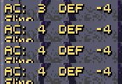

# 2026-11-23: rings, cloaks, bracers and robes of protection in Wake of the Ravager (effects group E)

*Branch `claude/ravager-party-transfer`. reports/wake-of-the-ravager-party-transfer.md, group E.*

## What was wrong

- A transferred Ring of Protection +1 is the sequel's Ring (type 45), which has no AC flag (+0Bh 0).
  The sequel's AC function skips any worn item without that flag, so the ring did nothing. Seen before
  this change: Balthbeorn's AC stayed 4 with the ring taken off.
- The mod's cloak of protection, bracers of defense and robes (types 103, 110 and 127) have the flag,
  so the sequel counted their plus. But it counted them whatever else was worn, with none of AD&D's
  limits.
- Nothing added a ring's or a cloak's plus to saving throws.

## What changed

DSCLOG2's PROTECTION is SL's RULE_PROTECTION (DSCLOG's PROBE_RING_AC, PROT_SCAN, RING_PLUS and
ROBE_PLUS) ported with the sequel's numbers. It uses two sites:

- **Site 43, `protection_ac`**, at 5D61Ah. This is where the AC function asks whether a worn item counts
  ("mov al,es:[bx+0Bh] / mov ah,0"). The rules:
  - A ring of protection (a Ring with a plus) counts only without magical armour, and of two rings only
    the better one counts (the left hand's if they are equal).
  - A cloak of protection counts only without magical or metal armour and without a shield.
  - Bracers of defense count only without armour (a helm counts as armour).
  - A robe's plus goes into the function's other total ([BP-6]), on top of the rest, as in SL.
- **Site 44, `protection_save`**, at 8360Eh. This is the start of the save modifiers ("mov si,[bp+6] /
  xor di,di"; SL's 79D47h). It adds:
  - the better ring's plus, whatever the armour;
  - the cloak's plus, under the same limits as for AC;
  - +1 on every save for the Veiled Robe;
  - +1 against a spell for the Ashen Robe (spells 0-234; the psionic powers start at 235).
- **Tests.** Both sites were run in an emulated CPU on every mix of the following, 1,152 cases in
  tests/test_ravprotect.py:
  - two rings (none, +1, +2, or a cursed -1 on the left);
  - a cloak;
  - bracers;
  - a robe (Ashen or Veiled);
  - armour (none, leather, magical leather, or metal);
  - a shield.

## In the game (about 00:00 UTC)

- **The setup.** The grate-user party was transferred earlier into `$WORK/ravT`. Balthbeorn, a mul
  fighter/druid, was added from the roster. He wears no armour, and has on the Ring/Protection +1
  (left hand), the Cloak/Protectn +1 and the Ashen Robe +1.
  
- **With the new build** (each item taken off, then put back):

  | worn | AC |
  |---|---|
  | everything | **3** |
  | ring off | 4 |
  | robe off | 4 |
  | cloak off | 4 |

  
- **Control** (`RAV_SKIP=protection_ac,protection_save`):

  | worn | AC |
  |---|---|
  | everything | 4 |
  | ring off | 4 (the ring does nothing) |
  | cloak off | 5 |

  
- **Not seen in play yet:**
  - **The limits.** No transferred member wears magical or metal armour or a shield with these items.
    The emulation covers the limits.
  - **The saves.** The inventory's save numbers are the sheet's own, without modifiers (they stay the
    same with the ring on or off in both builds). The save site only runs in a fight. The emulation
    covers the saves.
- **The first click.** The first click after the title menu comes up was lost twice: CREATE
  CHARACTERS needed a second click.

DOSBox and the dice log were stopped by pid, and nothing was saved (the test copy's roster only).
