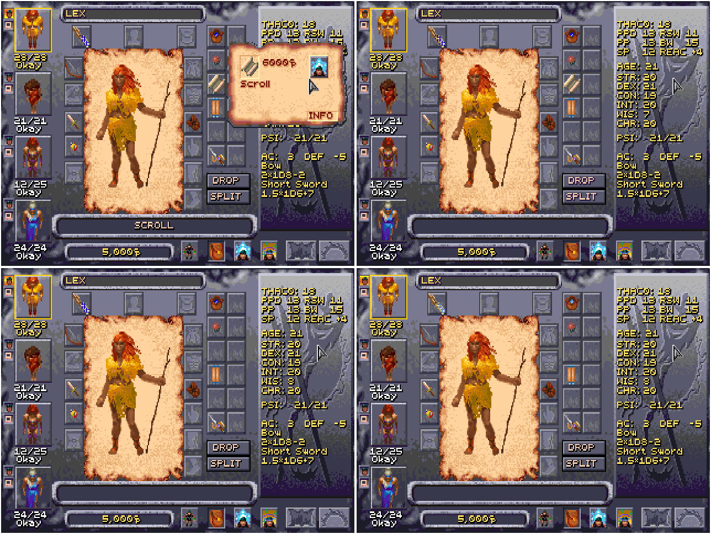
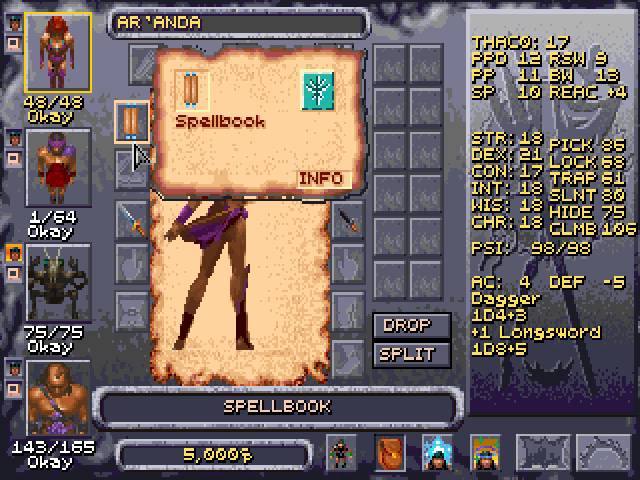
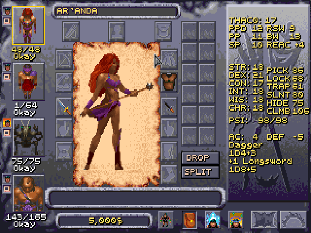

# 2026-11-23: the Tome of Understanding and Kalzith's scrolls in Wake of the Ravager (effects group G)

*Branch `claude/ravager-party-transfer`. reports/wake-of-the-ravager-party-transfer.md, group G.*

The mod's two used-up items are the Tome of Understanding (+1 WIS, SL object 1446) and Kalzith's six
scrolls (SL objects from 1440). The sequel has no tome; its scrolls are learned or cast from the item
box's icon (opener 99260h, handler 995AFh, the use at 999CDh: `[bp-4]` holds the spell, power - 1).

## The build

- **The transfer carries the Loader's own SL objects.** `ravtransfer.with_added` read SL's objects
  from the player's SEGOBJEX only, so the mod's new ones (the tome, the scrolls, every object the
  Loader adds) arrived as money bags. It now reads the Loader's copy (`dos/SEGOBJEX.GFF`) as well. A
  transfer of `fountain-user` printed `1446 -> 21446 (the Loader's)`, `1442 -> 31010` (Kalzith's Blur
  as the sequel's own Spellbook of Blur) and `1443 -> 21443` (a keepsake).
- **The tome** is the Loader's object 21446, made like the sequel's wizard scroll (its picture from
  object 31300), with the power 318 (spell 317, past every spell the sequel has). DSCLOG2's
  TOME_READ (site 48, the Loader's patch `tome` at 999CDh, where the routine does `dec [bp-4]`)
  takes that object: +1 WIS on the sheet (+19h) and the creature (+1Dh), at most 25, the message
  "NAME reads the tome: WIS N." (or "NAME can grow no wiser.") into the routine's message buffer, and
  the routine's own end: the item used up (99B44h), or kept when the reader is at 25 (99B67h). Any
  other item goes on as before. Unit tests: `test_ravprotect.ProtectionTests.test_tome_read`, `test_ravtransfer.ItemSpellTests.test_tome`.

## In the game (a copy of `$WORK/rav` with the transferred `fountain-user` party, the Draxans' fight in Tyr)

Test edits in memory, never saved (scratch `mktome.py` turns a keepsake into a tome).

- **The tome's icon works only in a fight, on the member's turn.** Outside a fight it does nothing:
  the opener sets `[9D8Ch]` from its caller's flag, 1 only in a fight. (A spellbook is different: the
  sequel's own scrolls were learnt outside a fight on 2026-11-21, logs/2026-11-21-ravager-int.md.)
- **The tome, Lex's turn**: the box ("Scroll", 5000), its icon clicked: the tome gone from the pack,
  Lex's WIS 6 to 7 (sheet and creature, DSCLOG2's `tomes_read` 1). A second tome (a keepsake made one
  in memory): WIS 7 to 8 on the inventory screen, `tomes_read` 2.
  
- **The message was not seen**: no text in the inventory's bar nor on the map after the box closed
  (a 20-a-second burst). That is the game's own way: its message routine (560h:2Ah) shows nothing on
  the inventory screen for its own scrolls either (logs/2026-11-21-ravager-int.md).
- **Kalzith's Blur, as the sequel's Spellbook of Blur (object 31010), in a fight** (a second run,
  Jenna's turn and then Lex's, `ravfight.py until 0`): the icon clicked, the book kept (also with its
  spell edited in memory to 36). The known-spells bits read in that run were at a wrong address (see
  2026-11-24 below), so only the kept book counts: not learnt. On the roster's inventory (CREATE
  CHARACTERS) the click doesn't reach the routine either (DSCLOG2's `learnt_tries` 0).
- **Learnt outside a fight (2026-11-24)**: `ravload.sh ravager-after-ambush` (Tyr's street after the
  Draxans), Ar'anda's item 3 made, in memory, the record the transfer writes for Kalzith's Blur
  (object 31010, type 4Dh, power 13, its name; scratch `putbook.py`). Her inventory, the book
  right-clicked (game 66,60), the box's spell icon clicked (158,45): the book gone, bit 12 (Blur) set in
  her known spells (now 0, 3, 8, 11, 12, 13, 17, 24, 27, 29), DSCLOG2's `learnt_tries` 1 (INT 18's 85%).
   
  The known spells are at `(load + 3D62h):39Ch` + 15 a member (3F3DCh in that start, ravhold.sh's).
- **Not played**: the WIS 25 case (unit test only).

## Open

- Why a spellbook's icon did nothing in a fight (the sequel's own way, most likely).

No new area, no water noted.
