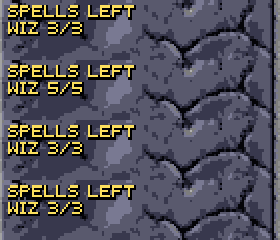

# 2026-11-23: the Veiled Robe's wizard slots in Wake of the Ravager (effects group E)

*Branch `claude/ravager-party-transfer`. reports/wake-of-the-ravager-party-transfer.md, group E.*

## What changed

- **The game's slots.** DSCLOG2's VEILED_SLOT is SL's robes.slots (DSCLOG's PROBE_SLOTS robe part). It
  runs at the end of ADND_SLOTS (site 34, 62893h), where the game's slot routine gives one class's
  slots at a spell level. A preserver (class 11) wearing the Veiled Robe (the mod's robe type 127,
  plus 2, on the chest) gets one more slot at spell levels 1 to 3, where it has any.
- **The Loader's USE lines.** RavGameData.robe_slots now does the same, where it used to say the mod's
  robes weren't in the sequel.
- **Robes and armour.** A robe's AC now follows the bracers' rule (DSCLOG's BRACERS_AX takes in both):
  nothing over armour on the arms, legs or head. The first port had counted it always.
- **Tests.**
  - In emulation, tests/test_ravprotect.py `test_veiled_robe_slots`: Veiled and Ashen, a priest,
    level 4, and no slots.
  - tests/test_ravlog.py `test_veiled_robe_slots`.

## In the game (about 00:25 UTC)

The run was `ravload.sh ravager-roost` (the Loader), with the dice log attached. Ar'anda is a
preserver with no wizard slots left.

- **Before the edit**, on USE, levels 1, 2 and 3: "NO SPELLS IN ARMOUR", WIZ 0/4, 1/2 and 0/2. She
  wears leather chest armour.
- **The edit.** Her leather armour was made a Veiled Robe +2 on the chest (a test edit). At once the
  lines read "SPELLS LEFT", WIZ 0/5, 1/3 and 0/3: the Loader's count, and she may cast now, since the
  robe isn't armour. 
- **A night at the Roost** (Reyhan: rent a room, the corridor, the fire ring looked at). Afterwards
  the game's own slots-left bytes (DS:4469h + level) were **5, 3, 3**: the slot routine's most, one
  more at each of levels 1-3 than her 4, 2, 2. USE read WIZ 5/5, 3/3, 3/3, and level 4 stayed 3/3.
  The helper's VEILED_SLOT count was 3. 
- **Control.** The same member before the edit: the game's most was 4, 2, 2. No run of the old build
  was made.
- **Saved files.** The save's files keep their 00:25 copy time, so nothing was saved. DOSBox and the
  dice log were stopped by pid.
- **Water:** the Roost's rented room has the fire ring (no water seen).
