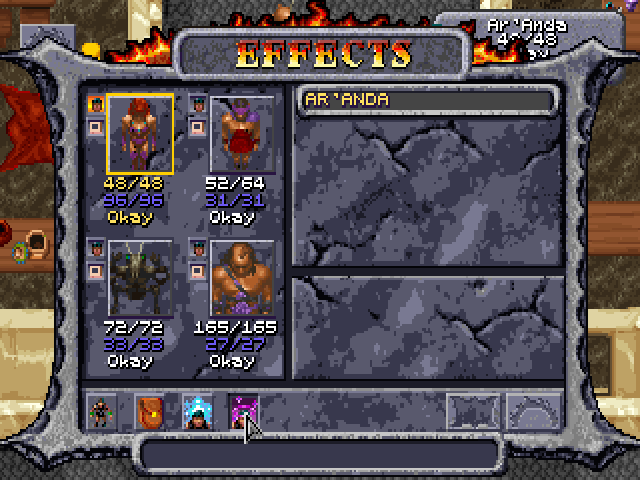

# 2026-11-23: items whose spell is on their wearer in Wake of the Ravager (effects group D)

*Branch `claude/ravager-party-transfer`. reports/wake-of-the-ravager-party-transfer.md, group D.*

The mod's worn items are Shadowseeker (Detect Invisibility), the Warden's Chest (Resist Fire), the
Warden's Helm (Cloak of Bravery), Arrowbane (Protection from Normal Missiles) and the Sunking Crown
(Protection from Evil). In Shattered Lands each keeps its spell in the item's +0Fh, and the game puts
that spell on whoever readies the item. The sequel keeps an item's spell in the same field as a
weapon's (+10h), and its own armour uses it (a leather chest with Resist Cold, one with Free Action;
a shield with Resist Fire: OBJEX.GFF). Since group C (commit ce0253f), the transfer writes each of
the Loader's own objects' spells there, by the sequel's numbers. The tests show the mapping:
Detect Invisibility 13, Resist Fire 138, Cloak of Bravery 167, Protection from Missiles 35,
Protection from Evil 122.

## In the game (about 05:00-05:15 UTC; `RAV_LOADER=1 sh ravhold.sh`, Ar'anda's turn)

Test edits in memory, never saved (scratch `powerset.py`):

- Ar'anda's leather chest (item 0, worn) was given Resist Fire (+10h and +2 = 139), and her +1
  longsword (item 2, in hand) Detect Invisibility (14).
- **Before**: her Effects screen was empty. The items were already on, so nothing had put the spells
  on. 
- **Taken off and put on again** (inventory: the chest to the backpack and back, the longsword the
  same; their worn slots read back 9 and 3): two effects. Hovered, they read "PROTECTED VS FIRE"
  (the sequel's name for Resist Fire's effect) and "DETECT INVISIBLE".
   
- **The chest taken off** (to the backpack, slot 15): both effects **stayed**. That held on the Effects
  screen opened afresh, in the effect records (owner 0, ids 77 and 25, no duration), and after a whole
  round of the fight. 

DOSBox was stopped by pid and nothing was saved.

## What this means

- **Putting on works.** The mod's worn items put their spell on their wearer in the sequel, through
  the sequel's own code, as its own magic armour does. No new helper code was needed.
- **Taking off does not end the spell.** This is the sequel's own behaviour (its own items go the same
  way), at least within the fight. Whether Shattered Lands ends it is not recorded anywhere, so it is
  an open item: check SL, then decide whether to end the spell in the sequel (a DSCLOG2 site where an
  item leaves a worn slot).
- **A transferred character starts with none of these spells on.** Its items arrive worn, but the spell is put on
  only when an item is readied, so the effects come only after the item is taken off and put on
  again. Also open: the full play from an SL save will show whether the sequel puts them on when the
  member joins or a game loads.

Water: none new (the same street).
