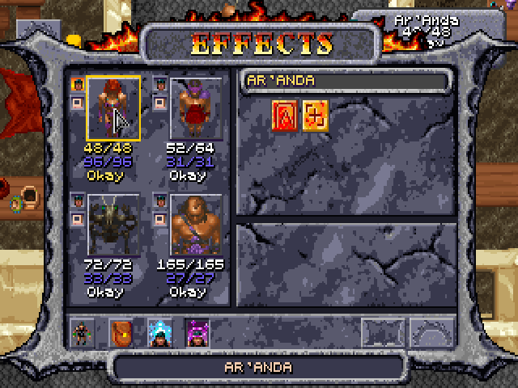
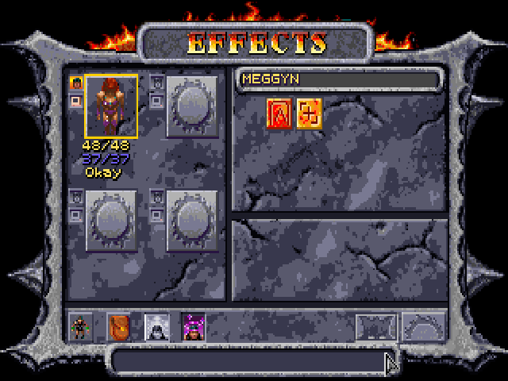
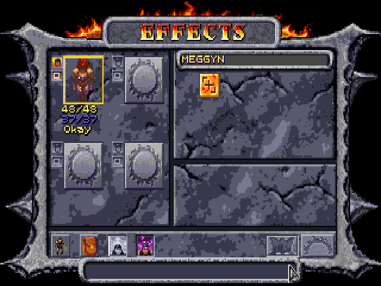

# 2026-11-23: items whose spell is on their wearer in Wake of the Ravager (effects group D)

*Branch `claude/ravager-party-transfer`. reports/wake-of-the-ravager-party-transfer.md, group D.*

The mod's worn items are Shadowseeker (Detect Invisibility), the Warden's Chest (Resist Fire), the
Warden's Helm (Cloak of Bravery), Arrowbane (Protection from Normal Missiles) and the Sunking Crown
(Protection from Evil). In Shattered Lands each keeps its spell in the item's +0Fh, and the game puts
that spell on whoever readies the item. The sequel keeps an item's spell in the same field as a
weapon's (+10h), and its own armour uses it (a leather chest with Resist Cold, one with Free Action;
a shield with Resist Fire: OBJEX.GFF). Since group C (commit ce0253f), the transfer writes each of
the Loader's own objects' spells there, by the sequel's numbers. The tests show the mapping:
Detect Invisibility 13, Resist Fire 138, Cloak of Bravery 167, Protection from Missiles 35,
Protection from Evil 122.

## In the game (about 05:00-05:15 UTC; `RAV_LOADER=1 sh ravhold.sh`, Ar'anda's turn)

Test edits in memory, never saved (scratch `powerset.py`):

- Ar'anda's leather chest (item 0, worn) was given Resist Fire (+10h and +2 = 139), and her +1
  longsword (item 2, in hand) Detect Invisibility (14).
- **Before**: her Effects screen was empty. The items were already on, so nothing had put the spells
  on. 
- **Taken off and put on again** (inventory: the chest to the backpack and back, the longsword the
  same; their worn slots read back 9 and 3): two effects. Hovered, they read "PROTECTED VS FIRE"
  (the sequel's name for Resist Fire's effect) and "DETECT INVISIBLE".
   
- **The chest taken off** (to the backpack, slot 15): both effects **stayed**. That held on the Effects
  screen opened afresh, in the effect records (owner 0, ids 77 and 25, no duration), and after a whole
  round of the fight. 

DOSBox was stopped by pid and nothing was saved.

## What this means

- **Putting on works.** The mod's worn items put their spell on their wearer in the sequel, through
  the sequel's own code, as its own magic armour does. No new helper code was needed.
- **Taking off did not end the spell**, nor did a transferred character start with its worn spells on
  (the items arrive worn, and the game puts a spell on only as an item is readied). Both are fixed
  below.

## Shattered Lands, for comparison (about 04:40 UTC)

In SL (the mod's game, test edits in memory, never saved), a chest armour given Resist Fire: its
effect (40) came on when the armour was put on and **went when it was taken off**. SL's unready
routine (6F8B9h) takes the item's spell off its wearer.

## Why the sequel kept it, and the fixes

- **Taking off.** The sequel's unready routine (77CDBh) has the same job: the item's +10h less 1 in
  DX, then 628h:BBh (864EDh), which ends the wearer's effects of that spell. Before that call it
  tests `cmp dx,-1 / jbe` (77D0Fh): an unsigned compare that every spell passes, so it always
  jumped past the removal (SSI's C, "spell > -1" on an unsigned). Run in an emulated CPU on the live
  game's memory (Ar'anda, the chest, effect 77 on): no change as it was; with `jbe` made `jle` the
  effect was gone. The Loader's patch `worn_spell_off` (77D12h) does that.
- **Joining.** A member added on the ADD screen (58CB5h: its CHAR loaded at 58D33h) gets no ready
  call for what it wears. DSCLOG2's JOIN_READY (site 47, `join_ready` at 58D81h, "cmp byte
  [13FAh],0") readies each worn item (+13h below 14) with a spell through the game's own routine
  (5E8h:39h, 77C1Ah), which casts only what the item puts on its wearer (a weapon's hostile spell is
  left for its hits). Tests: `test_join_ready` (emulated), the patches in test_ravager.py.

## In the game, with both fixes (about 05:05-05:15 UTC; `RAV_LOADER=1 RAV_MENU=1 sh ravstart.sh` on a copy of the sequel)

A test roster in the copy (never the user's): Meggyn (CHAR 37) with Resist Fire on her chest
armour and Detect Invisibility on her arm piece (+10h and +2: 139 and 14). CREATE CHARACTERS, a slot,
ADD, Meggyn:

- **Joined**: both effects on her at once (77 and 25 in the effect records; `join_readied` 2).
  
- **The chest taken off** (to the backpack): Resist Fire **gone**, Detect Invisible kept.
  
- **Put on again**: Resist Fire back, one record (no double).

**The control** (the same roster, `RAV_SKIP=join_ready,worn_spell_off`): Meggyn joined with **no**
effect; the chest taken off and put on gave Resist Fire, and taking it off again left it on, as
before the fix.

DOSBox was stopped by pid after each run; nothing was saved.

Water: none new (the same street).
