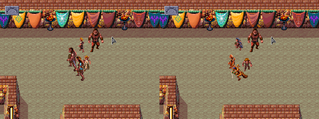

# Weapon and armor tests in the slave pens

Tested the class-outfits branch at `d37475e` with disposable copies of the `pens-after-arena` save.

## Live equipment changes

With the party on the map in DOSBox, attached the Loader's Dresser. Recorded each subject's empty-slot walking and combat pictures. Equipped an ordinary sword in the right hand, removed it, then equipped and removed a chest plate. At each step read both BMP chunks from the Loader's live SEGOBJEX copy and compared them byte for byte with the normal picture builder for that character and equipment. The test temporarily set inventory records in the running test game. All original item records and temporary figure/class edits were restored, and the session was discarded without saving.

The save supplied the human man (Mage), elf woman (temporarily set to Preserver), half-giant man, and Thri-kreen directly. The other ten used one party slot with the corresponding figure and race, the Fighter class, and its map picture. The human woman selected Warrior, both dwarves and the elf man selected Fighter, and the seven study figures selected their default appearance.

| Live check | Result |
|---|---|
| Sword | Changed the picture set on 14 of 14 figures. |
| Chest plate | Changed the picture set on all 13 humanoid figures. The Thri-kreen retained its shell. |
| Removal | Both picture chunks returned byte-for-byte to their empty-slot versions after all 28 equip/remove cycles. |

This exercises the live inventory-to-picture update. The seven studies still require an imported class outfit for that same test to exercise the new art.

## Staged map comparison

In two further sessions, wrote the equipped study pictures to the four party slots of temporary game-file copies. Verified both picture chunks in each slot and loaded the save in DOSBox. The screenshots below show the parties on the map. The equipment in these two sessions was fixed.

| Group | Pictures staged in party-slot order |
|---|---|
| Left | Half-elf man Fighter with full plate, half-elf woman Cleric with Ashen Robe, half-giant man Fighter with sword and shield, half-giant woman Fighter/Psionicist with Warden’s Plate |
| Right | Halfling man Thief with sword and shield, halfling woman Fighter with full plate, Mul Fighter with full plate, retail Thri-kreen with gythka |

The side-by-side floor tiles and per-pose data show details too small to identify in a map screenshot. [Equipment report and measurements](../../obsidian-edition/docs/class-outfits/equipment-tests.md)
