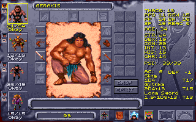

# Memory pass 7: the item types and names in the Loader's copy of GPLDATA

**Under test**: branch `claude/memory-pass-7` (on `claude/ravager-magic-metal`). The Loader's 44
item types and 56 item names, and the mends to the game's own types, now come from the IT1R and NAME
chunks of the Loader's copy of GPLDATA.GFF (`dsloader/itemtables.py`), not from DSCLOG's tables.
DSCLOG's fill probes only note where the game put the tables (`TYPES_PTR`, `NAMES_PTR`) and count the
Loader's types in (`TYPES_FIRST` 115) when the chunk read has them. Upper memory: 139 paragraphs
(2,224 bytes) free, from 58 (928).

**Build**: `dos/DSCLOG.EXE` 69,232 bytes, built from this branch; the copy of GPLDATA written by
`start.sh` (`prepare_patched_game`), 1,611,098 bytes.

## Steps

1. `sh loadsave.sh pens-after-arena`: loaded. Window 320x240.
2. `python3 buildcheck.py` (now also checks the item tables): the routines the same as the EXE, 127
   vectors at their handlers, the tail's kits' names the same, and in game memory "types at 678E4:
   the Loader's, noted", "names at 68564: the Loader's, noted", `types_first 115`: **OK**. The
   copy's chunks are also exactly `itemtables.chunks()` of the game's own GPLDATA.
3. `npcgear.py`: the game names the Loader's items from the tables it read: "Metal Shadowseeker +1"
   (Kurzak: type 115, the metal short sword, its metal shown), "Leather Inixhide +1" (Legcrusher),
   "Ring/Protection +1" and "Cloak/Protectn +1" (Pehtucl), "Ashen Robe +1" (Kalzith).
4. The inventory (I, `xdotool key --window W i`) opened as ever ().
5. `sh loadsave.sh fountain-user` (a second load: the tables read again): buildcheck OK again.
6. The ambush, fought as it is (`PT_NO_EDIT=1 fightout.sh`: no memory edit), till the party fell
   ("YOUR PARTY HAS BEEN DEFEATED"; not saved). The Loader's weapon types gave their dice in the
   attacks: "Seneca attacks Templar BACKSTAB with Bone Hayneedle +1 (1d4+1)", "Seneca attacks Arena
   Guard with Shadowseeker +1 (1d6+1)"; the game's own ("Bone Long Sword (1d8)", "Wooden Bow (1d8)")
   as before. No odd lines in the dice log.
7. DOSBox and the dice log stopped by pid; the lock released.

## Not played

The fallback copy with only the item chunks (written when the scripts' copy fails) is covered by
`test_audit_prepare` and `test_itemtables`, not played. The race panel's probe (`FRAME_UP` now) is
covered by `test_framecode`, not played: it runs on the creation screen's race or sex change.

## Learned

- `buildcheck.py` now compares the game's item types and names in memory with the copy's chunks,
  and checks DSCLOG noted them.
- A fight fought out with `PT_NO_EDIT=1` from `fountain-user` can end with the party defeated: fine
  for a check of the attack lines, but don't expect a win.
