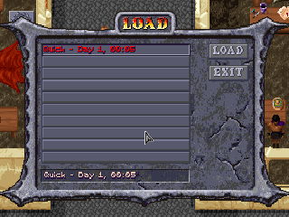
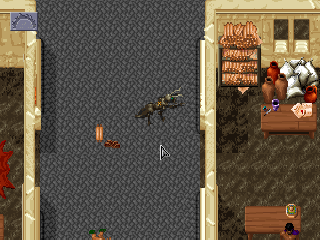

# 2026-11-25: Wake of the Ravager in DOSBox-X (branch claude/ravager-dosbox-x)

**Under test:** the sequel started by the Loader itself (`launch.launch(FOLDER)`, `engine` dosbox-x),
DOSBox-X 2026.10.01 built here, Linux, window single. `$WORK/ravX`: a fresh copy of the install with
`fountain-user`'s party transferred (`python -m dsloader.ravtransfer saves/fountain-user/SAVE01.SAV ravX
SL_FOLDER ./dos`). Run script: the steps of logs/files/2026-11-25-ravager-small-ports-run.sh with the
Loader's start in place of ravstart.sh; `rav.pid` the DOSBox-X's pid (ravclick.py and ravfight.py then
read its memory file through the lock file).

## What was seen

- **First start: the game quit at once.** DOSBox-X's log: "Could not load image file: .../game.ins",
  "MSCDEX: Failure". GOG's sheet names `music\Track02.ogg`, the folder is `MUSIC`: DOSBox-X reads
  the sheet itself and on Linux finds no such file. Fixed: `ravager.cd_sheet` writes
  `dosbox-x/ravager-cd.cue` with each file's full path as the folder has it. Second start: "CDROM:
  Loaded Track02.ogg [44100 Hz 2-channel length 1.9 min.]" and the rest; DSCLOG2 loaded.
- Title menu, CREATE CHARACTERS, the four transferred members ADDed (View Character: Jenna, Ranger,
  STR 20), Escape, S: the cinematic, the opening talk in Tyr.
- HP 250 for the four (a test edit, never saved; autosave off; the copy thrown away), `ravdice.py
  --numbers` attached through the memory file: initiative lines, the Draxans' bow and lotulis attacks
  with THAC0 and damage lines, Seneca's hide in shadows roll. 118 turns logged.
- `ravfight.py fight 600`: the party's attacks often stopped at "no foe on screen" (Draxans inside
  the building, its known limit), so the fight was not finished (4 foes standing, the party up)
  when the session stopped for the owner's usage limit. DOSBox-X never quit.

## Resumed after the pause (18:30-19:05 UTC)

- **The fight to its end, without edits.** A fresh `ravX`, the four at their own HP, autosave and quick
  save on; `ravfight.py tabfight` (new: Tab, the nearest enemy, and Return on each party turn, so foes
  indoors are reached). The Draxans (140 HP) won: YOUR PARTY HAS BEEN DEFEATED, as in GOG's DOSBox
  (the quick-save log's first run). The dice log followed every turn through the memory file, and
  DOSBox-X never quit.
- **Save and load.** `saves/ravager-after-ambush` copied in, started through the Loader, LOAD SAVED GAME,
  row 1, LOAD: the party on the street after the ambush. **F5**: "Quick save: Quick - Day 1, 00:05 (the
  QUICK page, slot 1)", SAVQ01.SAV written (51771 bytes, the Loader's 72-byte sheet). The party walked
  away (the leader from 135,73 to 95,154 on screen; "The gates are locked."). **F9**: the LOAD window
  on the quick save (); **Return**: the party back at
  135,73 and every other place as saved ().
- **A trap of the test, not the game:** the first dice log was started without `RAV`, so it looked for
  saves in `$WORK/rav` (another copy) and answered F9 with "no quick save or autosave yet". With
  `RAV=$WORK/ravX` F9 worked at once. ravdice.py's header now says so.

## Still to do

- The music heard: the CD's tracks are loaded; nobody has listened.
- On Windows: the same with the bundled DOSBox-X (the owner's test of #146 first).
- Pre-existing, not this branch: `test_ravitems.GameTests` (with DSUN_WOTR) expects no `wide_sheets`
  from `objects_fixed`; it fails on the base branch too.
