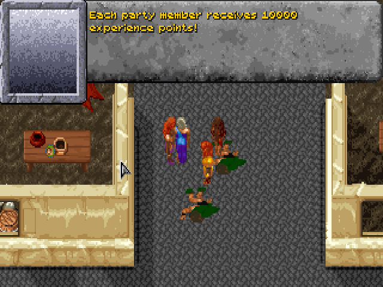

# 2026-11-25: the kits' rules in Wake of the Ravager

**Under test:** Shattered Lands' kits (RULE_KITS) ported to the sequel, branch `claude/ravager-kits` (merged
with `claude/ravager-screens`): DSCLOG2's KITS section (KIT_AC, KIT_ATTACKS, KIT_DAMAGE, KIT_SAVE, KIT_SKILL,
KIT_REAR, KIT_MOVE, KIT_TWO, KIT_INIT at site 60, KIT_RANGER_CAST at site 61) and `RULE_KITS` in
`ravager.RULES_PORTED`. Copy `ravK` of `ravG48` (the `fountain-user` party transferred: 48h sheets, the kit
byte at +3Dh).

Each run ([files/2026-11-25-ravager-kits-run.sh](files/2026-11-25-ravager-kits-run.sh), four in a row by
[files/2026-11-25-ravager-kits-series.sh](files/2026-11-25-ravager-kits-series.sh)): ravstart with the Loader
(`RAV_LOADER=1`, `RAV_STDOUT=1`), the four ADDed, a new game, the opening talk, kits given by a test edit in
memory (`ravkits.py match`, never saved), HP 250 for the four (`ravkits.py hp`), the dice log
(`ravdice.py --numbers`), Computer Control for all four in the Draxans' ambush, five minutes watched, then
DSCLOG2's kit counters (`ravkits.py count`: each counts a change a kit made, not a call). The controls ran with
`RAV_RULES_OFF=0x10000` (the rule's bit off in the Loader and DSCLOG2's header: `rules_hi` 0xFF2E against
0xFF2F). All four runs ended with the fight won and STDOUT.TXT empty (no "Illegal Op").

| Run | Lex (fighter 3) | Seneca (thief 3 / fighter 2) | Ester (fighter 2 / cleric 3, elf) | Jenna (human ranger 3) |
|---|---|---|---|---|
| A1, Actl1 | Ravager (a test edit: his preserver class taken off) | dwarf Ghetto Fighter (race edited) | Battle Dancer (the transfer's own kit) | Justifier |
| B1, Bctl1 | Myrmidon | half-elf Military Scout | Battle Dancer | Stalker |

The runs' edits for Ester (a half-elf druid/fighter) didn't take: she is a cleric, so `match 9,d` found no
one, and she kept the kit she came with, Battle Dancer, a good test of its own.

## What was seen

**The counters, rule on against off** (`ravkits.py count` at the end):

| Run | kit_acs | kit_hits | kit_damages | kit_twos | kit_inits | kit_moves | kit_rears |
|---|---|---|---|---|---|---|---|
| A1 | 21 | 40 | 26 | 30 | 0 | 0 | 0 |
| Actl1 | 0 | 0 | 0 | 0 | 0 | 0 | 0 |
| B1 | 12 | 5 | 5 | 20 | 24 | 12 | 1 |
| Bctl1 | 0 | 0 | 0 | 0 | 0 | 0 | 0 |

**The Ravager's AC** (A1, the game's own AC as the dice log reads it from DSCLOG2's PROBE_AC): Lex, at base AC
10 and level 3, takes the Ravager's table AC 6 for his base, so 4 better: AC -1 in every attack on him, AC 3 in
B1 and Bctl1 (Myrmidon, no AC of its own) with the same gear.

```
A1:    Draxan attacks Lex#0 with Stone Lotulis (2d4): d20 = 6, needs 11+ (50%), hits AC 4, target AC -1 -> miss
Bctl1: Draxan attacks Lex#0 with Stone Lotulis (2d4): d20 = 15, needs 7+ (70%), hits AC -5, target AC 3 -> HIT
```

**Initiative** (B1, KIT_INIT at site 60): the Myrmidon's -2 every round, the Military Scout's +2 in the open
(the Loader's KIT_OUTDOORS byte, 0Fh in B1's header, 0 in the control's); none in Bctl1.

```
B1:    Lex 30 = 20 + 8 (0-9 roll) +4 DEX -2 Myrmidon
B1:    Seneca 35 = 20 + 9 (0-9 roll) +4 DEX +2 Military Scout under the open sky
Bctl1: Lex 27 = 20 + 3 (0-9 roll) +4 DEX, tie broken by 34 (0-199 roll)
```

**The Military Scout's thief skills** (B1, KIT_SKILL): hiding +10 and not halved in daylight, moving
silently +10; Bctl1 the plain numbers.

```
B1:    Seneca hides in shadows: d100 = 16, needs 67 or less (57 +10 cloak = 67, a Military Scout: not halved in daylight) -> hidden
B1:      Seneca moves silently: d100 = 81, needs 77 (67 +10 boots) or less -> heard
Bctl1: Seneca hides in shadows: d100 = 2, needs 28 or less (47 +10 cloak = 57, halved in daylight) -> hidden
Bctl1:   Seneca moves silently: d100 = 14, needs 67 (57 +10 boots) or less -> unheard ...
```

**The Battle Dancer's dance** (B1: the Loader's KIT_DANCE, DSCLOG2's KIT_AC and KIT_DAMAGE): +1 damage (the HP
lost is the line's total) and AC 1 for her two rounds, AC 2 otherwise; Bctl1 no dance, AC 2 throughout. Her
two weapons without the penalty (KIT_TWO) are the kit_twos counts.

```
B1:  Ester dances: d20 = 16, needs 18 or less (DEX 22 -4) -> +1 to hit, damage and AC for 2 rounds
B1:    Ester hits Draxan#27 for 15: 1d8 = [5] -1 obsidian +2 specialized +1 Battle Dancer +8 STR 20
B1:    Draxan now 125/140 HP (-15)
B1:  Draxan attacks Ester#2 with Stone Lotulis (2d4): d20 = 14, needs 9+ (60%), hits AC -4, target AC 1 -> HIT
```

**What wasn't seen in play** (each in `tests/test_ravkits.py`'s emulated checks instead): the Justifier's made
specialization (Jenna has no expertise to make one of, her long sword a plain spec) and casting level, the
Stalker's skills (none in a fight), the Ghetto Fighter's two-weapon +2 apart from the Battle Dancer's in A1's
counter, saves (kit_saves 0: no spell cast at the party in the ambush), the expertise kits (no Battle Mage,
Crusader or Mind Warrior in the party: kit_rates 0).



## Found on the way

- **`ravdice.py` and the switched rules**: DSCLOG2's assembled rules words hold only the always-on rules, and
  the Loader's dice log sets the rest (kits, helms, best hit die, half-giant hands, new spells) from its
  settings. `ravdice.py` started from `RULES_ALWAYS`, so with `RAV_RULES_OFF` (even 0) it wrote the header
  without them: the first A1 ran with the kits off (`rules_hi` 0xFF2E, every kit counter 0). It now starts
  from the settings as the Loader does (`game.rules_from_settings`), then takes RAV_RULES_OFF's bits off. The
  second A1 had its header's kit bit set by hand at the fight's start (its dice log started before the fix), so
  its Python lines lack the kits' notes; its counters and the game's AC are DSCLOG2's.
- **A run script's `set --`** in a click loop overwrote the script's own arguments (the kit edits): the
  run script keeps them in variables first.
- **Editing a running shell script** (to chain a second series) broke the one running: `sh` reads the file
  as it goes. Make a new file instead.
- **Memory**: DSCLOG2 (the merged build, kits and screens) is 36192 bytes in upper memory, 119264 bytes of
  it free after (`dosmem.py`, DOSBox's own upper memory, not RAV_UMB's).
- No water in these runs (Tyr's ambush street only).
</content>
</invoke>
