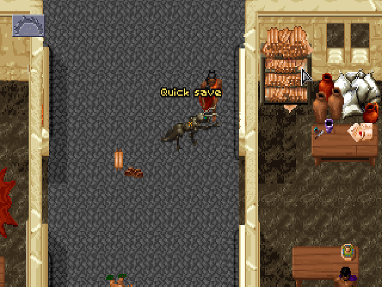
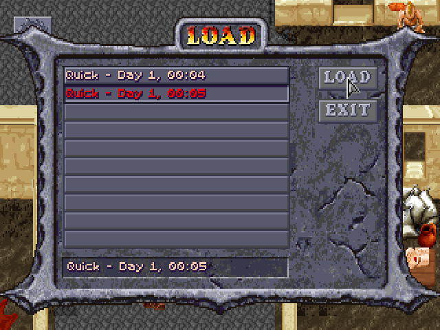
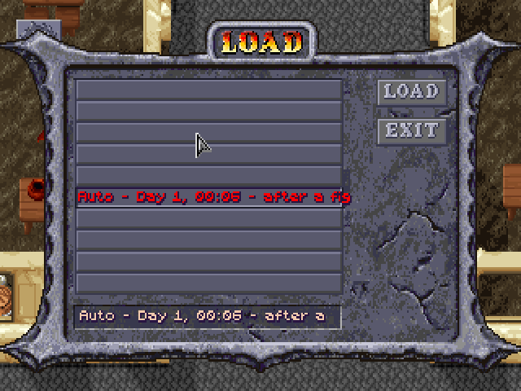

# 2026-11-25: Quick save, quick load, autosave and named saves in Wake of the Ravager

**Under test:** branch `claude/ravager-quick-saves` (from claude/ravager-join-tab-small), commit e3330d8:
DSCLOG2's QUICK SAVES (42400 bytes; header +1904 the keys, +1908 the counts, +1912 SAVE_REQ, +1914
SAVE_TEXT's offset, +1916 SAVE_GREQ, +1918/+1920 the GREQ chunks written and read; MAIN_TICKS moved to
+260), site 84 GREQ_LOAD at 7DA30h, quicksave.py's Layout with ravlog's QUICK_LAYOUT, SAVQnn.SAV in the
48h widening, named saves for the sequel. Throwaway copies only: `ravQS` (of `rav`) and `ravQS2` (of `ravK`),
both deleted after. No save was kept from either.

Runs: [files/2026-11-25-ravager-quick-saves-start.sh](files/2026-11-25-ravager-quick-saves-start.sh)
(ravager-after-ambush through the Loader's start, the dice log) and
[files/2026-11-25-ravager-quick-saves-fight.sh](files/2026-11-25-ravager-quick-saves-fight.sh) (a new game
with ravK's transferred four to the Draxans' ambush). `ravquick.py` read the header and the game's words
after each step; `ravquick.py greq FOLDER` the roster's GREQ chunks.

## 1. Quick save and quick load (ravQS, 13:24-13:31 UTC)

- After the load: keys 3F00 4300 (F5, F9: the Loader writes them), counts 0, the page letters E E.
- **F5**: "Quick save" over the leader at once (), the dice
  log `Quick save: "Quick - Day 1, 00:04" (the QUICK page, slot 1)`, SAVQ01.SAV written (51771 bytes, SAVE 6
  1224 bytes = 17 x 48h: the Loader's sheet), SAVE_GREQ 101, **GREQ 101** in CHARSAVE.GFF with the map's
  limits (0, 0, 2048, 1568), byte 0. The game's own F5 (the sound effects) didn't come up.
- Six steps up, **F5** again: SAVQ02.SAV, "Quick - Day 1, 00:05", GREQ 102.
- **F9**: the game's LOAD window on SAVQ01/02 with the newest (row 2) chosen, the letters Q Q, chosen 1
  (). **Return** loaded it: the party where the second quick
  save was, GREQ chunks read 1 (site 84 took GREQ 102: the manual row 2's GREQ 2 then held other limits,
  (0, 256, 1008, 1568), and the map's limits after the load were 102's (0, 0, 2048, 1568)), the letters back
  to E E.
- **F2** (the game's own LOAD): the game's page, AFTER AMBUSH only. Loading it: GREQ chunks read still 1
  (a manual load reads its own GREQ, untouched).
- **The control: the dice log stopped** (its pid killed), **F5**: SOUND EFFECTS ON, the game's own box; no
  save, counts unchanged. The dice log started again: **F5** made SAVQ03.SAV ("Quick - Day 1, 00:06",
  GREQ 103), so the keys come back with the Loader.

## 2. Named saves (ravQS)

- **F1**, row 2, "IN TYR", Return: SAVE02.SAV (the game's letter E), GREQ 2 rewritten.
- `namedsaves.sync(ravQS, scratch, wotr=True)`: `Page 1 slot 01 - AFTER AMBUSH.SAV`, `Page 1 slot 02 - IN
  TYR.SAV`; the SAVQ saves not copied. `is_wotr_save` True, `slot_name` "IN TYR".
- The copy narrowed to 42h (SAVE 6 1122 bytes) and put back with `restore(..., 1, 3, wotr=True)`: SAVE03.SAV
  with SAVE 6 1224 bytes again. **Seen by DOSBox only after a restart** (DOSBox caches the folder's listing:
  a file written beside a running game isn't listed). After the restart F2 listed it in row 3 and it loaded.

## 3. Autosave after a fight (ravQS2, 13:41-14:01 UTC)

- New game with the transferred four to the Draxans' ambush; **F5 in the fight**: the dice log `Quick save:
  not in a fight (the game saves none there)`, nothing written.
- First run, Computer Control for the four at their own HP: YOUR PARTY HAS BEEN DEFEATED, **no autosave**
  (none is due for a lost fight).
- Second run with HP 250 for the four (`HP=1`, a test edit in a copy deleted after): won under Computer
  Control in about 10 minutes; the talk after (10000 XP each), Lex's level-up spell (CHOOSE A SPELL, the
  first icon), the level messages; then on the map **`Autosave: "Auto - Day 1, 00:06 - after a fight" (the
  QUICK page, slot 6)`**: SAVQ06.SAV, SAVE 6 1224 bytes, GREQ 106.
- **F9** opened the LOAD window on row 6, the autosave chosen
  (); Escape shut it, the letters back to E E.
  **The sequel's rows are narrower than SL's**: the autosave's name runs past its row's right edge (the
  name field below cuts it at "after a"). Cosmetic; a shorter name ("Auto 00:06 after fight") would fit.

## Not played

- An area change's autosave (no area exit reached from the after-ambush street this time; the region names
  are unit-tested: `Auto - Day 1, 09:05 - The mines, level 1`).
- The roster's 40 places (static: every check is 28h; see RESEARCH.md).
- F1 pressed while the page letter is still Q (before the Loader puts it back, at most a few tenths of a
  second after the window shuts): the game's own save would then go to SAVQ and GREQ slot. Not seen.

**Water:** no new area.
