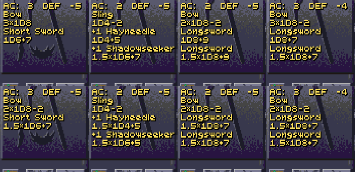
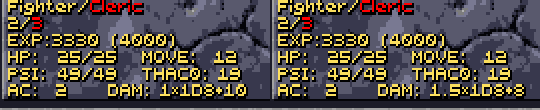
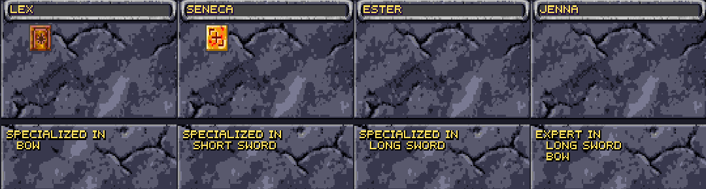
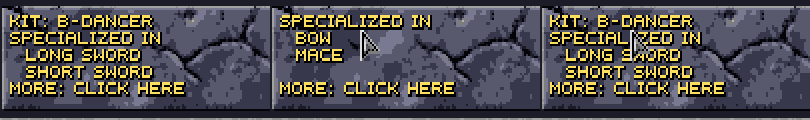
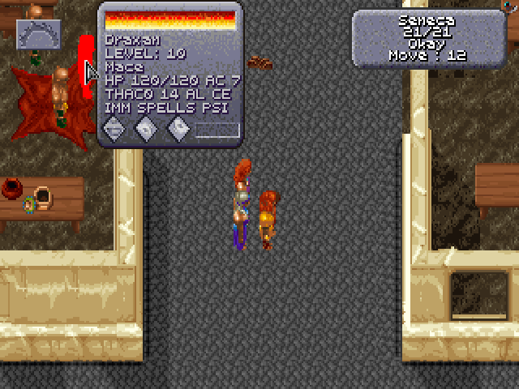
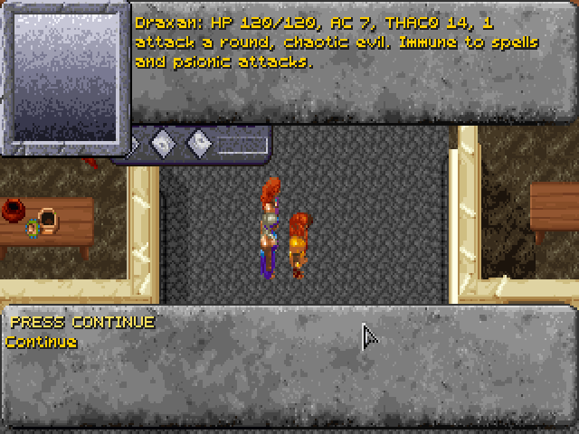

# 2026-11-25: the DAM lines, the Effects screen's lines and the Look box's description in Wake of the Ravager

**Under test:** branch `claude/ravager-screens`, the display pieces the specialization port left out, as
DSCLOG2 sites 70-75 (the kits' port takes 60 up):

| Site | Patch | Where (the sequel's DSUN.EXE) | SL's |
|---|---|---|---|
| 70 DAM_LINE | `dam_line` | 7B19Eh, "mov al,es:[bx+24h]": the inventory's line routine (7AF9Eh) reads a melee weapon's attacks a round from the sheet | PROBE_DAM_LINE, 72A77h |
| 71 MISSILE_LINE | `missile_line` | 7B124h, "mov al,es:[bx+7]": the same routine's missile branch (and an item box's) reads the type's | PROBE_MISSILE_LINE, 729FFh |
| 72 VIEW_DAM | `view_dam` | 6CAC9h, "mov [bp-0Eh],dx": View Character's DAM line stores the damage bonus | PROBE_VIEW_DAM, 64EB6h |
| 73 EF_ROWS | `ef_rows` | 8AFA9h, "pop di / pop si / leave": the end of the Effects screen's routine that fills its cells (8AC6Fh) | PROBE_EF_ROWS, 7F13Eh |
| 74 EF_CLICK | `ef_click` | 8AB1Ah, "mov si,[bp+8]": its cells' handler (8AB13h) | PROBE_EF_CLICK, 7EC9Eh |
| 75 UNLOOK | `unlook` | 6378Dh, "mov word [08CAh],270Fh": the routine that closes the Look box | PROBE_UNLOOK, 5F2AAh |

The copy `ravSC` of `ravG48` (the `fountain-user` party transferred: Lex fighter/preserver with the bow,
Seneca thief/fighter with the short sword, Ester fighter/cleric with the long sword, Jenna a human ranger
with the long sword: logs/2026-11-24-ravager-specialize.md), started with the Loader (`RAV_LOADER=1`), the
four ADDed, a new game, `ravdice.py` attached (it writes the rules into DSCLOG2's header), on into the
Draxans' ambush ([the start](files/2026-11-25-ravager-screens-go.sh)). The game was never saved.

## Found first

- **The inventory's line routine** is SL's (7AF9Eh, SL's 7286Ah), found by its "mov al,es:[bx+24h]" (the
  sheet's attacks a round, SL's +2Ah): its melee read at 7B19Eh, the missile read at 7B124h ("mov al,
  es:[bx+7]", SL's type +0Bh), both followed by the game's "mov ah,0" (SL's cbw) and the push for the line's
  routine (7B1D9h, where the `dam_half` fix is). The damage bonus, the sides and the count are pushed under
  it as in SL. The likeness search (ravsites.py) missed it: the sequel's sheet and types are other sizes.
- **View Character's** is SL's too (6CA43h on): [BP-6] the attacks (the sheet's +24h), [BP-2] the count,
  [BP-4] the sides, [BP-0Ah] the item, the bonus stored at 6CAC9h; the character on show at 370h:0B44h (the
  USE screen's). A character with no weapon takes another way (6CA40h) past the site.
- **The Effects screen's cell routine** (8AC6Fh) ends at 8AFA9h ("pop di / pop si / leave / retf"); its
  window is [1431h], the cells counted in [BP-4] (23h at most, as SL's). The handler (8AB13h) starts with
  "mov si,[bp+8] / sub si,2BCDh"; its way out is 8AC6Ah and its window redraw "call 140:60Dh" at 8AC62h with
  [1431h] pushed (SL's 118:618h). The lower panel and the USE screen's text place are SL's (USE_X 96h,
  USE_FIRST_Y 6Ch, 7 a line).
- **The dialogue window's stub** is 476Ch (SL's 42CAh): its callers' likeness (SL's 1BC2Ch, 1BE74h, 2225Fh
  calling 42CA:2Ah and :39h; the sequel's 1F063h, 1F2D6h, 25E0Ah calling 476C:2Ah and :39h), its entries
  in the same order (25h the window's input, 34h the wait). "Press continue", "Continue" and "CLOSE" at
  DS:1956h, 1965h, 25C8h. The Look box's close forgets the creature at DS:08CAh (SL's 0844h).

## What was seen

**The DAM lines, the rules on (top) and off (bottom: `RAV_RULES_OFF=0x1004`, weapon specialization and
two weapons off in the Loader and DSCLOG2's header):**

| | Rules on | Off |
|---|---|---|
| Lex, Bow (specialized) | 3x1D8 (3 shots, +2 against the wood's -2) | 2x1D8-2 |
| Lex, Short Sword (not chosen) | 1D6+7 (1 a round) | 1.5x1D6+7 |
| Seneca, +1 Hayneedle (left hand) | 1D4+5 (1 a round) | 1.5x1D4+5 |
| Seneca, +1 Shadowseeker (short sword, specialized) | 1.5x1D6+7 | 1.5x1D6+5 |
| Ester, Longsword (left hand, specialized) | 1D8+9 | 1.5x1D8+7 |
| Ester, Longsword (right hand) | 1.5x1D8+9 | 1.5x1D8+7 |
| Jenna, Bow (a ranger's expertise) | 3x1D8-2 | 2x1D8-2 |
| Jenna, Longsword (left hand; expertise: no damage) | 1D8+7 | 1.5x1D8+7 |

Each matches what the attack does in the specialization log's fights (Lex's bow 3 a round, his short sword
1, Seneca's +2 damage). **View Character** (Ester): DAM 1x1D8+10 with the rules on, 1.5x1D8+8 off: the game's
View takes her left-hand long sword here (1 a round, +2). It shows one more damage than the inventory, as
SL's did before its VIEW_MATERIAL (the obsidian's -1: not ported).

**The Effects screen** (USE, then EFFECTS 122,171; a portrait click shows another): the lower panel lists
each one's kinds, under the effects in the upper panel (Lex's and Seneca's one each):

Jenna's "EXPERT IN / LONG SWORD / BOW" (a ranger's, the bow not chosen). **Kits and pages** (a test edit,
never saved, [kitedit.py](files/2026-11-25-ravager-screens-kitedit.py)): Ester's specs made four (long sword, short sword, bow,
mace) and RULE_HI_KITS (1) set in DSCLOG2's rules_hi (header +270); her kit byte (+3Dh) was already 1,
the transfer's Battle Dancer (an elf cleric/fighter's multiclass group). Six lines: page 1 "KIT: B-DANCER /
SPECIALIZED IN / LONG SWORD / SHORT SWORD / MORE: CLICK HERE", a click on the panel page 2 "SPECIALIZED IN /
BOW / MACE" (the heading again over its kinds), another click page 1 again:

Without RULE_HI_KITS (the kits' rules not ported, so the Loader doesn't set it) no kit line shows: the
first try of the edit showed the kit line alone because the Loader's age pass rewrote the four bytes as
plain bytes (the specs are kept packed, SPEC_V2: the edit wrote them so the second time).

**The Look box's whole description** (right-click twice to the eye, a slow press on a Draxan, then a click
elsewhere to close it): Draxans have no defences, so there is nothing past the box's lines and no window
(as SL's, only when there's more to say); for the test, every Draxan's resistance class (creature +0Fh) was
made 2 in memory (put back after, never saved). The box: "HP 120/120 AC 7", "THAC0 14 AL CE", "IMM SPELLS
PSI"; on closing, the dialogue window: "Draxan: HP 120/120, AC 7, THAC0 14, 1 attack a round, chaotic evil.
Immune to spells and psionic attacks." with PRESS CONTINUE; Continue closed it and the fight went on.

## Not ported

- In the DAM lines: the kits' parts (none in the sequel's helper yet), a thri-kreen's chatkcha (OWN_THROWS),
  Hasted and Slowed (SL's FRAME_SPEED: the sequel's speed is its own, 628h:5Ch), and View Character's weak
  material (VIEW_MATERIAL: the sequel's material field to find in its 0Fh-byte types).
- On the Effects screen: a Shinobi's read languages and SL's own party's lines. The kit lines wait for the
  kits' rules (RULE_HI_KITS in ravager.RULES_PORTED); their routines (EF_KIT_AT, EF_KIT_PLACE,
  EF_MULTI_GROUP, EF_KIT_LINE) are DSCLOG's KIT_AT and the rest for this screen alone, to share with the kits'
  port when it lands.

## The session

The DOSBox lock was another agent's for 80 minutes first (waited with one flock). No new area: Tyr's street
only, no water noted.
